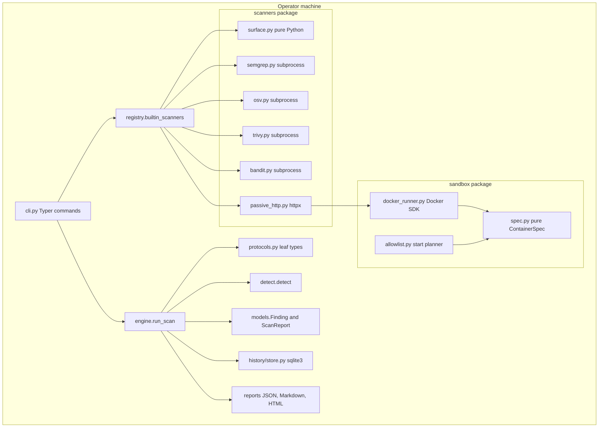
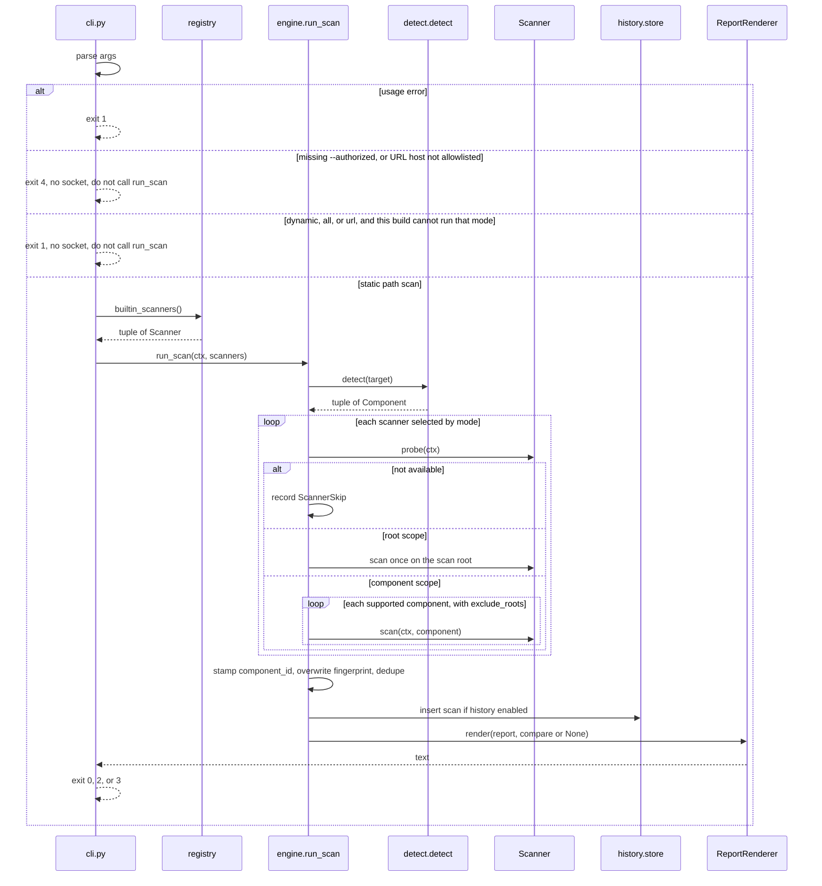

# Sentinel Design

| Field | Value |
| --- | --- |
| Author | Sentinel maintainers |
| Date | 2026-11-02 |
| Status | Approved architecture, amended, still no implementation |
| Intended repo | `/home/ubuntu/projects/MY/Tester` (not created yet) |
| Implementation language | Python 3.12+ only |
| Analyzed targets | Other languages and frameworks, via plugins |
| License target | MIT for Sentinel itself; third-party tools and any vendored rules keep their own licenses |

This document is the implementation contract for milestone 1 and the architectural contract for later milestones. The product owner approved the architecture and the Key Decisions. The seven amendments in this revision are part of that approval. The nine open questions stay at the recommendations already written in this document. Those recommendations are working defaults, not new blockers. No Sentinel source tree exists yet. No scanner is implemented. Do not treat examples in this document as scan results from a real project. Sample CVE identifiers, rule hits, and line numbers are labeled fixtures.

---

## Overview

Sentinel is a local, open-source, defensive security scanner for source trees the operator owns or is explicitly authorized to test. It is a command-line tool, not a service. Python is only the language Sentinel is written in. A scan target may be PHP, Go, Java, C#, Ruby, JavaScript, or a monorepo of several of those, and the central engine must not grow a language branch to support a new one.

Two modes share one lifecycle, one finding model, and one report:

- **Static (SAST).** Read the tree. Do not execute it. Normalize results from a tiny built-in surface scanner and from existing tools (Semgrep, and later Bandit, OSV-Scanner, and Trivy misconfiguration scanning).
- **Dynamic (DAST).** Only after an explicit operator attestation. Either talk to a URL the operator named, or start the project inside a constrained Docker sandbox and run passive, non-destructive checks. Milestone 1 does not start containers and does not open network connections to a target.

The engine is deliberately small: detect components, select scanners from an explicit registry, run the ones whose tools exist, normalize `Finding` objects, persist them, render a report, and return a documented exit code. Missing external tools are skipped and recorded. They are not fatal unless the operator opts into `--strict-tools`. Sentinel never invents a CVE, a CWE, a reference, a line number, or an evidence snippet that the producing scanner did not actually return.

---

## Background & Motivation

Teams already have specialized tools. Semgrep finds code patterns, Bandit has Python-specific checks, OSV-Scanner matches lockfiles to the OSV database, Trivy has maintained Infrastructure-as-Code checks, and OWASP ZAP is a full web-application testing platform. What those tools do not provide is a single operator workflow that:

- notices a monorepo instead of assuming one language at the root,
- runs the tools that apply, records the tools that were not installed, and still finishes,
- emits one finding schema with severity separated from confidence and with an honest kind (`confirmed`, `potential`, `misconfiguration`, `informational`),
- refuses to execute untrusted project code on the host,
- refuses to scan an arbitrary URL unless the operator attests authorization and names the host,
- compares two local runs without treating a random UUID as identity.

Re-implementing those scanners inside Sentinel would be less accurate and harder to maintain. Wrapping them behind one plugin protocol, and shipping a small pure-Python surface scanner so the core is useful with zero extra binaries, is the design.

Pain points this design refuses to "solve" by over-claiming:

- A pattern match is not proof that a request is exploitable.
- A vulnerable dependency version is evidence that an advisory names that version, not evidence that the application calls the affected function.
- A missing header on one HTTP response is a misconfiguration observation, not a demonstrated compromise.
- Starting whatever `docker-compose.yml` or `Dockerfile` happens to say is not a sandbox.

---

## Goals & Non-Goals

### Goals

1. Provide `sentinel scan`, `sentinel detect`, `sentinel plugins list`, `sentinel report`, and `sentinel version` as specified in [CLI](#cli).
2. Detect multiple components in one tree and aggregate one report.
3. Keep the engine free of language-specific conditionals. Adding a scanner is a new module plus a registry line.
4. Run when Semgrep, OSV-Scanner, Trivy, Bandit, and Docker are absent. Record why each was skipped.
5. Emit JSON and Markdown in milestone 1, HTML in milestone 3, with the same `ScanReport` model.
6. Persist scans in SQLite and, from milestone 3, diff them by stable fingerprint.
7. Define a Docker sandbox that milestone 4 can implement without redesigning the engine. Milestone 1 unit tests can assert the container spec with no daemon.
8. Recommend fixes, including a short framework-specific secure sketch when a plugin supplies one. Never modify the target tree.
9. Leave a single optional `Explainer` seam. Do not implement AI and do not depend on it.

### Non-goals

- Exploit payloads, proof-of-concept attack code, injection strings, gadget chains, fuzzing, or step-by-step compromise procedures. Validation means "run this scanner again" or "open this file at this line and read the matched snippet," not "here is how to attack it."
- Active DAST. No active ZAP scan, no injection probes, no crawl-as-attack, no ID brute force, no token theft, no destructive requests, and no general fuzzer. `POST`, `PUT`, `PATCH`, and `DELETE` are out of scope for Sentinel's own HTTP client. A GET or HEAD is not automatically safe. The admission policy in the passive-check section classifies every candidate before any socket, and it withholds `ambiguous` and `state_changing` requests. `--confirm-ambiguous-reads` may release only `ambiguous` GET and HEAD. It does not authorize a state-changing request, a body, injection, brute force, or identifier iteration.
- OWASP ZAP in the first milestones (see [ZAP decision](#zap-deferred)). Full scan, API active scan, and authenticated attack policies are non-goals even later.
- Building or running the project's `Dockerfile`. Running `docker-compose` automatically. Mounting the Docker socket, the host home directory, or credential files.
- Using the sandbox as a general remote-code-execution service. Start commands are an allowlist plus an explicit operator argv, executed only in the sandbox, never on the host.
- Scanning public internet hosts by default. URL mode is opt-in and allowlisted.
- Live validation of discovered secrets against cloud or git APIs. Sentinel must not attempt to use a credential it finds.
- Reachability proof for CVEs, business-logic review, malware detonation, mobile binary analysis, and auto-remediation pull requests.
- A plugin framework, event bus, or dependency-injection container.
- AI-generated findings. An explainer, if ever added, may only attach prose to an existing finding and that prose is not evidence.
- Telemetry or phone-home from Sentinel's own process.

### What milestone 1 honestly does not detect

Milestone 1 is a static preview. It does **not** detect SQL injection, XSS, command injection, insecure deserialization, authentication flaws, or vulnerable dependency versions, except to the extent an optional local Semgrep binary is installed **and** the operator has a ruleset on disk. The default milestone 1 binary, with no extra tools, detects only:

- sensitive filenames and a few deployment-file smells (the built-in surface scanner),
- stack composition (the detector).

It does not start the application, open a URL, or claim coverage of OWASP Top 10. The README shipped in milestone 1 must say this in the first screen. Its status table is generated from the [support matrix](#support-matrix) and uses only the status words `specified, not implemented` and `not planned in milestones 1–6`.

---

## Proposed Design

### 1. Final technical architecture

Sentinel is a single process. The CLI parses arguments, applies the exit-code order in [Exit codes](#exit-codes), and only then builds a `ScanContext` and calls `engine.run_scan`. The CLI is the only caller of `registry.builtin_scanners()`. The engine receives the scanner tuple as an argument. It does not import `registry`, scanner implementations, or Docker.



Trusted boundaries:

| Trusted | Untrusted, treat as data |
| --- | --- |
| Sentinel's own code and the operator's CLI flags for this invocation | The target tree, its scripts, Dockerfiles, compose files, and in-repo `sentinel.toml` |
| User-level config outside the target (`$XDG_CONFIG_HOME/sentinel/config.toml`) for non-loopback allowlist entries | HTTP responses from a target |
| External tool **binaries the operator installed**, invoked with an argv list | External tool **stdout**, parsed and escaped, never evaluated |
| Pinned base images already present locally, identified by digest at implementation time | Any start command suggested by the repository |
| The Docker daemon, with the residual risk called out under [Risks](#10-main-architectural-risks-and-mitigations) | Optional `Explainer` text |

There is no background service, no queue, and no multi-tenant API. Expected use is one developer or one CI job scanning one tree. Design load envelope for the Sentinel process itself, excluding the external tool:

- Trees up to 50,000 non-ignored files (`max_files`, default 50,000) or 20,000 entered directories (`max_directories`, default 20,000). Hitting either cap stops the walk, records one limitation, and still exits 0 or 3. It is not exit 2. The exact strings and the depth rule are in [Detection rules](#detection-rules).
- Built-in surface scan target: under 5 seconds for 10,000 files of ordinary source size on a laptop. It `lstat`s and reads only the candidate set in the surface-scanner section, not every file. Content reads are capped at 1 MiB.
- Sentinel does not set a latency SLO for Semgrep, Trivy, or OSV-Scanner. Their runtime dominates. Each static adapter sets `timeout_s`, default 300 seconds, ceiling 600 seconds, the same ceiling as the sandbox `timeout_s`. A dynamic HTTP scanner's ceiling is 180 seconds for the scanner and 30 seconds for one request. The engine enforces the deadline. See the plugin contract.
- HTTP checks, when they exist, hold at most 1 MiB of a response in memory long enough to hash it. The report stores the hash and the length. It does not store the body.

#### How a monorepo becomes one report

```mermaid
flowchart LR
  tree["scan target directory"] --> walk["detect.walk ignore vendor and VCS dirs"]
  walk --> roots["candidate component roots"]
  roots --> comps["list of Component"]
  comps --> own["assign each file to the deepest component root"]
  own --> sast["static scanners per scope"]
  sast --> bag["one Finding list"]
  bag --> fp["dedupe by fingerprint"]
  fp --> report["one ScanReport"]
```



`detect()` returns a **list**. The engine never assumes a single language. Ownership is an engine rule, not a per-tool convention. The normative function is `assign_component_id` in the core-engine section, including duplicate ids, a suppressed root, equal segment-depth ambiguity, and endpoint-only findings. After every scanner returns, the engine overwrites `Finding.component_id` with that result or drops the finding. Scanners do not get to keep a component id they invented. External `[[components]]` hints do not override the stamp and do not create a start plan. The fingerprint is computed only after this overwrite.

Root-scoped scanners run **once** on the scan root: `surface`, `semgrep`, `osv`, `trivy`, `passive-http`. They are not invoked again per component, so a file under `apps/api` is not reported twice by the same scanner. Component-scoped scanners (milestone 1 has none; `bandit` is the first) are invoked once per supported component and receive `exclude_roots`: the absolute paths of component roots strictly inside that component. They must pass those paths to the tool's documented exclude flag and must not descend into them. The engine stamp is the backstop: a finding whose path is inside a child still gets the child's id, so a leaked duplicate collapses in the fingerprint step.

`monorepo_tiny` has a root marker and `apps/api/.env`. The milestone 1 test asserts one surface finding for that file, with `component_id` `apps/api`, even though `surface.scope` is `ROOT`. A later Bandit test asserts the parent Python component's argv contains the child root in `-x` and that the report does not contain two rows for the same child file.

#### Mode composition

| Mode | Static scanners | Dynamic scanners | Network to target | Docker |
| --- | --- | --- | --- | --- |
| `static` (default) | yes | no | no | no |
| `dynamic` | no | yes | yes, after authorization | only for a path target, not for `--url` |
| `all` | yes | yes | yes, after authorization | only for the dynamic half of a path target |

`--url` forces the dynamic half only. There is no source tree to run SAST against. Static scanners are not invoked.

Milestone 1 implements the `static` column only. The CLI applies [Exit codes](#exit-codes) and does **not** call `run_scan` for a refused dynamic mode. No socket is opened and no container is created in either refusal:

| Invocation in milestone 1 | Exit | Message |
| --- | --- | --- |
| `--dynamic`, `--all`, or `--url` without `--authorized` | 4 | `dynamic scanning requires --authorized; refusing before any network or container operation` |
| `--url` whose host is not on the allowlist, with or without `--authorized` | 4 | `host <host> is not on the allowlist; refusing before any network operation` |
| `--dynamic --authorized` on a local path, or `--all --authorized`, or `--url` with `--authorized` and an allowlisted host | 1 | `dynamic scanning is not in this build (milestone 4); refusing rather than running the target on the host` |

`UnavailableDynamicRuntime.prepare` is only a second line of defense. The production CLI does not rely on it. If a test or a future caller reaches `run_scan` with that runtime and a dynamic mode, `prepare` raises `UsageError` with the milestone-1 message **before** any scanner probe and before `dynamic_session` is attached. That raise must not be turned into an empty successful dynamic scan. Milestone 4's CLI stops returning exit 1 for an authorized, allowlisted dynamic request and instead passes a real runtime. `engine.py` still does not import `docker`.

#### Degradation when a tool is missing

`probe()` is authoritative. The engine does not check `PATH` itself.

1. `shutil.which(binary)` is `None`: `ProbeResult(available=False, failed=False, reason="<name> not found on PATH")`. The binary exists but `--version` cannot be started: `available=False`, `failed=True`, reason `<name> version check failed`.
2. The engine appends a `ScannerSkip(name, reason, failed=probe.failed)` and continues.
3. The report lists skips in their own section. A skip is not a finding and not a vulnerability.
4. If every selected scanner is skipped and the mode was static, the scan still completes. Exit code is 0 unless `--strict-tools` is set, in which case exit code is 2.
5. A scanner that starts and then crashes, times out, or prints non-JSON when JSON was required is a `ScannerSkip` with `failed=True`. `ProbeResult` for that scanner stays the successful probe. Other scanners still run. If the operator set `--strict-tools`, any skip with `failed=True`, and any probe with `available=False`, yields exit code 2 after the report is written. The one exception is the later Bandit skip whose reason is exactly `bandit disabled because semgrep ran`: that probe is `available=False` and `failed=False`, and it does not trip the flag. On mode `all`, the same failure also sets `report.strict_failure` and skips `prepare` and the dynamic list. `--strict-tools` is milestone 1, not a later flag.
6. Adapter exceptions must not leak traceback into the finding model. The engine catches `ScannerError`, logs the traceback at debug, and records `scanner <name> failed: <safe one-line message>`.

Core scanning therefore works with an empty `PATH` beyond the Python interpreter: the surface scanner still runs.

### 2. Final project directory structure

Repo root, once created, is `/home/ubuntu/projects/MY/Tester`. Layout is a `src` package. One file has one job. Nothing below is created by this design task.

```
Tester/
├── pyproject.toml                 # project metadata, deps, console script sentinel
├── README.md                      # status table from the support matrix, install, usage
├── LICENSE                        # MIT
├── NOTICE                         # third-party and vendored-rule licenses, when any exist
├── CONTRIBUTING.md                # how to add a scanner without editing the engine
├── SECURITY.md                    # supported versions, reporting, sandbox limits
├── CHANGELOG.md                   # Keep a Changelog style
├── .github/workflows/ci.yml       # ubuntu-latest, CPython 3.12 and 3.13, pytest, no Docker service
├── docs/
│   ├── architecture.md            # short form of this design, updated when code lands
│   ├── security-model.md          # operator-facing trust and authorization model
│   └── supported-tech.md          # detection markers and which milestone scans what
├── src/sentinel/
│   ├── __init__.py                # __version__
│   ├── __main__.py                # python -m sentinel
│   ├── cli.py                     # Typer app, exit-code mapping, no scan logic
│   ├── errors.py                  # UsageError, ScannerError, ScanFailure, AuthorizationError, ExitCode
│   ├── models.py                  # Component, Finding, ScanReport, enums
│   ├── protocols.py               # Scanner, ReportRenderer, Sandbox, DynamicRuntime, Explainer
│   ├── fingerprint.py             # stable fingerprint, separate from Finding.id
│   ├── config.py                  # load sentinel.toml with tomllib, apply ceilings
│   ├── fs.py                      # open_inside: the only host read used by detect and surface
│   ├── detect.py                  # monorepo component detection
│   ├── registry.py                # the only explicit scanner and renderer list; CLI imports this, engine does not
│   ├── engine.py                  # lifecycle only; imports protocols and models, not registry or scanners
│   ├── recommendations.py         # static text keyed by rule id, plus the milestone-1 fallback template
│   ├── redact.py                  # truncate and mask before anything is stored
│   ├── scanners/
│   │   ├── surface.py             # milestone 1 built-in scanner
│   │   ├── semgrep.py             # optional CLI adapter
│   │   ├── bandit.py              # milestone 2, Python fallback
│   │   ├── osv.py                 # milestone 2 dependency advisories
│   │   ├── trivy.py               # milestone 2 misconfig only
│   │   ├── admit.py               # classify_request; no socket; milestone 4
│   │   └── passive_http.py        # milestone 4 checks that already passed admission
│   ├── rules/
│   │   └── semgrep/               # milestone 2, only after license check; empty in milestone 1
│   ├── sandbox/
│   │   ├── spec.py                # pure ContainerSpec and StartPlan builder, milestone 1, no docker import
│   │   ├── allowlist.py           # framework start plans, pure, milestone 1 for the Python rule
│   │   ├── policy.py              # path denylist, env denylist, ceilings
│   │   ├── unavailable.py         # UnavailableDynamicRuntime, no docker import
│   │   └── docker_runner.py       # milestone 4, the only module allowed to import docker
│   ├── history/
│   │   ├── store.py               # sqlite3 persistence
│   │   └── compare.py             # milestone 3 fingerprint diff
│   └── reports/
│       ├── json_report.py
│       ├── markdown_report.py
│       ├── html_report.py         # milestone 3
│       └── templates/report.html.j2
└── tests/
    ├── test_detect.py
    ├── test_engine.py
    ├── test_engine_imports.py     # AST guard: engine does not import scanners or docker
    ├── test_fingerprint.py
    ├── test_surface.py
    ├── test_semgrep_adapter.py
    ├── test_reports.py
    ├── test_exit_codes.py
    ├── test_authz_gate.py
    ├── test_sandbox_spec.py       # no daemon
    ├── test_history.py
    ├── test_redact.py
    └── fixtures/                  # tiny synthetic trees, one per stack, plus monorepo_tiny
```

#### Mapping from the suggested tree

| Suggested | Decision |
| --- | --- |
| `sentinel/core` | Dropped as a package. The core is `engine.py`, `detect.py`, `registry.py`, `config.py`, and `errors.py`. A `core` package would just re-export those. |
| `sentinel/scanners` | Kept. Each external tool is a scanner module, not a class hierarchy. |
| `sentinel/sandbox` | Kept. Split into pure spec (`spec.py`, `policy.py`) and daemon runner (`docker_runner.py`) so unit tests never import the Docker SDK. |
| `sentinel/analyzers` and `analyzers/false_positive.py` | Dropped. False-positive guidance is `Finding.false_positive_notes`, written by the scanner that has the evidence. A second pass that rewrites findings would hide provenance and invite "smart" filtering that drops real issues. |
| `sentinel/integrations` | Dropped. An adapter that is not the scanner has no second caller. HTTPX calls for passive checks live in `scanners/passive_http.py`. |
| `sentinel/reports` | Kept. `ReportRenderer` lives in `protocols.py`, not in a second protocol module. |
| `sentinel/models` package | Collapsed to `models.py`. Split only when the file passes roughly 500 lines of real model code. |
| `sentinel/templates` | Moved to `reports/templates`. Templates are a report concern. |
| `tests`, `docs`, `pyproject.toml`, `README.md`, `LICENSE`, `CONTRIBUTING.md`, `SECURITY.md` | Kept. |
| Not in the suggestion: `history/`, `protocols.py`, `fs.py`, `fingerprint.py`, `redact.py`, `recommendations.py`, `rules/` | Added. History is sqlite3, not a framework. Protocols are one leaf module so the engine can type scanners without importing them. `fs.py` is the symlink boundary. Recommendations are a dict of static strings plus one fallback template. Rules are data. |

`recommendations.py` is not an analyzer pipeline. It is a lookup:

```python
PATTERN_DISCLAIMER = (
    "Pattern match only. The scanner did not execute the application. "
    "A match can be in a test double, a migration, or dead code."
)

def recommendation_for(rule_id: str, framework: str | None) -> Recommendation | None:
    """Catalog text for a known rule id, or None. Milestone 1's catalog is empty."""

def fallback_remediation(message: str, path: str, line: int | None, rule_id: str) -> Recommendation:
    """Used whenever recommendation_for returns None. Does not split the message."""
```

`fallback_remediation` is the milestone-1 contract for Semgrep and for every later adapter until a catalog row exists. `text` is `redact_snippet(message)` capped at 200 characters. `where` is `path` when `line` is `None`, otherwise `f"{path}:{line}"`. The returned object is exactly:

| Field | Value |
| --- | --- |
| `what_is_wrong` | `text` |
| `recommended_fix` | `text` (the same string; milestone 1 does not invent a second sentence) |
| `why_dangerous` | `PATTERN_DISCLAIMER` |
| `where` | `where` |
| `secure_sketch` | `None` |
| `sketch_language` | `None` |
| `how_to_verify` | `Re-run sentinel scan on this path and confirm rule {rule_id} is absent for {where}.` |

Framework sketches are catalog rows for milestone 2 rule ids only. They replace this template when `recommendation_for` returns a value. Scanners still must not invent a CVE or a line number. Title is not part of this function; the Semgrep section specifies it.

### 3. Core engine

#### Lifecycle



`run_scan` in `engine.py` has this shape. Names here are the ones to implement, not a sketch of a different architecture.

```python
def run_scan(
    ctx: ScanContext,
    scanners: Sequence[Scanner],
    *,
    dynamic: DynamicRuntime,
    store: HistoryStore | None,
) -> ScanReport:
    """Run selected scanners. Never raises ScannerError.

    The CLI must not call this function for an authorization refusal (exit 4)
    or for a dynamic mode this build cannot run (exit 1). If a caller does,
    UnavailableDynamicRuntime.prepare raises UsageError before any probe and
    before dynamic_session is attached. That raise is a second line of defense,
    not the primary control flow. Do not catch it and return an empty dynamic scan.
    """
```

Steps inside `run_scan`:

1. If `ctx.target` is set, `components = detect(ctx.target, ctx.config.detect)`, then `components = apply_external_components(components, ctx.config.component_overrides)`. A file or directory cap records a limitation and does not raise. If the target root cannot be listed, `detect` raises `ScanFailure` and the override function is not called. If any `component_id` appears twice after that, raise `ScanFailure` with `duplicate component_id <id>`. Do not pick one. If `ctx.url` is set, `components` is one synthetic component with `component_id="url"`, empty languages, and `evidence=(ctx.url_host,)`, and overrides are not applied. `url_host` is the hostname the gate already parsed. It is `None` on a path scan, and `run_scan` is not the place that parses the URL.
2. Split scanners by `ctx.mode`. `static` keeps scanners with `"static"` in `modes`. `dynamic` keeps `"dynamic"`. `all` keeps both lists. A file or directory cap does not stop the static loop. Individual scanner failures do not abort that loop. `ScanFailure` from an unlistable target root propagates out of step 1. The CLI maps it to exit 2 and does not start a dynamic half.
3. Probe and run the static list only. Cache each `ProbeResult` on the report. `ProbeResult.failed` is true only when the binary was found but the probe itself could not start it (`--version` crashed). A missing binary is `available=False`, `failed=False`. Dispatch by `scanner.scope`. `ROOT` calls `scan` once, passing the root component. `COMPONENT` calls `scan` once per component for which `supports` is true, and passes `exclude_roots` as defined in the monorepo section. The engine, not the scanner, appends to `ScanReport`. Before `scan`, the engine sets a deadline of `scanner.timeout_s` seconds. `builtin_scanners()` already rejected a static scanner whose `timeout_s` is above 600, and a dynamic HTTP scanner whose `timeout_s` is above 180, as `UsageError`. The engine does not clamp. The adapter must start the tool with `start_new_session=True`. On deadline the engine sends `SIGKILL` to that process group with `os.killpg`, discards every finding from that invocation, and records `ScannerSkip(name=scanner.name, reason="timeout after <n>s", failed=True)`. `n` is the `timeout_s` that fired. Partial JSON is not parsed as success. The same skip is used when a JSON adapter returns non-JSON. A non-zero tool exit with valid JSON is success plus findings. `ScannerSkip.failed` means a run was attempted and failed. It is not a second copy of `ProbeResult.failed`.
4. If `ctx.config.strict_tools` is true and any static skip has `failed=True`, or any selected static probe has `available=False` other than the reason exactly `bandit disabled because semgrep ran`, set `report.strict_failure=True`. The CLI maps that flag to exit 2. When the dynamic list is non-empty, also append `dynamic skipped because --strict-tools failed during static scanning` and skip step 5. A static-only scan does not append that sentence.
5. If step 4 set `strict_failure`, do not call `prepare`. Otherwise, if the mode is `dynamic` or `all`, or `ctx.url` is set, call `dynamic.prepare(ctx)` before any dynamic probe. On success, `session` is a `DynamicSession`. On milestone 1, `prepare` raises `UsageError` and the engine does not catch it. The engine then builds the context scanners see with `dataclasses.replace(ctx, components=components, dynamic_session=session)`. Static mode does not call `prepare`, and `dynamic_session` stays `None`. Scanners read `ctx.dynamic_session.base_url` and must not read the CLI's raw URL argument or `os.environ` for the target. Then probe and run the dynamic list with the same probe, scope, and deadline rules as step 3. A dynamic scanner's deadline is its `timeout_s` (180 or less). One HTTP request uses a 30 second client ceiling. Connect is 5 seconds and read is 10 seconds, and both sit inside that 30 second ceiling. The client does not open a socket until `classify_request` has allowed that request. URL mode does not create a Docker network. `DynamicSession.handle` stays `None`, and the client connects only to `ctx.pinned_address`.
6. Normalize. Scanners return `ScanPluginResult` and do not append to a global list or to `ScanReport`. The engine redacts each finding first (`redact_finding`), then re-validates with `Finding.model_validate`. A finding whose `evidence.summary`, `evidence.rule_id`, `evidence.scanner`, `evidence.scanner_version`, `scanner`, or `scanner_version` is empty is invalid. A finding whose `scanner` or `scanner_version` differs from the `Scanner` that returned it is invalid. Drop invalid findings with `finding dropped, empty evidence` or `finding dropped, scanner identity mismatch`. A finding whose `location.line` is less than 1 is dropped with `finding dropped, invalid line` and is not hashed. The engine then overwrites `component_id` using `assign_component_id` for a finding that has a path, or `assign_endpoint_component` for an endpoint-only finding. It then **always** overwrites `fingerprint` and `fingerprint_version` from `fingerprint.fingerprint(finding)`. A scanner-supplied fingerprint is ignored. A tool path that `open_inside` would refuse is not a finding body. Drop it, count it, and if any such path was reported the engine keeps none of that invocation's findings and records `ScannerSkip(failed=True, reason="tool reported a path outside the target")` plus `dropped <n> tool paths outside target`. The engine does not invent evidence. After the invocation it appends one `ScannerRun` (`name`, `version`, `rule_pack_version`, `duration_ms`, `status` of `executed`, `skipped`, or `failed`, `finding_count`). For each `RequestRecord` on the result, `sent=True` is appended to `ScanReport.dynamic_requests.sent` and `sent=False` is appended to `dynamic_requests.withheld`. Each withheld record also becomes `ScannerSkip(failed=False, reason="withheld <class> <method> <path>")`. That skip is not a vulnerability finding. The engine does not send the request.
7. Dedupe within the scan: the same fingerprint keeps the first row and appends the limitation `duplicate finding collapsed for <scanner> <rule_id>`, using that row's scanner name and `evidence.rule_id`. Different scanners do not share a fingerprint, because the canonical string starts with the scanner name, so both rows stay. That is intentional.
8. Sort findings by severity rank, then path, then line, then rule id.
9. Fill `finished_at` and `duration_ms` from `time.monotonic`.
10. If `store` is not `None`, persist. Persistence failure is exit code 2 only when the operator passed `--history`. Default milestone 1 is `--history` off, so milestone 1 does not need a writable SQLite file to scan. The schema still lands with the store in milestone 2. Milestone 1's CLI accepts `--history` and exits 1 with `history store is not in this build (milestone 2)` so the flag is reserved and not silently ignored.
11. Return `ScanReport`. Rendering and exit codes stay in `cli.py` so the engine is usable from tests without Typer.

#### `ScanContext`

One context object is passed everywhere. Scanners must not read `os.environ` for scan policy (they may read it only to locate a tool if `probe` needs to, and the passive scanner may read credential env vars named by the operator's auth config). Prefer fields on the context.

```python
@dataclass(frozen=True)
class ScanContext:
    scan_id: str                      # uuid4, per run, not a fingerprint
    mode: ScanMode                    # static, dynamic, all
    target: Path | None               # resolved path, None for --url
    url: str | None                   # original URL, set only after the gate, else None
    url_host: str | None              # IDNA ASCII hostname from parse_scan_url, else None
    pinned_address: str | None        # milestone 4, the one resolved address; None until then
    started_at: datetime              # timezone-aware UTC
    components: tuple[Component, ...] # empty at CLI build; engine replace()s the detected tuple
    config: ScanConfig
    authorization: Authorization      # what the operator attested; see Security
    work_dir: Path                    # sentinel temp dir, not inside the target
    dynamic_session: DynamicSession | None = None  # engine sets this after prepare()
```

The CLI builds `ScanContext` with `components=()` and `dynamic_session=None`. The engine does not mutate the frozen context. Scanners see the `replace` result from step 5. `url_host` is set only by `parse_scan_url` after the authorization gate, never by a scanner and never from a file in the target.

#### `ScanConfig` and `Authorization`

`config.py` builds these. The engine reads them. It does not parse TOML and it does not read argv. In-repo policy keys never become fields here. `config.py` drops them and returns the limitation text for the report.

```python
@dataclass(frozen=True)
class DetectLimits:
    max_files: int = 50_000
    max_directories: int = 20_000

@dataclass(frozen=True)
class ComponentOverride:
    path: str                              # relative posix; must exist or config load exits 1
    frameworks: tuple[Framework, ...]      # Framework enum in the component model; config.py imports it from models
    suppress: bool

@dataclass(frozen=True)
class IgnoreRule:
    fingerprint: str                       # 64 lowercase hex characters
    reason: str

@dataclass(frozen=True)
class Authorization:
    attested: bool                         # True only when this argv included --authorized

@dataclass(frozen=True)
class ScanConfig:
    detect: DetectLimits
    strict_tools: bool                     # CLI --strict-tools, default False
    fail_on: str                           # critical|high|medium|low|informational|none, default "none"
    history: bool                          # CLI --history, default False
    semgrep_config: Path | None
    component_overrides: tuple[ComponentOverride, ...]  # empty if the source file was inside the target
    ignores: tuple[IgnoreRule, ...]        # same outside-target rule; applied in milestone 2
    confirm_ambiguous_reads: bool = False   # CLI --confirm-ambiguous-reads only; never from a file inside the target
```

`fail_on` is read by the CLI when it maps the returned report to an exit code. The engine does not exit. `history` is false in milestone 1 because the CLI rejects `--history` before `run_scan`. `confirm_ambiguous_reads` is false unless this invocation passed `--confirm-ambiguous-reads`. A file inside the target cannot set it. `component_overrides` and `ignores` are filled only from the user-level file or from `--config` whose resolved path is outside the target. After `detect` returns, the engine calls `apply_external_components(components, ctx.config.component_overrides)` before step 2. That function unions `frameworks` onto the component with the same `component_id` and drops a component when `suppress` is true. It does not delete a framework that detection evidence set. Files under a suppressed path stamp to the nearest remaining ancestor. If that ancestor is `"."` and `"."` is still in the list, the stamp is `"."`. If `"."` was suppressed and no ancestor remains, the finding is dropped with `unassigned path dropped: <path>`. Do not invent a component. `plan_start` does not read `ComponentOverride`. It reads evidence files only. Hints cannot override `assign_component_id`.

#### Component ownership

Components are a set of directory prefixes. A parent and a child may both be present. `detect` must not emit two components with the same `component_id`. If it does, step 1 raises `ScanFailure` (`duplicate component_id <id>`) and the CLI exits 2. The engine does not pick a winner.

```python
def assign_component_id(relative_path: str, components: tuple[Component, ...]) -> str | None:
    """Return the owner id, or None when the finding must be dropped.

    None means the caller appends either `ambiguous component for <path>`
    or `unassigned path dropped: <path>`, as returned in the companion reason.
    """
```

Normative steps. `assign_component_id` returns the id. A parallel reason string is empty on success.

1. Normalize `relative_path` with Unicode NFC, convert `\` to `/`, strip a leading `./`, and reject a leading slash, a NUL, an empty string, and any segment that is `..`. A rejected path is dropped with `unassigned path dropped: <path>`. Do not prefix it with the root to "save" it.
2. A component contains the path when its `component_id` is `"."`, or the path equals that id, or the path starts with that id plus `/`.
3. Rank containing components by path-segment depth, not by `len(component_id)`. The depth of `"."` is 0. The depth of any other id is the number of `/`-separated segments. `"."` never ties a one-segment directory such as `a`.
4. The unique deepest id is the owner. A path `a/main.go` contained by both `"."` and `a` belongs to `a`. A path `apps/api/.env` contained by `apps` and `apps/api` belongs to `apps/api`. If two or more non-root ids share that deepest segment count, drop the finding. Limitation: `ambiguous component for <path>`. Do not pick the first.
5. If no component contains the path, use `"."` only when a component with that id is in the tuple. If `"."` is absent because it was suppressed or never created, drop the finding. Limitation: `unassigned path dropped: <path>`. Do not invent a component.

Endpoint-only findings have `location.path is None` and a non-empty `location.endpoint`. They do not use the prefix rule. `assign_endpoint_component(invoked: Component, components)` returns `invoked.component_id` when that id is still in `components`. Root-scoped passive HTTP is invoked with the synthetic `url` component in URL mode and with `"."` in path mode. If that component was suppressed, drop the finding. Limitation: `unassigned endpoint dropped`. Do not attach it to a sibling directory.

#### Component model

```python
class Language(StrEnum):
    PHP = "php"
    GO = "go"
    PYTHON = "python"
    JAVASCRIPT = "javascript"
    TYPESCRIPT = "typescript"
    JAVA = "java"
    CSHARP = "csharp"
    RUBY = "ruby"

class Framework(StrEnum):
    LARAVEL = "laravel"
    WORDPRESS = "wordpress"
    DJANGO = "django"
    FLASK = "flask"
    FASTAPI = "fastapi"
    EXPRESS = "express"
    NESTJS = "nestjs"
    SPRING_BOOT = "spring-boot"
    ASPNET_CORE = "aspnet-core"
    RAILS = "rails"
    REACT = "react"
    VUE = "vue"
    ANGULAR = "angular"

class ComponentKind(StrEnum):
    APPLICATION = "application"
    FRONTEND = "frontend"
    REPOSITORY = "repository"   # scan root when no framework matched, or the root itself

@dataclass(frozen=True)
class Component:
    component_id: str                 # posix path relative to the scan target, "." for the root
    root: Path
    languages: tuple[Language, ...]
    frameworks: tuple[Framework, ...]
    evidence: tuple[str, ...]         # posix paths of marker files, relative to the scan target
    kind: ComponentKind
```

#### Detection rules

`detect.py` walks with `os.scandir` and reads file bytes only through `fs.open_inside`. `lstat` every entry. If the entry is a directory symlink, do not descend and do not open it. A symlink to `~/.aws/credentials` or to `/etc` produces the limitation from `open_inside`, not a finding and not a snippet.

#### Host reads (`fs.open_inside`)

Static scanners may read the target tree and nothing else. `fs.open_inside` is the only host-read policy. `detect` and `surface` call it for every content read. No scanner opens a target file with `open()`, `Path.read_bytes`, or `Path.read_text`.

```python
@dataclass(frozen=True)
class OpenInsideResult:
    data: bytes | None          # None when refused or over the cap; never a prefix of a secret
    relative_posix: str | None  # NFC posix path inside the root, or None when refused
    limitation: str | None

def open_inside(root: Path, candidate: Path | str, max_bytes: int | None = None) -> OpenInsideResult:
    """Read a file inside the resolved scan root, or refuse it."""
```

Contract:

1. `root` is the resolved scan root. `candidate` is the path the caller wants to read. `max_bytes`, when set, is the maximum file size that may be read. Manifest and surface content reads pass `1_048_576`.
2. Reject a candidate that contains a NUL, is absolute, or uses a `\\` separator. After lexical normalization (Unicode NFC, `/` separators, strip a leading `./`), reject an empty path and any segment equal to `..`. Mixed separators and `..` are refusals, not paths to clean up and then open.
3. `lstat` the candidate joined under `root`. Never follow a directory symlink. A directory symlink is a refusal. Do not descend through it.
4. If the `lstat` result is a file symlink, resolve it. If the real path is not strictly inside `root.resolve()` (a descendant, not the root directory itself, and not outside it), do not open it and do not read the link target. Limitation, one line per path, capped at 20 lines and then a count: `skipped symlink outside target: <relpath>`.
5. If the real path is strictly inside the root, open that real path read-only: `os.open(..., os.O_RDONLY | O_NOFOLLOW)` where the platform has `O_NOFOLLOW`, otherwise `O_RDONLY` on the already-resolved path. Do not use a mode that writes, truncates, or creates. `O_NOFOLLOW` is on the resolved path so a race that swaps in a new symlink fails the open. Static scanners must not write inside the target. Tool stdout and Sentinel-owned config are written under `work_dir`, which is created outside the target.
6. If `lstat` size is greater than `max_bytes`, or a read would exceed it, return `data=None`. Limitation: `read skipped, larger than <max_bytes> bytes: <relpath>`. Do not return a prefix. That is a cap, not a partial secret scrape.
7. On success, `data` is the full file bytes and `relative_posix` is the NFC path relative to the root.

Shell-out adapters (Semgrep, Bandit, OSV-Scanner, Trivy) do not get a free pass. Before launch, if the walk recorded any `skipped symlink outside target` limitation, the adapter reads the pinned tool's `--help`. If that text has an option whose description says symlinks are not followed, the adapter passes that real option. If it does not, the adapter does not launch the tool: `ScannerSkip(failed=False, reason="tree contains a symlink that resolves outside the target and this <tool> build has no no-follow flag")`. Do not invent the flag name. After launch, every reported path is relativized. An absolute path whose resolved form is strictly inside the root becomes that relative path. A path `open_inside` would refuse (`../../etc/passwd`, or an absolute path outside the root) is dropped and counted. It never becomes a finding body. Sentinel cannot reach into the tool's address space. The pre-check plus the result drop is the control. If any reported path is refused, including when the no-follow flag was passed and the tool followed a link anyway, that invocation is a failed adapter: keep no findings from it, `ScannerSkip(failed=True, reason="tool reported a path outside the target")`, and limitation `dropped <n> tool paths outside target`. That is not a successful scan.

Honest limitation, printed in the milestone 1 README and in `SECURITY.md`: `open_inside` confines Sentinel's own reads. It does not make an external process incapable of `open()` if that process is handed the directory and ignores flags. That case fails closed as the skip above.

Skip directory names `.git`, `node_modules`, `vendor`, `venv`, `.venv`, `dist`, `build`, `target`, `__pycache__`, `.tox`, `.eggs`. Also skip `bin` and `obj` only when that directory's parent contains a `*.csproj` or `*.sln`, so a Go `bin` directory is not skipped just for its name.

Depth counts the target as 0. A directory at depth 8 is visited and its files are considered. Its children are not passed to `scandir`. The first time a descent is refused, append one limitation: `detection did not descend below depth 8; deeper paths were not scanned`. Do not append it again.

`max_files` (default 50,000) counts every non-ignored file `os.scandir` yields, not only manifests. `max_directories` (default 20,000) counts every directory that is entered. When the next entry would pass the cap, stop the walk and append exactly one of:

- `detection stopped: file cap 50000 reached; results are incomplete`
- `detection stopped: directory cap 20000 reached; results are incomplete`

Substitute the configured number when it is not the default. The scan still completes. Exit code is 0, or 3 if `--fail-on` matches a finding. It is not 2. A test sets `max_files=2` on a three-file fixture and asserts that limitation string and exit code 0.

If the target root cannot be listed, raise `ScanFailure` (exit 2). If a nested directory cannot be listed, append `unreadable directory: <relpath>`, continue the walk, and exit 2 after the report is written. The unit test injects `OSError` from a fake `scandir`; it does not `chmod` a directory, because CI may run as root.

A directory is a candidate when any rule below matches. One directory produces one `Component`. Its `frameworks` tuple is the union of every rule that matched, with one exception: if any application framework matched (anything in the table other than React, Vue, and Angular), omit React, Vue, and Angular from that directory's tuple. Express plus React in one `package.json` is `frameworks=(EXPRESS,)` and `kind=APPLICATION`, not both. Kind is `FRONTEND` only when the tuple contains React, Vue, or Angular and nothing else. Every other matched rule, including a bare manifest and a Go module, uses `kind=APPLICATION`. The synthetic scan root that no rule selected uses `kind=REPOSITORY`.

Evidence paths are the files that matched. Manifest reads go through `open_inside` and are size-capped at 1 MiB. A larger manifest is not parsed; append `manifest skipped, larger than 1 MiB: <relpath>`. A parse error records a limitation and does not fail the scan. There is no component for an arbitrary directory that merely contains a `.php` file.

| Framework | Required evidence | Language added |
| --- | --- | --- |
| Laravel | `composer.json` contains the JSON key path `require.laravel/framework` or `require-dev.laravel/framework`, and `artisan` exists in the same directory | PHP |
| WordPress | `wp-config.php` or `wp-settings.php` or both `wp-includes/` and `wp-content/` exist as directories | PHP |
| Django | `manage.py` exists, or a Python manifest (`pyproject.toml`, `requirements.txt`, `Pipfile`) contains the token `django` as a dependency name, not as a substring of an unrelated word. Use a line-oriented check: the requirement name equals `django` or `Django` | Python |
| Flask | Python manifest names `flask` or `Flask` | Python |
| FastAPI | Python manifest names `fastapi` | Python |
| Express | `package.json` `dependencies` or `devDependencies` has an exact key `express` | JavaScript, plus TypeScript if `tsconfig.json` exists |
| NestJS | `package.json` has exact key `@nestjs/core` | TypeScript if `tsconfig.json` exists, else JavaScript |
| React | `package.json` has exact key `react`. Omitted from the tuple when an application framework also matched this directory. Otherwise kind is `frontend` | JavaScript or TypeScript |
| Vue | `package.json` has exact key `vue`. Same omission rule as React. Otherwise kind is `frontend` | JavaScript or TypeScript |
| Angular | `package.json` has exact key `@angular/core`, or `angular.json` exists. Same omission rule as React. Otherwise kind is `frontend` | TypeScript |
| Spring Boot | `pom.xml` contains `spring-boot` or `build.gradle` / `build.gradle.kts` contains `springframework.boot` or `spring-boot` | Java |
| ASP.NET Core | a `*.csproj` or `*.sln` exists and a csproj contains `Microsoft.NET.Sdk.Web` or `Microsoft.AspNetCore` | C# |
| Rails | `Gemfile` contains a gem named `rails` (bundler line, not a comment-only match if easily avoided; a comment false positive is acceptable at low cost) and `config/routes.rb` or `bin/rails` exists | Ruby |
| Go module | `go.mod` exists. No framework enum unless a later plugin adds one. Kind is `application` | Go |

Python with a manifest but no framework still yields a component with `languages=(PYTHON,)` and `frameworks=()` when `pyproject.toml`, `requirements.txt`, `setup.py`, or `Pipfile` exists and no deeper rule claimed that directory. The same pattern applies to a bare `package.json` (JavaScript) and a bare `pom.xml` / `*.csproj` (Java / C#). Bare components matter so Bandit and OSV know where to look.

A WordPress plugin component exists only when the relative directory matches `wp-content/plugins/<one segment>` and no WordPress core marker matched that directory or an ancestor. The component is PHP, `frameworks=()`, `kind=APPLICATION`, evidence is the plugin directory. Do not label it WordPress core, and do not create a component for any other directory just because it contains a `.php` file.

The scan root is always included as a component with `component_id="."` and `kind=REPOSITORY` if no rule selected the root itself. Its languages are the union of children. Nested candidates stay in the list.

`sentinel detect PATH` prints a table and exits 0 even when the only row is an empty repository component. Columns, in order, are `component_id`, `kind`, `languages`, `frameworks`, `evidence`. Languages, frameworks, and evidence are comma-separated inside the cell. Exit 1 if `PATH` does not exist or is not a directory. Exit 2 if the target root cannot be listed. A nested unreadable directory follows the exit-2 rule above.

`[[components]]` is honored only from the user-level config file or from `--config` when that file's resolved path is **not** inside the scan target. The same table inside the target, including when the operator points `--config` at a file inside the target, is ignored. The limitation is `in-repo sentinel.toml attempted to set components; ignored`. Add `components` to the in-repo ignore list in Security. A repository cannot add a Laravel label, and it cannot change a start plan.

External table, every key optional except `path`:

```toml
[[components]]
path = "services/billing"     # relative to the scan target; must exist
frameworks = ["laravel"]      # union into the report label; never deletes a detected framework
suppress = false              # true: this path is not its own component
```

Unknown keys are exit 1. A `path` that does not exist is exit 1. `frameworks` values that are not in the `Framework` enum are exit 1. Omission of a detected framework does not remove it. `suppress = true` drops that path from the component list. Files under it stamp by `assign_component_id`: the nearest remaining ancestor, `"."` only when that component still exists, otherwise the finding is dropped. Start plans use **evidence-backed** frameworks only. A framework that is present solely because of this table does not select `php artisan`, `uvicorn`, or any other plan. The test puts `frameworks = ["laravel"]` in an in-repo `sentinel.toml` next to a directory that has no `artisan` and no `composer.json`, and asserts the component is not Laravel and `plan_start` returns no plan.

#### Missing-tool policy, summarized for implementers

| Situation | Report | Exit, default | Exit, `--strict-tools` |
| --- | --- | --- | --- |
| Optional binary not on `PATH` | `scanners.skipped` | scan continues, 0 or 3 | 2 |
| Binary times out | skip with `failed=true` | continues | 2 |
| Binary returns non-JSON | skip with `failed=true`, do not parse partial invented findings | continues | 2 |
| Binary returns JSON findings and a non-zero exit status | accept the findings if JSON validates | 0 or 3 from findings, not from the tool status | same |
| Surface scanner finds nothing | empty finding list, scanner still `executed` | 0 | 0 |
| Daemon unreachable or start plan refused, milestone 4 | Static findings stay on mode `all`. The dynamic half is a limitation. | Mode `dynamic` exits 2. Mode `all` exits 0 or 3. A sandbox failure does not also exit 3. | 2 |
| `--dynamic`, `--all`, or `--url` in milestone 1 without `--authorized`, or `--url` host not allowlisted | no scan | 4 | 4 |
| Those modes in milestone 1 with attestation and an allowlisted host | no scan | 1 | 1 |
| Readable tree that hit `max_files`, `max_directories`, or depth 8 | limitation, partial components | 0 or 3 | 0 or 3, then 2 only if a tool also failed under `--strict-tools` |

Do not map an external tool's exit code onto Sentinel's exit code. Semgrep, Bandit, OSV-Scanner, and Trivy use non-zero exits for "findings exist" in at least some configurations, and those conventions change. Parse stdout. The milestone 1 Semgrep adapter must be tested with a fake binary that exits 1 and prints valid JSON, and with one that exits 2 and prints garbage. A non-zero exit with valid JSON is success. Non-JSON is `ScannerSkip(failed=True)`. A traceback is a debug log line, never a finding field and never a Markdown report line.

#### Support matrix

This matrix is how a reader tells a real check from a logo. Universal checks are listed once here and are not repeated on every framework row as if that framework had a dedicated analyzer.

Universal, each `specified, not implemented`:

- Surface filename and literal rules, milestone 1, one root scan: `sentinel.surface.env-file`, `sentinel.surface.private-key-filename`, `sentinel.surface.vcs-metadata`, `sentinel.surface.compose-docker-sock`, `sentinel.surface.compose-privileged`, `sentinel.surface.k8s-host-network`, `sentinel.surface.world-writable`. `sentinel.surface.wp-config-in-tree` is the WordPress row, not this list.
- Semgrep, milestone 1, one root scan, only when the operator has a local config. It is not a per-framework analyzer.
- OSV-Scanner, milestone 2, lockfile advisories for the whole tree. CVE values are copied from tool output only.
- Trivy misconfig, milestone 2, whole tree. It does not set `cve`.
- Origin-level dynamic checks, not tied to a framework: admission-classified passive HTTP in milestone 4 (headers, cookie flags, one CORS GET, the fixed path list), then OpenAPI safe-method operations, the configured auth-boundary list, and the bounded rate-limit observation in milestone 5. A row below says "origin-level only" when those checks can run because a start plan or `--url` exists. It does not mean the framework has its own dynamic analyzer.

A cell that names a milestone is `specified, not implemented`. A cell with no milestone is `not planned in milestones 1–6`. The Status today column is `specified, not implemented` on every row, because nothing in this repository is implemented. The README status table and `docs/supported-tech.md` use these same status words and no others.

| Row | Detection | Static checks | Dynamic start | Dynamic checks | Status today |
| --- | --- | --- | --- | --- | --- |
| Laravel | Milestone 1: `composer.json` key `laravel/framework` and `artisan`. specified, not implemented. | None beyond the universal surface scanner. specified, not implemented. | Milestone 4 allowlist when `artisan` and `vendor/` both exist: `php artisan serve`. specified, not implemented. | No Laravel-specific dynamic check. Origin-level checks apply only if that plan starts. specified, not implemented. | specified, not implemented |
| WordPress | Milestone 1: `wp-config.php`, `wp-settings.php`, or both `wp-includes/` and `wp-content/`. specified, not implemented. | `sentinel.surface.wp-config-in-tree` only (filename, secrets not read). specified, not implemented. | not planned in milestones 1–6. | not planned in milestones 1–6. | specified, not implemented |
| Plain PHP | Milestone 1, and only `wp-content/plugins/<one segment>` when no core marker matches that directory or an ancestor. A directory that merely contains `.php` is not a component. specified, not implemented. | None beyond the universal surface scanner. specified, not implemented. | not planned in milestones 1–6. | not planned in milestones 1–6. | specified, not implemented |
| Go | Milestone 1: `go.mod`, kind `application`, no framework enum. specified, not implemented. | None beyond the universal surface scanner. No Go analyzer. specified, not implemented. | not planned in milestones 1–6. `build_spec` rejects `tmpfs_exec`. | not planned in milestones 1–6. | specified, not implemented |
| Django | Milestone 1: `manage.py` or a manifest dependency named `django`. specified, not implemented. | None beyond the universal surface scanner. That surface coverage is specified, not implemented. Bandit, when it runs, is the plain-Python fallback, not a Django rule pack. A Django rule pack is not planned in milestones 1–6. | not planned in milestones 1–6. | not planned in milestones 1–6. | specified, not implemented |
| Flask | Milestone 1: manifest dependency named `flask`. specified, not implemented. | None beyond the universal surface scanner. specified, not implemented. | Milestone 1 planner and milestone 4 runner when the `ast` rule finds one module-level `Flask()` assignment. specified, not implemented. | No Flask-specific dynamic check. Origin-level checks apply only if that plan starts. specified, not implemented. | specified, not implemented |
| FastAPI | Milestone 1: manifest dependency named `fastapi`. specified, not implemented. | None beyond the universal surface scanner. specified, not implemented. | Milestone 1 planner and milestone 4 runner when the `ast` rule finds one module-level `FastAPI()` assignment. specified, not implemented. | No FastAPI-specific dynamic check. Origin-level checks apply only if that plan starts. specified, not implemented. | specified, not implemented |
| Plain Python | Milestone 1: `pyproject.toml`, `requirements.txt`, `setup.py`, or `Pipfile`, frameworks empty. specified, not implemented. | Bandit fallback, milestone 2, only when Semgrep did not run. That is the Python fallback, not a framework analyzer. specified, not implemented. | Only when the `ast` rule matches Flask or FastAPI in that component (see those rows). That plan is specified, not implemented. Otherwise not planned in milestones 1–6. | No Python-specific dynamic analyzer. Origin-level checks apply only when a plan exists. specified, not implemented. | specified, not implemented |
| Express | Milestone 1: exact `package.json` key `express`. React in the same file is omitted. specified, not implemented. | None beyond the universal surface scanner. specified, not implemented. | No Express launcher. Milestone 4 may run `node server.js` or `node index.js` when that file exists (plain Node row). That Node plan is specified, not implemented. An Express-specific start is not planned in milestones 1–6. | No Express-specific dynamic check. Origin-level checks apply only if the Node plan starts. specified, not implemented. | specified, not implemented |
| NestJS | Milestone 1: exact key `@nestjs/core`. specified, not implemented. | None beyond the universal surface scanner. specified, not implemented. | not planned in milestones 1–6. TypeScript-only sources and `npm` / `yarn` / `pnpm` / `npx` are refused. | not planned in milestones 1–6. | specified, not implemented |
| Plain Node | Milestone 1: bare `package.json`, languages JavaScript. specified, not implemented. | None beyond the universal surface scanner. specified, not implemented. | Milestone 4: `node server.js`, or `node index.js` when `server.js` is absent. specified, not implemented. | No Node-specific dynamic check. Origin-level checks apply only if that plan starts. specified, not implemented. | specified, not implemented |
| Spring Boot | Milestone 1: `pom.xml` or Gradle file contains `spring-boot` or `springframework.boot`. specified, not implemented. | None beyond the universal surface scanner. specified, not implemented. | not planned in milestones 1–6. | not planned in milestones 1–6. | specified, not implemented |
| ASP.NET Core | Milestone 1: `*.csproj` or `*.sln` with `Microsoft.NET.Sdk.Web` or `Microsoft.AspNetCore`. specified, not implemented. | None beyond the universal surface scanner. specified, not implemented. | not planned in milestones 1–6. | not planned in milestones 1–6. | specified, not implemented |
| Rails | Milestone 1: `Gemfile` gem `rails` and `config/routes.rb` or `bin/rails`. specified, not implemented. | None beyond the universal surface scanner. specified, not implemented. | not planned in milestones 1–6. | not planned in milestones 1–6. | specified, not implemented |
| React | Milestone 1: exact key `react`. Omitted when an application framework matched the same directory. Otherwise kind `frontend`. specified, not implemented. | None beyond the universal surface scanner. specified, not implemented. | not planned in milestones 1–6. | not planned in milestones 1–6. | specified, not implemented |
| Vue | Milestone 1: exact key `vue`. Same omission rule as React. specified, not implemented. | None beyond the universal surface scanner. specified, not implemented. | not planned in milestones 1–6. | not planned in milestones 1–6. | specified, not implemented |
| Angular | Milestone 1: exact key `@angular/core` or `angular.json`. Same omission rule as React. specified, not implemented. | None beyond the universal surface scanner. specified, not implemented. | not planned in milestones 1–6. | not planned in milestones 1–6. | specified, not implemented |
| Repository root | Milestone 1: synthetic `component_id="."`, kind `repository`, when no rule selected the root. Languages are the union of children. specified, not implemented. | The universal surface scanner runs once here. That is not a second analyzer. specified, not implemented. | The root is a start target only when the root directory itself matches an allowlisted plan. That case is specified, not implemented. Otherwise not planned in milestones 1–6. | Path-mode origin checks use `"."` when it was not suppressed. URL mode uses the synthetic `url` component, not this row. specified, not implemented. | specified, not implemented |

### 4. Plugin architecture and scanner interface

#### Why registration is explicit

`registry.py` returns a tuple. Milestone 1 does not call `importlib.metadata.entry_points`. A security scanner must not execute third-party code because some other package happened to be installed in the same environment. Entry points are a milestone 6 opt-in, default off, and only from the user-level config key `enable_entry_points = true`. In-repo config cannot turn that on.

Adding a language or framework later means adding a detector rule and, if needed, a scanner module, then one line in `builtin_scanners()`. It does not mean editing `run_scan`.

Protocols live in `sentinel/protocols.py`, a leaf module. It may import `models` and the standard library. It must not import `scanners`, `registry`, `sandbox.docker_runner`, or `docker`. `engine.py` may import `protocols`, `models`, `detect`, `fingerprint`, `redact`, and `errors`. It must not import `registry` (the registry imports scanner modules), `sentinel.scanners`, `sentinel.sandbox.docker_runner`, or `docker`. The production CLI calls `registry.builtin_scanners()` and passes the tuple into `run_scan`. Tests pass fakes the same way.

`tests/test_engine_imports.py` parses AST, not just the engine's own import lines:

- `engine.py` fails the build if it imports `sentinel.registry`, `sentinel.scanners`, anything under `sentinel.scanners`, `sentinel.sandbox.docker_runner`, or `docker`.
- Until `docker_runner.py` exists, **no** module under `src/sentinel` may import `docker`. Once that file exists, only `sentinel/sandbox/docker_runner.py` may import `docker`. The test looks at every module, so a transitive import through `registry.py` fails even if `engine.py` looks clean.

#### Protocols

These are the types to code against. One scanner protocol, one renderer protocol, one sandbox protocol, one dynamic-runtime protocol, one optional explainer protocol.

```python
class ScanMode(StrEnum):
    STATIC = "static"
    DYNAMIC = "dynamic"
    ALL = "all"

class ScannerScope(StrEnum):
    ROOT = "root"
    COMPONENT = "component"

@dataclass(frozen=True)
class ProbeResult:
    available: bool
    version: str | None
    reason: str | None          # required when available is False
    failed: bool = False        # True only when the binary exists but probe could not start it

class ScannerRunStatus(StrEnum):
    EXECUTED = "executed"
    SKIPPED = "skipped"
    FAILED = "failed"

@dataclass(frozen=True)
class ScannerSkip:
    name: str
    reason: str
    failed: bool                # True only when a scan run was attempted and failed

@dataclass(frozen=True)
class ScannerRun:
    name: str                   # scanner slug
    version: str                # SemVer of the adapter, not the external binary
    rule_pack_version: str | None
    tool_version: str | None    # binary version from probe, or None for pure Python
    duration_ms: int
    status: ScannerRunStatus
    finding_count: int
    reason: str | None = None

@dataclass(frozen=True)
class ComponentScanTarget:
    component: Component
    exclude_roots: tuple[Path, ...]   # nested component roots the tool must not descend into

@dataclass(frozen=True)
class RequestRecord:
    """One admission decision. No body, no query values, no response bytes."""

    request_class: str          # read_candidate, ambiguous, or state_changing
    method: str
    path: str                   # path only
    sent: bool

@dataclass(frozen=True)
class ScanPluginResult:
    findings: tuple[Finding, ...]
    skips: tuple[ScannerSkip, ...] = ()
    limitations: tuple[str, ...] = ()
    requests: tuple[RequestRecord, ...] = ()  # static scanners leave this empty

@runtime_checkable
class Scanner(Protocol):
    name: str                   # stable slug, lowercase, e.g. "semgrep"
    version: str                # SemVer of this adapter
    rule_pack_version: str | None
    timeout_s: int              # static ceiling 600; dynamic HTTP scanner ceiling 180
    modes: frozenset[str]       # subset of {"static", "dynamic"}
    scope: ScannerScope

    def probe(self, ctx: ScanContext) -> ProbeResult: ...

    def supports(self, component: Component) -> bool: ...

    def scan(self, ctx: ScanContext, target: ComponentScanTarget) -> ScanPluginResult: ...


@runtime_checkable
class ReportRenderer(Protocol):
    format_id: str              # "json" | "markdown" | "html"

    def render(self, report: ScanReport, compare: CompareResult | None = None) -> str: ...


@dataclass(frozen=True)
class SandboxHandle:
    base_url: str               # http://127.0.0.1:<port>
    scan_id: str

    def stop(self) -> None: ...


@runtime_checkable
class Sandbox(Protocol):
    def build_spec(self, ctx: ScanContext, plan: StartPlan) -> ContainerSpec: ...

    def run(self, spec: ContainerSpec) -> SandboxHandle: ...


@runtime_checkable
class DynamicRuntime(Protocol):
    """What the engine calls. Milestone 1's implementation refuses."""

    def prepare(self, ctx: ScanContext) -> DynamicSession | None: ...


@dataclass(frozen=True)
class DynamicSession:
    base_url: str
    limitations: tuple[str, ...]
    handle: SandboxHandle | None   # None for --url mode, where nothing was started


@runtime_checkable
class Explainer(Protocol):
    """Optional seam. Not registered in milestone 1 through 5.

    Must not create findings, must not change severity, kind, evidence,
    CVE, CWE, or fingerprint. Output is labeled non-evidence in the report.
    """

    def explain(self, finding: Finding) -> str | None: ...
```

`Scanner.scan` returns `ScanPluginResult`. It does not append to a module-level list and it does not touch `ScanReport`. The engine is the only writer of findings, skips, limitations, `ScannerRun` rows, and `dynamic_requests`. Both `version` and `rule_pack_version` are copied onto the `ScannerRun` and onto each finding's evidence. A finding without `scanner` and `scanner_version` is dropped.

Errors, in `errors.py`:

- `UsageError` is the operator's mistake: bad flags, a ceiling exceeded, a malformed config. The CLI maps it to exit 1. A scanner does not raise it for a tool crash.
- `ScannerError` is an adapter bug or a tool crash after the process started. The engine catches it, logs the traceback at DEBUG only, and records `ScannerSkip(failed=True, reason="scanner <name> failed: <safe one-line message>")`. The traceback is not copied into the finding, the limitation text, or the Markdown report.
- `ScanFailure` means the target root or a nested directory cannot be listed, or `component_id` values are duplicated. The CLI maps it to exit 2.
- A JSON adapter whose process exits non-zero and prints valid JSON is success plus findings. Semgrep is the milestone 1 example. The tool's exit code is not Sentinel's exit code.
- A JSON adapter that prints non-JSON is `ScannerSkip(failed=True)`. Partial JSON is not success.

Timeouts. Static `timeout_s` defaults to 300 and must be less than or equal to 600, the same ceiling as the sandbox wall clock. Dynamic HTTP scanners set `timeout_s` to 180. One dynamic request's client timeout is 30 seconds. Inside that 30 second ceiling, connect is 5 seconds and read is 10 seconds. The engine starts `time.monotonic` before `scan` and kills the scanner's process group at the deadline (`start_new_session=True`, then `os.killpg(pid, signal.SIGKILL)`). On timeout the unfinished tool contributes no findings. The engine records `ScannerSkip(failed=True, reason="timeout after <n>s")` using the deadline that fired. `n` is `scanner.timeout_s`. A dynamic scanner that would set `timeout_s` above 180, or a static scanner above 600, is a `UsageError` at registration time in `builtin_scanners()`. The scan does not clamp. Partial JSON is not parsed as success.

`Scanner.scan` must not raise `AuthorizationError`. It must not shell out with `shell=True`. The passive scanner must not open a socket before `admit()` returns a request the policy allows to be sent.

`registry.builtin_scanners()` in milestone 1 returns `(SurfaceScanner(), SemgrepScanner())`. Later milestones append scanners in that function only. Scope is fixed:

| Scanner | `scope` | `modes` | When it is registered |
| --- | --- | --- | --- |
| `surface` | `ROOT` | `static` | milestone 1 |
| `semgrep` | `ROOT` | `static` | milestone 1, one process, one timeout, the scan root |
| `osv` | `ROOT` | `static` | milestone 2 |
| `trivy` | `ROOT` | `static` | milestone 2 |
| `bandit` | `COMPONENT` | `static` | milestone 2, Python components only, with `exclude_roots` |
| `passive-http` | `ROOT` | `dynamic` | milestone 4 |

`registry.renderers()` returns the JSON and Markdown renderers in milestone 1. HTML joins in milestone 3. Unknown `--format` is exit 1.

#### Built-in surface scanner (milestone 1)

- `name = "surface"`, `version` is `sentinel.__version__` (SemVer of the adapter), `rule_pack_version = "surface-1"`, `timeout_s = 60`, `modes = frozenset({"static"})`, `scope = ROOT`.
- `probe` always returns available, `version=sentinel.__version__`. Every finding sets `scanner="surface"` and `scanner_version` to that same SemVer, and copies both onto `evidence` with `rule_pack_version="surface-1"`.
- `supports` always returns `True`. The engine still calls it once, because the scope is `ROOT`.
- It does not import Semgrep, Docker, or HTTPX.
- It leaves `component_id` as `"."`. The engine overwrites it from the finding path. The sample finding's `component_id` of `apps/api` is the engine's stamp, not a value the scanner hard-codes.

Behavior, all of it filename and text-pattern posture, none of it an exploit check:

| Rule id | What it looks at | Kind | Default severity | Confidence |
| --- | --- | --- | --- | --- |
| `sentinel.surface.env-file` | file name `.env` or `.env.*` excluding `.env.example` and `.env.sample` | misconfiguration | high | high |
| `sentinel.surface.private-key-filename` | names ending in `.pem`, `id_rsa`, `id_dsa`, `id_ed25519` | misconfiguration | high | medium |
| `sentinel.surface.vcs-metadata` | path segment `.git` present inside the tree (not the top `.git` directory, which is skipped) | misconfiguration | medium | high |
| `sentinel.surface.wp-config-in-tree` | `wp-config.php` present. Does not read secrets out of it | misconfiguration | medium | high |
| `sentinel.surface.compose-docker-sock` | a file named `docker-compose.yml` or `compose.yml` or `compose.yaml` contains the literal `docker.sock` | misconfiguration | high | medium |
| `sentinel.surface.compose-privileged` | the same files contain the literal `privileged: true` | misconfiguration | high | medium |
| `sentinel.surface.k8s-host-network` | a `*.yml` or `*.yaml` under a directory named `k8s` or `kubernetes` or `deploy` contains the literal `hostNetwork: true` | misconfiguration | medium | low |

File contents are not copied into the finding. `evidence.summary` is a sentence such as `filename matched .env`. `evidence.snippet` is `None` for filename rules. For the three text rules, read through `open_inside` with `max_bytes=1_048_576`. A larger file is not a content match; append `surface skipped content read over 1 MiB: <relpath>`. `snippet` is the single matching line, then `redact_snippet`. The line number is the real line the matcher saw, or the finding is not emitted.

The candidate set, and the only paths this scanner `lstat`s, is: names matched by the filename rules; `docker-compose.yml`, `compose.yml`, and `compose.yaml` anywhere in the walk; and `*.yml` / `*.yaml` files whose parent directory is named `k8s`, `kubernetes`, or `deploy`. World-writable checks use `lstat` on that set only. Do not `stat` every file in the tree, and do not follow symlinks.

This scanner does not claim a Dockerfile is safe or unsafe. Naive `USER` checks false-positive on multi-stage builds. Dockerfile posture waits for Trivy misconfig in milestone 2.

World-writable files are informational, POSIX only, rule `sentinel.surface.world-writable`, confidence low, because a umask on a workstation is weak evidence. The bit test is `lstat(candidate).st_mode & 0o002` on the candidate path itself. `os.stat` is not used. A symlink is not followed: the mode is the link's own mode, not the mode of the file it names. A candidate that `open_inside` would refuse (the resolved path is outside the target) does not become this finding. It stays the limitation `skipped symlink outside target: <relpath>`. On non-POSIX, skip that one rule with a limitation, do not fail.

#### Semgrep adapter

Contract the implementer can write without guessing a private API:

- `scope = ROOT`. One invocation per scan, on the scan root, one timeout. Do not start a second Semgrep process per component.
- Resolve the binary with `shutil.which("semgrep")`. Do not import a `semgrep` Python package. Semgrep does not offer a stable embeddable API for this use.
- Argv, milestone 1 and later, no shell. The positional path is the scan root:

```text
semgrep scan --metrics=off --quiet --json --config <config-path> <scan-root>
```

- `--metrics=off` is documented by Semgrep so registry use does not send pseudonymous metrics. Always pass it.
- `--json` writes the JSON document to stdout. Schema source of truth: the `semgrep-interfaces` repository referenced in Semgrep's CLI docs (https://semgrep.dev/docs/cli-reference and https://docs.semgrep.dev/getting-started/cli). Do not vendor a guessed schema. Parse defensively: require `results` to be a list; ignore unknown keys.
- Do **not** pass `--error` or `--strict`. Those flags tie exit status to findings. Sentinel's exit status is its own contract.
- Do **not** pass `--config auto` by default. `auto` needs network access to Semgrep's registry. Milestone 1's default config path is empty: if the operator did not pass `--semgrep-config` and `rules/semgrep` has no rules, `probe` returns unavailable with reason `no local semgrep config; pass --semgrep-config or install rules in milestone 2`. The binary being present is not enough. This keeps CI offline.
- A test fixture config lives at `tests/fixtures/semgrep/marker.yml` and matches the literal function name `sentinel_fixture_marker`. It is not a security rule and it is not shipped as a production rule.
- `timeout_s` is 300. Run with `subprocess.run(..., timeout=self.timeout_s, check=False, capture_output=True, start_new_session=True, cwd=ctx.work_dir, env=tool_env(ctx))`. The integer passed as `timeout` is that same `timeout_s`, not a second constant. `tool_env` copies only `PATH`, `LANG`, and `LC_ALL` from the host and sets `HOME` to `ctx.work_dir`. It does not copy `SEMGREP_*`, `TRIVY_*`, `BANDIT_*`, `OSV_*`, or any other variable. `cwd` is `work_dir`, not the target, so a tool that reads config only from the process working directory does not read the target by accident. That does not apply to Semgrep ignore files. Semgrep reads `.semgrepignore` from the git project root and from `.semgrepignore` files in the tree, and without Git it reads them from the folder on the command line, which is `<scan-root>`. Semgrepignore v2 also applies the project's `.gitignore`. `--config` does not disable either file. `cwd=work_dir` and `HOME=work_dir` do not stop that lookup. On `TimeoutExpired`, `os.killpg(process.pid, signal.SIGKILL)`, wait, discard stdout, and return no findings and no adapter skip. The only skip reason is the engine's `timeout after 300s`. Do not record `semgrep timed out after 300s`.
- Project ignore files use the same fail-closed pattern as Bandit, Trivy, and OSV-Scanner. Do not invent a flag name. During the adapter PR, run pinned `semgrep scan --help` with the same `tool_env` and `cwd=work_dir`. Parse option entries as the first whitespace-separated token that starts with `-`, plus the rest of that line and any following lines indented further. An entry disables project `.semgrepignore` when it contains the literal `.semgrepignore` and, case-insensitively, `disable` or `not read`. An entry disables applying `.gitignore` as Semgrep ignore rules when it contains the literal `.gitignore` and, case-insensitively, `disable` or `not applied`. If several entries match one role, pass the first token only. The production source must not hardcode a flag copied from Semgrep's website. The unit test's fake `--help` is what selects the token.
- If the `.semgrepignore` entry exists, pass its token on every scan. If it does not, and a file named `.semgrepignore` exists under the target, do not run Semgrep. Search with `os.scandir` and `lstat`, do not follow directory symlinks, and use detect's skip-directory names, depth 8, and file cap. A symlink whose name is `.semgrepignore` counts as present and is not opened. Record `ScannerSkip(name="semgrep", failed=False, reason="project .semgrepignore could not be disabled")` and the same string once in `limitations`. Semgrep is not listed in `scanners.executed`. This is the same `failed=False` dotfile skip the other adapters use: `--strict-tools` does not treat the file as a crashed binary, and a successful JSON result must not be how the ignore wins. A tree whose `.semgrepignore` is `*` and that contains `sentinel_fixture_marker` must not produce a successful Semgrep result that simply omits the marker.
- If the `.gitignore` entry exists, pass its token whenever Semgrep runs. If it does not, still run Semgrep when the `.semgrepignore` rule above allowed the run. Do not skip a checkout only because `.gitignore` exists. Append one limitation, exactly `Semgrepignore v2 still applies the target's .gitignore`. Do not append it when Semgrep was skipped.
- If the walk recorded any `skipped symlink outside target` limitation, use that same `--help` text. If an option entry says symlinks are not followed, pass that token. Do not invent the flag name in this document. If no such option is present, do not run Semgrep: `ScannerSkip(failed=False, reason="tree contains a symlink that resolves outside the target and this semgrep build has no no-follow flag")`. A fixture symlink to a file outside `tmp_path` must not contribute its bytes to the report.
- Map each result object:
  - `rule_id` from `check_id`. If missing, drop the result and add a limitation. Do not invent an id.
  - `title` from `semgrep_title`: if `extra.metadata` is an object and `shortlink` is a non-empty string, use that string stripped and capped at 120 characters; otherwise use `check_id`. Do not derive a title by splitting `extra.message`.
  - `remediation` from `recommendation_for(check_id, framework)` when that returns a value (milestone 2 catalog only). Otherwise `fallback_remediation(extra.message or "", relative_path, line, check_id)`. Milestone 1 always takes the fallback. The fake-binary test in PR 9 asserts all four required strings and `secure_sketch is None`.
  - `path` and `start.line` from the result. If `start.line` is missing, `location.line` is `None`. Do not invent `1`.
  - `snippet` from `extra.lines`, then `redact.redact_snippet`, cap 200 characters.
  - `explanation` from `extra.message`.
  - Severity from `extra.severity`: `ERROR` → `high`, `WARNING` → `medium`, `INFO` → `low`. Any other value → `medium` with `confidence=low` and a note that the tool severity was unrecognized. Do not map `ERROR` to `critical`. `critical` is reserved for an advisory score that the source tool actually labeled critical, or a surface rule that this document marks high or critical explicitly. Surface `.env` is `high`, not `critical`, because the file's contents were not even read.
  - Confidence from `extra.metadata.confidence` when it is `HIGH`, `MEDIUM`, or `LOW`. Otherwise `medium`.
  - Kind is `potential` for pattern matches. Kind is `misconfiguration` only when `extra.metadata.category` is present and equals `security` **and** the rule id contains `.dockerfile.` or `.kubernetes.` — otherwise stay at `potential`. When unsure, `potential`.
  - CWE: if `extra.metadata.cwe` is a string or list of strings, extract `CWE-<digits>` with a regex. If no such token exists, `cwe=None`.
  - CVE: `None`. Semgrep code rules are not an advisory database. Do not copy random identifiers out of the message text.
  - `references`: copy only `extra.metadata.references` entries that parse as `http` or `https` URLs. Drop the rest. If the field is absent, `[]`.
  - `scanner="semgrep"`.
- `false_positive_notes` is `PATTERN_DISCLAIMER`.
- `component_id` on the way out of the adapter is `"."`. The engine stamps the real owner before fingerprinting. Set `scanner="semgrep"`, `scanner_version` to the adapter SemVer, and `evidence.scanner` / `evidence.scanner_version` / `evidence.rule_pack_version` to the same values (`rule_pack_version` is `None` unless the operator config's first line is `# sentinel-rule-pack: <token>` with a single token of at most 32 characters). Relativize `path` through the `open_inside` rules. An escaping path fails the invocation as specified in Host reads. Do not keep the other results from that invocation.

Production rulesets are milestone 2. Before any rule file is copied into `src/sentinel/rules/semgrep/`, record its license in `NOTICE`. If the license does not allow vendoring, do not vendor it; document the operator-supplied `--semgrep-config` path instead. CI for milestone 1 and 2 runs the adapter against the fixture rule, not against the live Semgrep registry.

#### Bandit adapter (milestone 2)

Bandit overlaps Semgrep on Python. Running both by default doubles findings and disagrees on severity. Policy:

- `scope = COMPONENT`. `supports()` is true only when the component languages include Python.
- `probe()` returns unavailable with reason `bandit disabled because semgrep ran for this scan` when the Semgrep probe for this scan was available **and** a config was present. That skip is `failed=False` and does not trip `--strict-tools`, because Bandit was intentionally not selected.
- When Semgrep did not run, and `which("bandit")` finds a binary, run it once per Python component.

Argv, from the Bandit manual (https://bandit.readthedocs.io/en/latest/man/bandit.html). `--ini`, `-o`, and `-x` are documented there:

```text
bandit -r <component-root> -x <exclude_roots joined by comma> -f json -q --exit-zero --ini <work_dir>/sentinel-bandit.ini -o <work_dir>/bandit-<component_id>.json
```

`sentinel-bandit.ini` is a file Sentinel writes under `work_dir` before the run. Its entire contents are the two comment lines `# sentinel-owned empty bandit config` and `# no output, no exclude, no tests`. Passing `--ini` stops Bandit from walking the target for a `.bandit` file. Passing `-o` under `work_dir` means a project `output` key cannot redirect the write even if a future Bandit merges ini keys. Read findings from that `-o` file. Same `subprocess` rules as Semgrep: `start_new_session=True`, `cwd=work_dir`, `tool_env`, `os.killpg` on timeout.

`--exit-zero` is documented so findings do not look like a crash. Still parse JSON rather than trusting the exit code. If `--exit-zero` is rejected by `--help` of that binary, rerun once without it and treat exit code 1 with valid JSON as success. If `--help` does not contain `--ini`, and the walk found any file named `.bandit` under the target, do not run Bandit. Skip with `failed=False` and reason `bandit project config present and this binary has no --ini override`. The fixture `.bandit` sets an `output` path outside the tree. The test asserts that path is never created and that the adapter's argv points `--ini` and `-o` at `work_dir`.

Map `results[]`: `test_id` → rule id and, via `semgrep_title`'s fallback rule, the title (Bandit has no `shortlink`; title is `test_id`). `filename` is relativized with the `open_inside` rules. An absolute path strictly inside the root becomes relative. A path `open_inside` would refuse fails the whole invocation, as in Host reads, and no Bandit finding from that invocation is kept. Set `scanner`, `scanner_version`, and the matching evidence fields. `rule_pack_version` is `None`. `line_number`, `issue_text` as the fallback remediation message, `issue_severity` (`LOW`/`MEDIUM`/`HIGH` → `low`/`medium`/`high`), `issue_confidence` similarly, `issue_cwe.id` → `CWE-<id>` when it is an integer, `more_info` → references when it is an https URL. Kind is `potential`. Snippet from `code`, redacted and capped. `false_positive_notes` is `PATTERN_DISCLAIMER`. Do not import Bandit as a library. Timeout 300 seconds. Register the class in `builtin_scanners()` in the same PR that adds the module.

#### OSV-Scanner adapter (milestone 2)

This is the only scanner allowed to set `Finding.cve`, and only by copying an identifier the tool returned. Trivy does not set `cve`. `scope = ROOT`.

Argv. `--format json` is documented on the source-scan page (https://google.github.io/osv-scanner/usage/scan-source). `--config` is documented to replace every per-directory `osv-scanner.toml` (https://google.github.io/osv-scanner/configuration/): an explicit config applies to all parsed files and the scanner ignores `osv-scanner.toml` in the tree.

```text
osv-scanner scan source -r <root> --format json --config <work_dir>/osv-scanner.toml
```

The override file Sentinel writes contains only the comment `# sentinel-owned override; no IgnoredVulns and no PackageOverrides`. It must not be a copy of the target's file. Same subprocess rules: `start_new_session=True`, `cwd=work_dir`, `tool_env`, `os.killpg` on timeout. If the pinned `--help` does not show `--config`, and any file named `osv-scanner.toml` exists under the target, do not run the scanner. Skip with `failed=False` and reason `osv-scanner.toml present and this binary has no --config override`.

The v1 CLI (`osv-scanner -r <path>`) is obsolete relative to those docs. Pin a v2 binary in contributor docs when implementing, and record the tested version. If `osv-scanner scan source --help` on the pinned binary disagrees with this document, the binary wins; update the adapter and the design notes together. Do not guess an offline-mode flag. If the database cannot be reached, record a failed skip with one redacted stderr line. Do not fabricate advisories.

JSON shape, as documented: top-level `results[]`, each with `source.path`, `packages[]`, each package with `package.name`, `package.version`, `package.ecosystem`, `vulnerabilities[]`, and `groups[]` whose entries hold `ids`. Emit **one finding per `groups[]` entry**. `rule_id` is the first string in that entry's `ids`. The other ids, including a `GHSA-` id and a `GO-` id for the same group, go in `evidence.summary` and do not become extra findings. `cve` is the id in that same `ids` list that matches `^CVE-[0-9]{4}-[0-9]+$`, else `None`. If `groups` is missing or empty, emit one finding per vulnerability object and use that object's `id` as `rule_id`. Do not emit both.

`source.path` is often absolute in upstream samples. Relativize it with the same resolver as `open_inside`. Store the posix path relative to the scan target when the absolute path is strictly inside the root. If any result path is one `open_inside` would refuse, fail the whole invocation as in Host reads and keep no OSV finding from that invocation. `location.line` is `None` unless the tool returned a line number for that file. Set `scanner="osv"`, the adapter `scanner_version`, and `rule_pack_version=None`. `cve` is still copied only from the tool's id list.

Severity precedence, and no CVSS library:

1. Use a severity label if the embedded record has one that maps onto `critical|high|medium|low` by exact case-insensitive match.
2. Else if a JSON **number** is present in a field the pinned OSV schema names as a CVSS base score, map 9.0–10.0 critical, 7.0–8.9 high, 4.0–6.9 medium, 0.1–3.9 low.
3. Else, including when the only score is a CVSS vector string, `severity=medium`, `confidence=low`, and `explanation` says the advisory had no numeric score. Do not parse vectors.

Kind is `confirmed` for "this lockfile declares a version the advisory names." `false_positive_notes` must say reachability was not assessed. Title is the `rule_id`. Remediation uses `fallback_remediation` unless the catalog has a row. References are https URLs from the records in the group. Register the scanner in `builtin_scanners()` in the adapter PR. The adapter does not depend on the history store.

#### Trivy adapter (milestone 2)

Trivy is used for misconfiguration only, so it does not duplicate OSV advisories or the surface scanner's filename rules. `scope = ROOT`. It does not set `Finding.cve`.

The filesystem command and `--scanners` values are documented (https://trivy.dev/docs/latest/guide/scanner/misconfiguration and the `trivy filesystem` CLI reference). Defaults have changed across Trivy versions (`--scanners` has defaulted to values that include `vuln` and `secret`). Trivy also loads `trivy.yaml` from the current directory, and `.trivyignore` from the target, unless told not to (https://trivy.dev/docs/latest/guide/configuration/). The documented disable is an empty string, which is not the same as omitting the flag:

```text
trivy fs --scanners misconfig --format json --config="" --ignorefile="" --secret-config="" <root>
```

Run it with `cwd=ctx.work_dir` and `tool_env`, so a `trivy.yaml` in the operator's shell directory is not the implicit file, and so `TRIVY_*` from the host cannot turn loading back on. Upstream notes that an empty `TRIVY_CONFIG` environment variable does **not** disable loading; the CLI flag is required. Confirm `--config`, `--ignorefile`, and `--secret-config` on the pinned `trivy fs --help`. If one of them is absent and the corresponding file exists (`trivy.yaml` in `work_dir` or the target, `.trivyignore` in the target, `trivy-secret.yaml` in the target), do not run Trivy. Skip with `failed=False` and reason `trivy project config present and this binary cannot disable it`.

Also confirm whether the JSON flag is `--format json` or `-f json`, and whether the subcommand is `fs` or `filesystem`. If `--quiet` is not in that help text, omit it. Do not add `--skip-db-update` or `--offline-scan` until that help text shows them. If the pinned Trivy still tries to update a database and fails, record the skip. Do not fall back to enabling `vuln` or `secret`. Register the scanner in `builtin_scanners()` in the adapter PR.

Map `Results[].Misconfigurations[]`: `ID` → rule id, `Title`, `Description`, `Severity` (`CRITICAL`/`HIGH`/`MEDIUM`/`LOW`/`UNKNOWN` → `critical`/`high`/`medium`/`low`/`informational`), `PrimaryURL` → references when https, `CauseMetadata.StartLine` → line when it is an integer. Kind is `misconfiguration`. Confidence is `medium` unless the tool provides a better signal; do not invent one. `UNKNOWN` severity becomes `informational`, confidence `low`. Paths follow the Host reads rule: one escaping path fails the invocation and no Trivy finding from it is kept. Set `scanner="trivy"`, the adapter `scanner_version`, and `rule_pack_version=None`. Do not set `cve`.

Do not enable Trivy's secret scanner in this design. Secret material belongs in a redacting, filename-first scanner, not a second copy in the report.

#### Passive HTTP scanner (milestone 4)

`name="passive-http"`, `version` is the adapter SemVer, `rule_pack_version=None`, `timeout_s=180`, modes `{"dynamic"}`, scope `ROOT`. `probe` returns available only when `ctx.dynamic_session is not None`. The base URL is `ctx.dynamic_session.base_url`. The engine attaches that session after `prepare`. The scanner has no parameter for a raw CLI URL and does not read one from the target tree. Every candidate goes through `classify_request` in `scanners/admit.py` before any socket. Checks and the header allowlist are in [Passive check interface](#passive-check-interface-milestone-4).

#### Recommendation sketches plugins may attach

Sketches are static strings in `recommendations.py`, selected by rule id prefix and framework. They illustrate the secure pattern only. Example text the catalog may contain, and that tests may snapshot:

Laravel, for a Semgrep rule the project has mapped to SQL injection patterns:

```php
$users = DB::select('select id from users where email = ?', [$email]);
```

Go, `database/sql`:

```go
row := db.QueryRowContext(ctx, "SELECT id FROM users WHERE email = $1", email)
```

Express, for a missing browser-hardening header:

```js
res.setHeader("X-Content-Type-Options", "nosniff");
```

If the framework is not one of those, `secure_sketch` is `None`. That is preferable to a generic snippet that does not match the stack. WordPress guidance points at the documented `$wpdb->prepare` API and the official plugin handbook, by URL, without pasting a second copy of their docs. No sketch shows a vulnerable counterpart.

`how_to_verify` is one of:

- `Re-run: sentinel scan <path> --static --format json and confirm rule <id> is absent for <path>.`
- `Open <path> at line <n> and confirm the named pattern is gone.`
- For a dynamic check that was actually sent: `Re-run sentinel scan --url <origin> --authorized and confirm the same classified read_candidate check passed.` Do not tell the operator to send a withheld request.

#### ZAP, deferred

ZAP is not registered in milestones 1 through 5.

Reasons, tied to current upstream behavior:

- The baseline script (`zap-baseline.py -t <url>`, documented at https://www.zaproxy.org/docs/docker/baseline-scan/) spiders the target. That is crawling, which is more active than milestone 4's passive policy, even though it is not the full active scan.
- Upstream documents that packaged scans expose the unauthenticated ZAP API on the host (https://www.zaproxy.org/docs/docker/about/). That is extra attack surface on the operator machine.
- The stable image is a large Java distribution. It fails the "core runs when an optional tool is missing" story if contributors start treating it as required.
- Sentinel's own HTTPX checks cover the properties milestone 4 and 5 actually want, and only after admission: headers, cookie flags, a single CORS GET that classifies as `read_candidate`, the fixed path list when each path classifies as `read_candidate`, a bounded rate-limit observation of `GET /`, and operator-supplied OpenAPI operations that `classify_request` returns as `read_candidate`. Only a candidate that classifies as `read_candidate` is sent, unless `--confirm-ambiguous-reads` has released an `ambiguous` GET or HEAD.

A later milestone may add an optional adapter that shells out to `zap-baseline.py` only, never `zap-full-scan.py` and never the Automation Framework active scan, and only when `--enable-zap-baseline` is on the CLI, `--authorized` is present, and the URL passed the allowlist. That adapter is not scheduled. `zap-full-scan.py` and authenticated attack policies stay non-goals.

### 5. Standardized finding schema

Severity and confidence are independent. Kind is independent of both. A high-severity potential issue is a strong pattern with incomplete proof. A low-severity confirmed issue can be a real but minor misconfiguration. Reports must show all three.

| Kind | Meaning | Typical source |
| --- | --- | --- |
| `confirmed` | The evidence directly shows the condition. For dependencies, the condition is "this version is named by an advisory," not "this is exploitable in this app." | OSV record; a live response missing a header the check measured |
| `potential` | A pattern or taint-style rule matched. Data flow to a real sink was not proven by Sentinel. | Semgrep, Bandit |
| `misconfiguration` | File, header, cookie, CORS, or deployment posture. | Surface scanner, Trivy misconfig, passive HTTP |
| `informational` | Useful observation that is not by itself a vulnerability. Scanner skips are **not** findings. They live on the report. | World-writable bit; detected debug port that is loopback-only, if such a check is added later |

```python
class Severity(StrEnum):
    CRITICAL = "critical"
    HIGH = "high"
    MEDIUM = "medium"
    LOW = "low"
    INFORMATIONAL = "informational"

class Confidence(StrEnum):
    HIGH = "high"
    MEDIUM = "medium"
    LOW = "low"

class FindingKind(StrEnum):
    CONFIRMED = "confirmed"
    POTENTIAL = "potential"
    MISCONFIGURATION = "misconfiguration"
    INFORMATIONAL = "informational"

class Location(BaseModel):
    model_config = ConfigDict(extra="forbid")
    path: str | None = None          # posix, relative to the scan target
    line: int | None = None          # 1-based, only if a tool returned it
    end_line: int | None = None
    endpoint: str | None = None      # "GET /health" or None

HEADER_ALLOWLIST: frozenset[str] = frozenset({
    "strict-transport-security",
    "content-security-policy",
    "x-content-type-options",
    "x-frame-options",
    "referrer-policy",
    "content-type",
    "server",
    "access-control-allow-origin",
    "access-control-allow-credentials",
})

class CookieFlag(BaseModel):
    model_config = ConfigDict(extra="forbid")
    name: str
    secure: bool
    http_only: bool
    samesite: str | None = None      # "Strict", "Lax", "None", or None if the attribute was absent

class HttpEvidence(BaseModel):
    model_config = ConfigDict(extra="forbid")
    method: Literal["GET", "HEAD"]
    url_path: str                    # path only, query string stripped
    status_code: int
    selected_headers: dict[str, str] # lowercase allowlist names only; values redacted
    cookies: list[CookieFlag] = []   # flags only; never the Set-Cookie value
    body_sha256: str | None
    body_length: int | None
    body_stored: Literal[False] = False

class Evidence(BaseModel):
    model_config = ConfigDict(extra="forbid")
    scanner: str                     # required, same slug as Finding.scanner, 1..64 chars
    scanner_version: str             # required SemVer of the adapter, 1..32 chars
    rule_pack_version: str | None = None  # 1..32 chars when set
    summary: str                     # required, 1..500 chars after redaction
    snippet: str | None = None       # redacted, <= 200 chars, or None
    rule_id: str                     # required, 1..200 chars
    request: HttpEvidence | None = None

    # Optional response record. Bodies are not stored.
    # response status lives on HttpEvidence when a request was sent.
    # Max references on the finding: 20 URLs, each <= 500 chars.
    # explanation on the finding: <= 2000 chars. path <= 1024. endpoint <= 512.

class Recommendation(BaseModel):
    model_config = ConfigDict(extra="forbid")
    what_is_wrong: str
    why_dangerous: str
    where: str
    recommended_fix: str
    secure_sketch: str | None = None
    sketch_language: str | None = None
    how_to_verify: str               # re-run or read the static evidence, never an exploit procedure

class Finding(BaseModel):
    model_config = ConfigDict(extra="forbid")
    schema_version: Literal["1.0"] = "1.0"
    id: str                          # uuid4 for this report row
    fingerprint: str                 # sha256 hex; stable across runs
    title: str
    severity: Severity
    confidence: Confidence
    kind: FindingKind
    cwe: str | None = None           # "CWE-89" or None
    cve: str | None = None           # copied from an OSV group id, else None
    location: Location
    explanation: str
    evidence: Evidence
    remediation: Recommendation
    references: list[str]            # https URLs from the tool or the static catalog, max 20
    scanner: str                     # required slug; engine drops the finding if empty
    scanner_version: str             # required adapter SemVer; engine drops the finding if empty
    fingerprint_version: Literal["v1"] = "v1"
    false_positive_notes: str
    component_id: str
```

The engine drops a finding when `scanner` or `scanner_version` is missing or empty, or when `evidence` lacks `scanner`, `scanner_version`, `rule_id`, or `summary`. Redaction runs before that validation. Empty evidence is invalid. It is not stored as a finding with a blank summary.

`Finding.id` is random. Diffs must not use it. `extra="forbid"` so adapters fail tests when they stuff raw tool JSON into the model.

#### Fingerprint

The canonical string is versioned. The current version is `v1`. Changing the field order, the separators, the bucket width, or the normalization is a new fingerprint version, not a silent tweak. Comparison does not treat two versions as the same issue. The report says `fingerprint versions differ: <baseline> vs <current>` and does not fill `new`, `resolved`, or `persisting` across those versions. The version label is `Finding.fingerprint_version`. The canonical string itself is not stored. It exists only as the input to the digest. There is no second hash.

```python
def line_bucket(line: int | None) -> str:
    """Lines 1–10 share bucket 0, lines 11–20 share bucket 1, and so on.

    Line None is the empty string, which is not bucket 0.
    Bucket edges: line 10 -> "0", line 11 -> "1".
    A line less than 1 is invalid. The engine drops that finding
    (`finding dropped, invalid line`) and does not call this function.
    """
    if line is None:
        return ""
    if line < 1:
        raise ValueError("line < 1 is not hashed")
    return str((line - 1) // 10)

def normalize_path(path: str | None) -> str:
    """NFC, backslash to slash, strip leading ./, no absolute path, no .. ."""

def normalize_endpoint(endpoint: str | None) -> str:
    """`METHOD /path` with the query string removed. Method is uppercased.

    `GET /health?x=1` becomes `GET /health`. None becomes the empty string.
    """

def canonical_fingerprint_input(finding: Finding) -> str:
    path = normalize_path(finding.location.path)
    endpoint = normalize_endpoint(finding.location.endpoint)
    bucket = line_bucket(finding.location.line)
    rule_id = unicodedata.normalize("NFC", finding.evidence.rule_id)
    scanner = unicodedata.normalize("NFC", finding.scanner)
    component = unicodedata.normalize("NFC", finding.component_id)
    return f"v1|{scanner}|{rule_id}|{component}|{path}|{bucket}|{endpoint}"

def fingerprint(finding: Finding) -> str:
    digest = hashlib.sha256(canonical_fingerprint_input(finding).encode("utf-8")).hexdigest()
    return digest  # 64 lowercase hex characters
```

Normalization rejects an absolute path and a `..` segment by returning a value the engine treats as a drop (`unassigned path dropped`) before hashing. A line less than 1 is not the empty bucket. The engine drops that finding with `finding dropped, invalid line` and does not hash it. Line `None` remains the empty bucket. The hashed fields are the scanner slug, the rule id, the component id, the posix relative path, the line bucket, and the endpoint method plus path. Unicode NFC applies to each of those strings. The hash input does not include a timestamp, `Finding.id`, a snippet, a header, or evidence text.

The engine calls `fingerprint()` after it stamps `component_id` and assigns both the digest and `fingerprint_version="v1"` onto the finding. A value the scanner put in `Finding.fingerprint` is discarded, even if it is well formed. A one-line shift inside the same bucket does not change the digest. A move from line 10 to line 11, or a move to another path, **will** look like resolved plus new. The compare view must describe that bucket limitation in the report.

Two different canonical strings are not collapsed by anything other than the SHA-256 digest. A cryptographic collision is not specially detected. 256-bit SHA-256 is the mitigation. Do not add a second hash and do not store the canonical string beside the digest.

Dedupe inside one scan stays first-row-wins for an equal digest, with `duplicate finding collapsed for <scanner> <rule_id>`. Across scans, equal fingerprints mean the same canonical identity. They do not mean the evidence text is the same.

Worked example, fictional:

```text
canonical = v1|surface|sentinel.surface.env-file|apps/api|.env|0|
sha256    = <64 hex chars of that utf-8 string>
```

Line 1 and line 10 both fall in bucket 0 because `(line - 1) // 10 = 0`. Line 11 is bucket 1. A missing line is the empty bucket, so the canonical string has an empty field between the path and the endpoint. The endpoint field is empty in this example, so the string ends with a trailing pipe. A Windows-style path `apps\\api\\.env` normalizes to `apps/api/.env` before hashing and produces the same digest as the posix path.

#### JSON report shape

```json
{
  "schema_version": "1.0",
  "sentinel_version": "0.1.0",
  "scan_id": "00000000-0000-4000-8000-000000000001",
  "target": "apps/api",
  "url": null,
  "mode": "static",
  "started_at": "2026-11-02T12:00:00+00:00",
  "finished_at": "2026-11-02T12:00:01+00:00",
  "duration_ms": 1200,
  "components": [
    {
      "component_id": "apps/api",
      "languages": ["php"],
      "frameworks": ["laravel"],
      "evidence": ["apps/api/artisan", "apps/api/composer.json"],
      "kind": "application"
    }
  ],
  "fingerprint_version": "v1",
  "scanners": {
    "executed": [{
      "name": "surface",
      "version": "0.1.0",
      "rule_pack_version": "surface-1",
      "tool_version": null,
      "duration_ms": 40,
      "status": "executed",
      "finding_count": 1,
      "reason": null
    }],
    "skipped": [{"name": "semgrep", "reason": "no local semgrep config", "failed": false}]
  },
  "dynamic_requests": {"sent": [], "withheld": []},
  "totals": {"critical": 0, "high": 1, "medium": 0, "low": 0, "informational": 0},
  "strict_failure": false,
  "limitations": [
    "Milestone 1 static preview. No dependency advisories, no dynamic checks, no proof of exploitability."
  ],
  "findings": [
    {
      "schema_version": "1.0",
      "id": "00000000-0000-4000-8000-000000000002",
      "fingerprint": "example-not-a-real-hash",
      "title": "Environment file is present in the tree",
      "severity": "high",
      "confidence": "high",
      "kind": "misconfiguration",
      "cwe": null,
      "cve": null,
      "location": {"path": "apps/api/.env", "line": null, "end_line": null, "endpoint": null},
      "explanation": "FICTIONAL SAMPLE. A file named .env was found. Contents were not read or stored.",
      "evidence": {
        "scanner": "surface",
        "scanner_version": "0.1.0",
        "rule_pack_version": "surface-1",
        "summary": "FICTIONAL SAMPLE. Filename matched the .env rule at apps/api/.env.",
        "snippet": null,
        "rule_id": "sentinel.surface.env-file",
        "request": null
      },
      "remediation": {
        "what_is_wrong": "A dotenv file is inside the scanned tree.",
        "why_dangerous": "These files often hold credentials and are easy to commit or to publish into an image.",
        "where": "apps/api/.env",
        "recommended_fix": "Keep real environment files out of the tree and out of images. Commit only a template with placeholder keys.",
        "secure_sketch": null,
        "sketch_language": null,
        "how_to_verify": "Re-run sentinel scan on this path and confirm sentinel.surface.env-file is absent."
      },
      "references": ["https://owasp.org/www-project-secrets-management/"],
      "scanner": "surface",
      "scanner_version": "0.1.0",
      "fingerprint_version": "v1",
      "false_positive_notes": "A deliberately fake .env used as a fixture is still a match. Suppress by removing the file from the tree or by an operator ignore list in a later milestone.",
      "component_id": "apps/api"
    }
  ],
  "comparison": null
}
```

The object above is a schema illustration. `fingerprint` in real output is a SHA-256 hex digest of 64 lowercase characters. `CVE-0000-0000` is not used, and no real advisory id appears, because this sample was not produced by OSV-Scanner. Production code must leave `cve` null unless the adapter copied an identifier from tool output on that run. `strict_failure` is false unless `--strict-tools` failed a selected scanner, in which case the CLI exits 2 even when findings are below `--fail-on`. `dynamic_requests` is empty on a static scan. `ScanReport` is a Pydantic model with `extra=forbid` and the same fields as this object, plus `comparison`.

`comparison`, when milestone 3 fills it, is:

```json
{
  "baseline_scan_id": "…",
  "new": ["<fingerprint>"],
  "resolved": ["<fingerprint>"],
  "persisting": ["<fingerprint>"],
  "changed": [{"fingerprint": "…", "baseline_severity": "low", "severity": "high", "baseline_kind": "potential", "kind": "potential"}],
  "resolved_findings": []
}
```

`resolved_findings` is a list of the baseline `Finding` JSON objects whose fingerprints are in `resolved`. New and persisting objects stay in the top-level `findings` array and are not copied again. Changed means the fingerprint matched and severity or kind differed. If `fingerprint_version` on the baseline scan differs from the current scan, do not compute those sets. The comparison object sets them to empty lists and the report says `fingerprint versions differ: <baseline> vs <current>`. Markdown and HTML both print a line `Scan: <scan_id>` before the totals, because the operator needs that id for `--compare`. The JSON field `scan_id` is the same string. Equal fingerprints across scans mean the same canonical identity, not the same evidence text.

#### Ignore list (small, milestone 2)

Operator-level config only:

```toml
[[ignore]]
fingerprint = "<64 hex>"
reason = "accepted risk, ticket OPS-123"
```

An ignore suppresses a finding from totals and from `--fail-on`, but the report lists `suppressed fingerprint <hex> (<reason>)` in `limitations`. In-repo `[[ignore]]` tables are not honored, including when `--config` points inside the target. There is no regex ignore. PR 12 stores scans. PR 17 reads `ScanConfig.ignores` and applies this filter. The filter is not folded into the store PR and it is not left unspecified. Milestone 6 adds `sentinel history list` and `sentinel history prune --older-than DAYS` so the XDG file does not keep redacted snippets forever. Default retention is unset in milestone 2 (keep everything the operator stored) until that prune command exists.

### 6. Docker sandbox security design

The sandbox does not exist in milestone 1. The **spec builder does**, as pure data, so tests can lock the policy before any daemon is involved. `docker_runner.py` is milestone 4 and is the only module that may `import docker`.

#### Threat model

| Threat | Severity if unmitigated | Mitigation in this design |
| --- | --- | --- |
| Untrusted repo executes on the host because dynamic mode "falls back" | Critical | No fallback. Milestone 1 refuses dynamic. Later, only the sandbox runs start argv. Host `subprocess` is for scanner binaries, never for project code. |
| Malicious `Dockerfile` `RUN` or compose service mounts the Docker socket or sets `privileged` | Critical | Sentinel does not build the project's Dockerfile and does not run compose. Those files are static findings only. |
| Start script reads host credentials | High | No mount of `/home`, `/root`, `~/.ssh`, `~/.aws`, `/var/run/docker.sock`, or the daemon's config. Environment passed in is an explicit allowlist, default empty. |
| Container escape through the Docker daemon gives host root on a rootful daemon | High | Documented residual risk. Warn when `docker info` does not report rootless. Do not pretend a container is a VM. Optional stronger isolation (rootless, a dedicated VM, gVisor) is operator-side and not required to run. |
| Fork bomb, disk fill, CPU burn | High | PID limit, memory limit, no swap growth beyond the memory limit, tmpfs size cap, wall-clock kill. |
| Scanned app calls the bridge gateway, link-local metadata, or an off-network address | High | One user-defined bridge per scan, `internal=True`, no `extra_hosts`, the target container is the only member. `internal=True` sets no default route and drops off-network traffic. It does not by itself stop a connection to the bridge gateway. Docker documents that path to host services listening on the gateway address. Set both gateway modes to `isolated` only when the pinned Engine docs list gateway mode `isolated` for IPv4 and IPv6 and the pinned docker-py `networks.create` page shows a driver-options parameter that can carry them. Otherwise both fields stay `None`, the runner passes no gateway mode, and every dynamic path-mode report includes `internal network still has a bridge gateway; host services on that address are reachable`. That reach is not a setup this spec already fails. |
| Scanned app attacks the operator's browser or other users via a published port | Medium | Publish on `127.0.0.1` only, ephemeral port, short lifetime. Document that other local users can still connect. |
| Scanned app attacks the HTTP client with a huge or slow response | Medium | HTTPX timeouts, 1 MiB cap, no HTML rendering, redirect restricted to the same host. |
| Repo `sentinel.toml` sets `authorized = true`, a public allowlist, or a Laravel component hint | High | Those keys, including `components`, are ignored when the file is inside the target. See Security. |
| Bandit, Trivy, OSV-Scanner, or Semgrep load the repo's own ignore or output config | High | Adapters pass a Sentinel-owned config under `work_dir`, or a disable option taken from that binary's `--help`, or skip. `cwd=work_dir` does not disable `.semgrepignore`. See the adapter sections. |
| Host-side static scan follows a symlink to `~/.aws` or `/etc` | High | `fs.open_inside` is the only Sentinel read. Outside symlinks become limitations, not snippets. A shell-out adapter passes a real no-follow flag from `--help` or skips. A tool that still reports an outside path is a failed adapter (`failed=True`), and none of its findings are kept. `open_inside` does not make that external `open()` impossible. |
| Symlink escape when mounting the project | High | `Path.resolve` the target; refuse if it escapes; refuse denylisted paths; do not follow directory symlinks during detect. |
| Sentinel used as a public "run this repo" service | High | Out of scope. The sandbox API is not exposed over the network. `Sandbox.run` is an in-process call from the CLI. |

Trusted: operator CLI, Sentinel code, local pinned images, the daemon. Not trusted: the repo, including its tests and its CI config.

#### Container spec

`StartPlan` and `ContainerSpec` are frozen dataclasses in `sandbox/spec.py`. Milestone 1 ships both, with tests and no daemon. `privileged` is typed as `Literal[False]`. The builder raises `UsageError` if a caller passes a value outside the ceiling. It does not clamp.

```python
@dataclass(frozen=True)
class StartPlan:
    argv: tuple[str, ...]     # exec form, passed as ContainerSpec.command; no shell
    image_key: str            # "python", "php", or "node"; key into images.toml
    tmpfs_exec: bool          # milestone 4 build_spec raises UsageError when True

@dataclass(frozen=True)
class ContainerSpec:
    command: tuple[str, ...]  # copied from StartPlan.argv
    image: str                # digest-pinned reference resolved from image_key
    network_name: str         # "sentinel-<scan_id>"; never a leftover name
    network_internal: Literal[True] = True
    extra_hosts: tuple[str, ...] = ()          # must stay empty
    publish_host: Literal["127.0.0.1"] = "127.0.0.1"
    gateway_mode_ipv4: Literal["isolated"] | None = None
    gateway_mode_ipv6: Literal["isolated"] | None = None
    # remaining fields are the table below
```

`build_spec` sets `network_name` to `sentinel-` plus `ctx.scan_id`. It raises `UsageError` if `extra_hosts` is non-empty, if `network_internal` is not `True`, or if `publish_host` is not `127.0.0.1`. Set both gateway modes to `isolated` only when the pinned Engine docs list gateway mode `isolated` for IPv4 and IPv6 and the pinned docker-py `networks.create` page shows a driver-options parameter that can carry them. Otherwise both fields stay `None`, the runner passes no gateway mode, and every dynamic path-mode report includes `internal network still has a bridge gateway; host services on that address are reachable`. That reach is not a setup this spec already fails. That choice is a constant recorded in the container-spec PR after reading those docs. It is not inferred from a running daemon, and it is not an invented flag. URL mode does not call `build_spec` and does not create a network.

`build_spec(ctx, plan)` copies `plan.argv` into `command` unchanged. It rejects an empty argv, any element that contains a NUL, and `tmpfs_exec=True`. Milestone 4 always mounts `/tmp` with `noexec`. The `tmpfs_exec` field exists so a later Go plan is a one-line policy change rather than a new type. It is not honored in milestone 4.

| Field | Default | Ceiling | Notes |
| --- | --- | --- | --- |
| `mem_limit` | `512m` | `2048m` | Docker's own minimum is 6m; our default is well above that. Set `memswap_limit` equal to `mem_limit` so swap cannot double the cap. Confirm the docker-py keyword against the pinned SDK docs before coding. |
| `nano_cpus` | `1_000_000_000` (1 CPU) | `2_000_000_000` | docker-py `nano_cpus` is in units of 1e-9 CPU. https://docker-py.readthedocs.io/en/stable/containers.html |
| `pids_limit` | `256` | `512` | JVM and some `dotnet` hosts may need a raise toward the ceiling. If the kernel kills the process, record a limitation, not a vulnerability. |
| `timeout_s` | `180` | `600` | Wall clock for the whole sandboxed run, including startup. `time.monotonic` in the runner, not only Docker's stop timeout. |
| `command` | `StartPlan.argv` | not a shell string | Exec form only. `build_spec` copies the tuple. |
| `tmpfs /tmp` | `rw,nosuid,nodev,noexec,size=128m` | size `512m` | `noexec` is mandatory in milestone 4. `tmpfs_exec=True` is a `UsageError`. |
| `user` | `65534:65534` | not overridable to `0:0` or `root` | Numeric id, so a missing `/etc/passwd` name does not matter. `HOME=/tmp`. |
| `read_only` | `True` | cannot be set `False` in milestone 4 | Project is a read-only bind mount. If the app must write its tree, the run fails with a limitation. Do not remount the project writable to "make it work." |
| `cap_drop` | `("ALL",)` | cannot add caps in milestone 4 | `cap_add` must be empty. |
| `security_opt` | `("no-new-privileges:true",)` | — | Pass through docker-py `security_opt`. |
| `privileged` | `False` | `False` only | |
| Network | `network_name=sentinel-<scan_id>`, `network_internal=True`, `extra_hosts=()` | cannot select `host`, the default bridge, a project network, or another scan's network | See [Per-scan network](#per-scan-network). |
| Published port | container `8080/tcp` to `127.0.0.1` and an ephemeral host port, removed at cleanup | cannot bind `0.0.0.0` | Read the host port back from container inspect. Do not invent a port-0 helper if the pinned docker-py `ports=` dict does not document it; the requirement is localhost binding plus inspect. Docs: https://docker-py.readthedocs.io/en/stable/containers.html |
| Mounts | one bind, `/workspace`, read-only, source is the resolved component root | no extra mounts in milestone 4 | `docker.types.Mount`. |
| Env | `HOME=/tmp`, `PORT=8080` | operator `--env KEY=VALUE` | Reject the key when it matches `(?i)(SECRET\|PASSWORD\|TOKEN\|CREDENTIAL\|PRIVATE\|AWS_\|GITHUB_\|SSH_\|DATABASE_URL\|DSN)`, or when the key ends with `_URL` (case-insensitive) and the value contains `://`. `--allow-secret-env` is required to pass a rejected pair, and it is CLI-only. Never copy the host environment wholesale. |
| Labels | `org.sentinel.managed=true`, `org.sentinel.scan_id=<uuid>`, `org.sentinel.pid=<pid>` | — | `pid` is `os.getpid()` at create time, decimal. Cleanup matches the pid label, never `scan_id`. |
| Image | from `sandbox/images.toml`, pinned by digest at implementation time | operator cannot substitute an image via in-repo config | This document intentionally does not freeze a digest. `python:3.12-slim`, `php:8.3-cli`, and `node:22` are the **families** milestone 4 prepares. The runner calls `images.get` and does not pull. |

`build_spec` refuses the target path when its resolved form is `/`, `/etc`, `/usr`, `/var`, `/proc`, `/sys`, `/root`, `/home`, the operator's home directory exactly, or any path whose final component is `.ssh` or `.aws`, or any path that contains a component named `docker.sock`. Mounting a project subdirectory of the home directory is allowed. Mounting the home directory itself is not, because that would expose credential files.

#### Per-scan network

Every dynamic path-mode scan creates its own user-defined bridge network. The name is `sentinel-<scan_id>`. The labels are `org.sentinel.managed=true`, `org.sentinel.scan_id=<scan_id>`, and `org.sentinel.pid=<pid>`, the same pid label `should_reap` already uses. No scan joins the default bridge, `host`, an existing project network, or another scan's network. A new scan never reuses a leftover network name. If `networks.create` fails because that name already exists, do not attach to the leftover. That is a sandbox failure: mode `dynamic` exits 2, and mode `all` still returns the static report and exits 0 or 3, or 2 when `--strict-tools` is set. A sandbox failure does not also exit 3.

`internal=True`. docker-py `networks.create(..., internal=True, labels=...)` is the documented parameter. Confirm it against the pinned SDK. Do not invent a flag that those docs do not show. `internal=True` sets no default route and drops off-network traffic. It does not by itself stop the container from connecting to the bridge gateway, which Docker documents as a path to host services listening on that address. Do not set `host.docker.internal`, `extra_hosts`, or `--add-host`. Do not attach a second container. The target container is the only member. Inter-container communication on that network is irrelevant because membership is one. Do not set links or network aliases that point at host services.

Set both gateway modes to `isolated` only when the pinned Engine docs list gateway mode `isolated` for IPv4 and IPv6 and the pinned docker-py `networks.create` page shows a driver-options parameter that can carry them. Otherwise both fields stay `None`, the runner passes no gateway mode, and every dynamic path-mode report includes `internal network still has a bridge gateway; host services on that address are reachable`. When both modes are `isolated`, the runner passes those two values through that driver-options parameter and passes no other driver option. That reach is not described as a setup this spec already fails.

A published port, if any, is `127.0.0.1` and an ephemeral host port. Cleanup removes that publish. Residual risk, stated in `SECURITY.md` and in the dynamic report: other local users can connect to that port while it is published, and a rootful daemon is not a VM.

Milestone 4 tests the spec object with no daemon: network name, `network_internal is True`, `extra_hosts == ()`, `publish_host == "127.0.0.1"`, and the gateway-mode pair. Set both gateway modes to `isolated` only when the pinned Engine docs list gateway mode `isolated` for IPv4 and IPv6 and the pinned docker-py `networks.create` page shows a driver-options parameter that can carry them. Otherwise both fields stay `None`, the runner passes no gateway mode, and every dynamic path-mode report includes `internal network still has a bridge gateway; host services on that address are reachable`. The optional daemon test is marked `docker` and excluded from default CI. It asserts the container has no default route. When isolation was requested, the test fails if the host gateway or `169.254.169.254` accepts a connection. That failure is not rewritten into a skip, a passing gap, or the limitation above. When isolation was not requested, the test does not assert that those connections fail. The limitation is the record of that gap.

Cleanup removes the network even when the container kill fails. The `finally` path is `container.kill` if running, then `container.remove(force=True)`, then `network.remove`, and a failure of `kill` does not skip `network.remove`. At process start, `should_reap` (pid label plus age over 660 seconds) selects leftover Sentinel containers and leftover Sentinel networks. Never `docker system prune`. Never remove an unlabeled resource.

URL mode (`--url`) does not create a network. `DynamicSession.handle` is `None`. It also does not grant the target any path to the operator's other services. The HTTP client connects only to `ctx.pinned_address`.

#### Start allowlist

`allowlist.plan_start(component)` returns a `StartPlan` or a refusal. Refusal becomes a dynamic limitation. Mode `dynamic` exits 2. Mode `all` still returns the static report and exits 0 or 3, or 2 when `--strict-tools` is set. A sandbox failure does not also exit 3. The plan's `argv` is exec form, not `sh -c`. Hints from `[[components]]` are not an input. Evidence files are.

Python, milestone 1 planner (pure, no daemon). Consider the first of these files that exists, in order: `app.py`, `main.py`, `app/main.py`, relative to the component root. Read it with `open_inside` and parse it with `ast.parse`. Do not import it. A qualifying statement is an `ast.Assign` with exactly one target, that target is an `ast.Name`, and the value is an `ast.Call` whose `func` is an `ast.Name` with `id` of `FastAPI` or `Flask`. Attribute calls, subscripts, and calls of any other name, including `create_app`, do not qualify. If that file contains zero qualifying assignments or more than one, fail closed. Do not try the next filename. If none of the three files exist, fail closed. `<module>` is `app`, `main`, or `app.main` for those three paths. `<attr>` is the `ast.Name.id` of the assignment target, so `application = FastAPI()` yields `application`. The plan is:

```python
StartPlan(
    argv=("python", "-m", "uvicorn", f"{module}:{attr}", "--host", "0.0.0.0", "--port", "8080"),
    image_key="python",
    tmpfs_exec=False,
)
```

`PYTHONPATH=/workspace` is set by the runner's env allowlist, not by a shell prefix.

Laravel and Node, added in the milestone 4 planner PR, still with `tmpfs_exec=False`:

| Detected | `argv` | `image_key` | Fail closed when |
| --- | --- | --- | --- |
| Laravel evidence and both `artisan` and `vendor/` exist | `("php", "artisan", "serve", "--host=0.0.0.0", "--port=8080")` | `php` | `vendor/` missing. Do not run Composer. |
| A regular file `server.js` or, if that is absent, `index.js`, at the component root | `("node", "server.js")` or `("node", "index.js")` | `node` | The only sources are TypeScript, or the command would be `npm`, `yarn`, `pnpm`, or `npx`. |

Not allowlisted in milestone 4, even if detection works: WordPress (needs a database and a second container), Rails, Spring Boot, ASP.NET Core, Go, and NestJS. An operator can still pass `--start-cmd` with an explicit argv, which does not relax `noexec`, the user, or the mounts. Go is not given a special plan in milestone 5 either: `build_spec` rejects `tmpfs_exec=True`, and `go run` needs an executable output directory. Changing that is a design revision. Milestone 5 does not fetch modules. Prebuilt binaries checked into the repo are never executed. They are untrusted and may not even match the container OS.

Operator override: `--start-cmd` is a Typer variadic option. The operator must pass `--` before any argument that starts with `-`, for example `sentinel scan . --dynamic --authorized --start-cmd -- php -S 0.0.0.0:8080 -t public`. Typer then puts `("php", "-S", "0.0.0.0:8080", "-t", "public")` in the plan. Values are not re-parsed by a shell. The plan is `StartPlan(argv=that_tuple, image_key="python", tmpfs_exec=False)` unless `--start-image python|php|node` selects another key. Default image key for an explicit command is `python`. The command still runs only inside the sandbox. In-repo `start_command` is ignored. The limitation text is `in-repo sentinel.toml attempted to set start_command; ignored`.

`docker build` of the project's Dockerfile is out of scope. A Dockerfile can run arbitrary instructions at build time and can receive build secrets. Static misconfig scanning is the supported path.

#### Runner behavior

1. `images.get(pinned)` or fail closed with `base image not present locally; Sentinel does not pull during a scan`.
2. Create this scan's user-defined bridge from `ContainerSpec`: name `spec.network_name`, `internal=True`, the three Sentinel labels, empty `extra_hosts`. Do not pass `host`, the default bridge, a project network name, `host.docker.internal`, or `--add-host`. Do not attach a second container. Confirm `networks.create(..., internal=True, labels=...)` against the pinned docker-py docs and do not invent another parameter. Set both gateway modes to `isolated` only when the pinned Engine docs list gateway mode `isolated` for IPv4 and IPv6 and the pinned docker-py `networks.create` page shows a driver-options parameter that can carry them. Otherwise both fields stay `None`, the runner passes no gateway mode, and every dynamic path-mode report includes `internal network still has a bridge gateway; host services on that address are reachable`. When both modes are `isolated`, pass them through that driver-options parameter and pass nothing else.
3. Create the container on that network only, from `ContainerSpec`, including `command=spec.command` and the three labels. Publish `8080/tcp` on `127.0.0.1` and an ephemeral host port. Do not pass `privileged=True`. Do not pass the host environment. Do not set links or aliases that point at host services.
4. Start, wait until localhost port accepts a TCP connection or `timeout_s` elapses.
5. `prepare` returns `DynamicSession(base_url=..., handle=...)`. The engine `replace`s it onto the context. `passive-http` reads only that field.
6. `finally`: `container.kill` if running, then `container.remove(force=True)`, then `network.remove`. `network.remove` runs even when `kill` raises. At process start, reap leftover labeled containers and leftover labeled networks with `should_reap` below. A new scan does not adopt a leftover network. Never `docker system prune`. Never remove unlabeled resources. Never compare `scan_id` to a pid.

```python
def should_reap(labels: dict[str, str], created_at: datetime, *, now: datetime) -> bool:
    """True only for a dead Sentinel process's leftover, after the ceiling grace.

    pid_is_running uses os.kill(pid, 0) and treats EPERM as running.
    A live scan, including this process, is not eligible.
    Age uses the timeout ceiling (600s) plus 60s, not the scan's own timeout_s,
    so a scan that asked for 180s is still inside the grace window after a crash
    until 660s have passed. The same predicate selects leftover containers and
    leftover networks. Tests pass fake label dicts and timestamps. No daemon.
    """
    if labels.get("org.sentinel.managed") != "true":
        return False
    pid_text = labels.get("org.sentinel.pid")
    if pid_text is None or not pid_text.isdigit():
        return False
    if pid_is_running(int(pid_text)):
        return False
    return (now - created_at).total_seconds() > 600 + 60
```
7. If the daemon is unreachable, or the start plan is refused, `probe` or `prepare` fails before dynamic checks. Mode `dynamic` exits 2. Mode `all` still returns the static report and exits 0 or 3, or 2 when `--strict-tools` is set. A sandbox failure does not also exit 3. The static findings are not discarded on mode `all`.

#### Honest limitations

- A container is not a security boundary against a malicious kernel exploit or a vulnerable Docker daemon. Say so in `SECURITY.md` and in every dynamic report's limitations section.
- Rootful Docker means a container escape is host root. The runner should call `docker info` and, if SecurityOptions does not indicate rootless, add the limitation `docker daemon does not report rootless; sandbox escape would be host-root equivalent`. Do not hard-fail on that in milestone 4, or many legitimate developer machines cannot run the feature. Revisit if Sentinel is ever pointed at a multi-user CI host; that revisit is an open question.
- `internal=True` on a per-scan bridge sets no default route and drops off-network traffic. It is not a VM, and it does not by itself stop a connection to the bridge gateway. Set both gateway modes to `isolated` only when the pinned Engine docs list gateway mode `isolated` for IPv4 and IPv6 and the pinned docker-py `networks.create` page shows a driver-options parameter that can carry them. Otherwise both fields stay `None`, the runner passes no gateway mode, and every dynamic path-mode report includes `internal network still has a bridge gateway; host services on that address are reachable`. That reach is not a claim that the spec already made the gateway unreachable. The optional daemon test is not on default CI. When isolation was requested, a connection accepted by the gateway or by `169.254.169.254` fails that test. The failure is not turned into a pass.
- Read-only root plus a non-root user will break applications that write into their tree or need capabilities. Those runs are failed starts, not successful scans with a green bar.
- Other local users can hit the published localhost port while the scan runs. The port is `127.0.0.1` and an ephemeral host port, and cleanup removes it. That does not stop another local user during the run.
- The app under test can still be hostile to the scanner process. Response handling stays in HTTPX with hard limits.
- Sentinel will not detect every bug in the allowlisted framework command. `php artisan serve` runs the project's PHP inside the sandbox. That is the point of dynamic mode, and it is why the mount and capability policy exists.
- No gVisor, Kata, or seccomp custom profile in milestone 4. A custom seccomp profile is easy to get wrong and is an open question, not a default.

### 7. Development roadmap

Versions below are tags the changelog should use. They are not a promise of calendar dates.

#### Milestone 1 — `0.1.0` static preview

Small enough to land without a Docker daemon and without Semgrep installed in CI. The pure container spec is part of this milestone so the policy is tested before a runner exists. The runner is not.

Ships:

- Package, `sentinel version`, MIT license, a README status table generated from the [support matrix](#support-matrix), and `ci.yml` on `ubuntu-latest` for CPython 3.12 and 3.13 from the first PR. The table uses only `specified, not implemented` and `not planned in milestones 1–6`.
- Detector for every stack in the table in section 3, plus `monorepo_tiny`, with the cap and symlink rules.
- `fs.open_inside` as the only host read, with the contract under Host reads in section 3. This milestone specifies that contract. The status of the code is specified, not implemented.
- Fingerprints are `v1` SHA-256 of the canonical string in the fingerprint section, including the bucket edges (lines 1–10 share bucket 0, lines 11–20 share bucket 1, a missing line is the empty bucket, a line below 1 is dropped and not hashed). Comparison across fingerprint versions does not treat them as the same issue. This is specified behavior. It is not a claim that the code exists.
- `SurfaceScanner` rules in section 4.
- Semgrep adapter, `ROOT` scope, fallback title and remediation, skip when the binary or the config is missing.
- JSON and Markdown renderers. Markdown includes `Scan: <scan_id>`.
- CLI: `scan` (static only), `detect`, `plugins list`, `version`. `--strict-tools` works for the Semgrep skip. `report` and `--history` exit 1 with a milestone message.
- Exit codes 0, 1, 2, 3, and 4 in the order in [Exit codes](#exit-codes). Missing `--authorized` on `--dynamic`, `--all`, or `--url` is 4. An authorized allowlisted dynamic request in this build is 1. Neither calls `run_scan` or opens a socket.
- `StartPlan`, `ContainerSpec`, the Python `ast` start rule, and `should_reap`'s pure predicate. No `import docker`.

Does not ship: HTML, SQLite, OSV, Trivy, Bandit, the Docker runner, URL fetching, framework sketches, entry points, AI.

#### Milestone 2 — `0.2.0` external static tools and history write

- OSV-Scanner, Trivy misconfig, and Bandit-as-fallback adapters, each registered in `builtin_scanners()`, each with a Sentinel-owned config path under `work_dir`.
- First vendored or operator-pointed Semgrep rules, after license review.
- Recommendation catalog for the rule ids those adapters actually emit in fixtures. No bulk invented mappings.
- SQLite store, schema in [Data model](#data-model-changes), copy-and-replace migrations. Write path and `sentinel report --scan-id`.
- `--history` works. Default database path is `$XDG_DATA_HOME/sentinel/history.db` or `~/.local/share/sentinel/history.db`, mode `0600`.
- Operator-level `[[ignore]]` by fingerprint. `--strict-tools` already exists from milestone 1; these adapters honor the same flag.

#### Milestone 3 — `0.3.0` HTML and diff

- Jinja2 HTML report, no CDN assets, autoescape on.
- `sentinel report --scan-id ID --format html|json|markdown`.
- `sentinel report --scan-id ID --compare OTHER_ID` and `sentinel scan --compare SCAN_ID`.
- Example report generated from `fixtures/monorepo_tiny` checked into `docs/examples/` by a test, so the example cannot drift from the renderer.

#### Milestone 4 — `0.4.0` sandbox and passive dynamic

- `ContainerSpec` already specified; this milestone adds the runner and the three start plans (plain Python ASGI/WSGI, Laravel with `vendor/`, plain Node). The runner creates one internal bridge per path-mode scan, as in [Per-scan network](#per-scan-network). The no-daemon test locks the spec object. Set both gateway modes to `isolated` only when the pinned Engine docs list gateway mode `isolated` for IPv4 and IPv6 and the pinned docker-py `networks.create` page shows a driver-options parameter that can carry them. Otherwise both fields stay `None`, the runner passes no gateway mode, and every dynamic path-mode report includes `internal network still has a bridge gateway; host services on that address are reachable`. The optional daemon test asserts no default route. After isolation was requested, an accepted connection to the host gateway or to `169.254.169.254` fails the test and is not rewritten into a passing gap. Mode `dynamic` exits 2 when the daemon is unreachable or the start plan is refused. Mode `all` still returns the static report and exits 0 or 3, or 2 when `--strict-tools` is set. A sandbox failure does not also exit 3.
- Authorization gate enforced for real network I/O. URL mode creates no network and connects only to `ctx.pinned_address`.
- Request admission and the default deny, in [Request admission](#request-admission). `--confirm-ambiguous-reads` is default off.
- Passive checks in section [Security](#security--privacy-considerations), each sent only after classification.
- The CLI stops returning exit 1 for an authorized dynamic request and calls `run_scan`. Passive checks are a separate PR from the runner and from that CLI switch.
- Optional CI job `integration-docker` is allowed to require a daemon. The default `ci.yml` job must stay green without one.
- Dynamic report limitations always include the sandbox honesty paragraph.

#### Milestone 5 — `0.5.0` narrower dynamic additions

- OpenAPI conformance for operations that `classify_request` returns as `read_candidate`. A non-GET/HEAD operation and a denylist hit are withheld.
- Auth-boundary check, only with the operator's local account file, and only for configured GET or HEAD paths that still classify as `read_candidate`.
- Bounded rate-limit observation of classified `GET /` requests.
- No new start plans that need `tmpfs_exec`. Go stays unsupported until a design revision.
- More recommendation sketches for frameworks the detector already knows.

#### Milestone 6 — `0.6.0` extension seams, still no AI product

- Entry-point loading, default off, user-level config only. This cannot merge before milestone 5's last PR.
- `sentinel history list` and `sentinel history prune --older-than DAYS`.
- `Explainer` protocol registered as `None`. No vendor SDK, no network call, no new finding path.
- ZAP baseline remains unscheduled unless a separate design revision accepts the residual risk.
- Portfolio polish: logo file if one exists by then, supported-tech table refreshed, `SECURITY.md` threat summary kept in sync with the runner.

### 8. Initial dependency list

Prefer the standard library. `sqlite3`, `pathlib`, `tomllib`, `subprocess`, `hashlib`, `json`, `logging`, `dataclasses`, `enum`, `ast` (for the import guard test and for reading start-plan files as text, not for executing them), `ipaddress`, and `urllib.parse` are required and are not wrapped.

Floors, not pins. When implementation starts, lock exact versions with the chosen installer and re-read each tool's `--help`. If a floor is wrong for the ecosystem at that moment, lower or raise it in the lockfile and the changelog, not by inventing an API.

#### Runtime, milestone 1, installed by default

| Package | Why | Not used for |
| --- | --- | --- |
| `typer` >= 0.12 | Subcommands, help, and `typer.Exit` codes. Argparse would work; Typer is accepted because the CLI surface is the product. | Scan logic |
| `rich` >= 13 | Stderr status and readable `detect` / `plugins` tables. Reports themselves are rendered without Rich so they can be redirected. | HTML reports |
| `pydantic` >= 2 | `Finding` and `ScanReport` validation, `extra=forbid`. Dataclasses alone would push validation into ad hoc code and let adapters drift. | Persistence format beyond JSON |

No HTTPX, Docker SDK, or Jinja2 in the milestone 1 default install. That keeps the import-guard test honest and CI light.

#### Runtime extras

| Extra | Packages | When |
| --- | --- | --- |
| `html` | `jinja2` >= 3.1 | Milestone 3. `select_autoescape` for `.html` and `.j2`. |
| `dast` | `httpx` >= 0.27, `docker` >= 7 | Milestone 4. The PyPI name is `docker` (Docker SDK for Python). Import it only from `docker_runner.py`. |

If an extra is not installed, the corresponding command exits 1 with `install sentinel[dast]` or `sentinel[html]`, after authorization checks for URL mode. Do not auto-pip-install.

#### Optional external binaries, never imported, never auto-installed

| Binary | Role | If absent |
| --- | --- | --- |
| `semgrep` | Static pattern adapter | Skip, unless `--strict-tools` |
| `osv-scanner` | Advisory lookup, milestone 2 | Skip. Do not call the OSV HTTP API ourselves in v1; that would be a second client to keep correct. |
| `trivy` | Misconfig adapter, milestone 2 | Skip |
| `bandit` | Python fallback CLI, milestone 2 | Skip. Do not add it as a Python dependency of Sentinel; subprocess isolation is the point. |
| Docker daemon and a locally present base image | Milestone 4 dynamic path mode | Skip or exit 2 as specified. No pull during scan. |
| ZAP | Not used | Not a dependency |

#### Development

| Package | Why |
| --- | --- |
| `pytest` >= 8 | The only test runner. |
| `ruff` | Format and a small lint set, including a ban on `subprocess` `shell=True` if ruff's rules cover it; the AST test is the backstop. |

No mypy requirement in milestone 1. Protocols are checked by tests that instantiate the fakes. Add a type checker only when the contributors want it; it is not architecture.

#### Explicitly rejected as dependencies

- A YAML parser in milestone 1. Compose checks are literal substring searches on a size-capped file. A real YAML parser can be added in milestone 2 if false positives on those three rules show up.
- Requests, when HTTPX is already the DAST client.
- An ORM. `sqlite3` is enough.
- Semgrep's Python package, Bandit's Python package, the ZAP Python API, and any LLM SDK.

### 9. Initial testing strategy

Runner: pytest. Tests must pass on a machine with no Docker daemon, no Semgrep, no OSV-Scanner, no Trivy, and no Bandit. Default CI is that machine.

Every feature in a milestone has tests in the same milestone. Fixtures are synthetic trees under `tests/fixtures/`. They contain marker files and placeholder strings only. They are not copies of vulnerable applications. A fixture `.env` may contain the canary `CANARY_SHOULD_NOT_APPEAR_IN_REPORT=placeholder` so a regression that dumps file contents fails `test_surface.py`.

| Area | What is asserted without external tools |
| --- | --- |
| Detection | Each stack fixture yields the expected `component_id`, kind, language, framework, and evidence. Express plus React in one `package.json` yields only Express, kind `application`. `wordpress_plugin_tiny` is PHP with no WordPress framework. A directory that only has `index.php` is not a component. `monorepo_tiny` yields more than one component, and the surface finding for `apps/api/.env` has `component_id` `apps/api` once. A symlink to a file outside `tmp_path` contributes no bytes. `max_files=2` on a three-file tree yields the file-cap limitation and exit 0. |
| Host reads | `open_inside` refuses an absolute path, a NUL, a `..` segment, a mixed separator, a directory symlink, and a file symlink whose real path is outside the root. An over-cap read returns `data=None` and `read skipped, larger than <max_bytes> bytes: <relpath>`, not a prefix. A file inside the root is opened read-only. |
| Ownership | Parent and child: the deepest segment count wins, so `apps/api/.env` stamps `apps/api` rather than `apps` or `"."`. `a/main.go` with components `"."` and `a` stamps `a`, because `"."` has depth 0 and does not tie a one-segment id. Ranking is not `len(component_id)`. A suppressed parent with no remaining ancestor yields `unassigned path dropped: <path>`. Duplicate `component_id` values raise `ScanFailure` and the CLI exits 2. Two non-root ids that share the deepest segment count yield `ambiguous component for <path>` and the finding is dropped, not assigned to the first id. An endpoint-only finding uses the component the dynamic scanner was invoked for. A path outside every component, when `"."` is absent, is dropped. Root-scoped passive HTTP uses `url` in URL mode and `"."` in path mode, and a suppressed component yields `unassigned endpoint dropped`. |
| In-repo hints | An in-repo `frameworks = ["laravel"]` does not produce a Laravel component and `plan_start` returns no plan. The same table in a config file outside the target unions the label and still does not produce a plan without evidence. |
| Registry | `builtin_scanners()` names are unique. Milestone 1 set is exactly `surface` and `semgrep`, both `ROOT`. |
| Engine imports | AST of `engine.py` does not import `registry`, `sentinel.scanners`, or `docker`. No module imports `docker` until `docker_runner.py` exists; after that, only that module does. |
| Engine lifecycle | A fake scanner that raises `ScannerError` becomes a `ScannerSkip` with `failed=True`; a second fake scanner's finding is kept. The traceback is not in the finding or the Markdown. A probe with `available=False` does not call `scan`. The engine overwrites a scanner-supplied fingerprint and sets `fingerprint_version` to `v1`. Empty evidence is dropped. A line below 1 is dropped and not hashed. Two identical fingerprints collapse with the limitation `duplicate finding collapsed for <scanner> <rule_id>`. The engine appends one `ScannerRun` per invocation. A tool path outside the target fails that invocation (`failed=True`) and keeps none of its findings. |
| Surface scanner | `.env` match, `.env.example` non-match, compose `docker.sock` match, canary string absent from the `Finding` JSON. A content file larger than 1 MiB is not read. World-writable uses `lstat().st_mode & 0o002` and does not follow a symlink. A candidate symlink that resolves outside `tmp_path` is the outside-symlink limitation and is not `sentinel.surface.world-writable`. |
| Fingerprint | The same finding hashed from two constructed objects is equal, including a Windows-style path that normalizes to the same posix path. Line 10 and line 11 produce different digests. A fixture set of distinct inputs — the bucket boundary, two scanners, two components, and a finding with an endpoint versus without one — produces distinct digests. `Finding.id`, a snippet, a timestamp, and an absolute path are not inputs. A line below 1 is dropped. A `fingerprint_version` mismatch yields empty compare sets and the sentence `fingerprint versions differ: <baseline> vs <current>`. |
| Severity and kind | Model rejects unknown enums. Semgrep mapping, including `semgrep_title` and `fallback_remediation`, is tested with dict fixtures, not a live binary. |
| Semgrep adapter | `which` monkeypatched to `None` yields a skip with `failed=False`. A temp executable that prints a minimal JSON result and exits 1 yields one `potential` finding with the fixture's line, title equal to `check_id` when `shortlink` is absent, fallback remediation fields, and no CVE. A temp executable that prints `not-json` and exits 2 yields `ScannerSkip.failed=True` and zero findings. `--strict-tools` then exits 2. A fake `--help` with no `.semgrepignore` disable entry, plus a `.semgrepignore` of `*`, yields `ScannerSkip` reason `project .semgrepignore could not be disabled`, `failed=False`, and Semgrep is not in `scanners.executed`. A fake `--help` whose description says `.semgrepignore` files are not read causes that fixture token to be passed, and the marker finding is present. When `.gitignore` cannot be disabled, Semgrep still runs and the limitation is `Semgrepignore v2 still applies the target's .gitignore`. |
| Reports | JSON validates against `ScanReport`. Markdown contains the skip reason, the limitation string, and `Scan: <scan_id>`. HTML, when added, escapes a finding title that contains `<script>` and shows the same scan id. |
| Exit codes | Path missing → 1. Target root unreadable → 2. `--fail-on high` with a high finding → 3. `--fail-on high` with only low → 0. `--dynamic` without `--authorized` → 4 and `run_scan` is not called. `--dynamic --authorized` in milestone 1 → 1, no `run_scan`, docker not imported. `--url http://example.com` without `--authorized` → 4. `--url http://127.0.0.1` without `--authorized` → 4. `--url http://127.0.0.1 --authorized` in milestone 1 → 1. A socket mock fails the test if called. `file:`, a backslash, and `http://127.0.0.1@evil.example/` → 1. |
| Sandbox spec | `build_spec` copies `command` from `StartPlan.argv`, sets non-root user, `privileged is False`, `cap_drop == ("ALL",)`, read-only workspace mount, memory and PID defaults, `noexec` on `/tmp`, `network_name` equal to `sentinel-<scan_id>`, `network_internal is True`, `extra_hosts == ()`, `publish_host == "127.0.0.1"`, pid label, no mount whose source contains `docker.sock`, refusal when the target is `Path.home()` or `tmpfs_exec` is true. Set both gateway modes to `isolated` only when the pinned Engine docs list gateway mode `isolated` for IPv4 and IPv6 and the pinned docker-py `networks.create` page shows a driver-options parameter that can carry them. Otherwise both fields stay `None`, the runner passes no gateway mode, and every dynamic path-mode report includes `internal network still has a bridge gateway; host services on that address are reachable`. `application = FastAPI()` becomes `app:application` when the file is `app.py`. Zero or two assignments fail closed. `should_reap` is true only when the pid is not running and age exceeds 660s, for both a container label dict and a network label dict. No daemon and no `import docker` in this test module. |
| Admission | `GET /` with no query keys is `read_candidate`. `GET /logout` and a query key `delete` are `state_changing`. An unknown method and a classifier failure are `ambiguous`. The default client sends only a `read_candidate` on the fixed list. `--confirm-ambiguous-reads` defaults off, is ignored when an in-repo file sets it, and does not send `state_changing` or POST. The mock transport raises if it is called for a withheld request. Withheld rows are under `dynamic_requests.withheld` and are not findings. |
| Auth-boundary config | A config that names `POST` is a usage error. A config that inlines a secret instead of an env var name is a usage error. The check function, given two canned `httpx.MockTransport` responses, records status and body hash and does not contain a loop over guessed ids. |
| Timeouts | Semgrep `timeout_s` is 300, and that same integer is the `subprocess.run` timeout. The adapter uses `start_new_session=True`. On `TimeoutExpired` it calls `os.killpg` with `SIGKILL`, discards stdout, and returns no findings and no adapter skip. The only skip reason is the engine's `timeout after <n>s` with `failed=True`. The test does not accept `semgrep timed out after 300s`. |
| History | Temp sqlite file. Insert two scans, compare fingerprints, assert new, resolved, and persisting. File mode `0600` where the platform supports Unix modes. |
| Recommendations | Catalog entries do not contain the canary from the vulnerable-looking fixture, and sketches match the safe samples in this document. A test greps the catalog for `shell=True` as a string we do not want in sketches and fails if someone adds an insecure sketch that enables shell execution. Secure sketches may mention the dangerous API only to say not to use it? Avoid even that. The catalog test bans the substrings `shell=True`, `os.system`, and `pickle.loads`. |

Integration tests that need a daemon are marked `@pytest.mark.docker` and excluded in default CI with `-m "not docker"`. They are not required to merge milestone 1 through 3.

Fixture minimum set: `laravel_tiny`, `wordpress_tiny`, `wordpress_plugin_tiny`, `go_tiny`, `python_django_tiny`, `python_flask_tiny`, `python_fastapi_tiny`, `node_express_tiny`, `node_nestjs_tiny`, `java_spring_tiny`, `dotnet_tiny`, `rails_tiny`, `react_tiny`, `vue_tiny`, `angular_tiny`, `monorepo_tiny`. Each is a handful of files. `java_spring_tiny` can be a `pom.xml` with the text `spring-boot` and an empty `src/`. It does not need to compile.

### 10. Main architectural risks and mitigations

| # | Risk | Severity | Mitigation |
| --- | --- | --- | --- |
| 1 | Dynamic mode runs untrusted code on the host, or the sandbox is treated as safe on a rootful daemon | Critical | Fail closed. No host execution of project commands. Spec tests lock caps, user, mounts, and `privileged=False`. Document rootful Docker as host-root equivalent. Never mount the socket. |
| 2 | Operators trust the report as proof of exploitability, or Sentinel invents CVEs and line numbers when a tool is fuzzy | High | Kind and confidence are mandatory. Adapters drop results that lack a rule id. CVE only from OSV output. README and limitations list what the milestone does not detect. |
| 3 | URL mode is used as a general internet scanner | High | Default allowlist is loopback. Non-loopback requires `--authorized` and an allowlist entry from the CLI or user-level config. In-repo config cannot authorize. Gate runs before any connection. The flag is an attestation, not proof of ownership, and `SECURITY.md` says that. |
| 4 | A repo under scan steers Sentinel through its own config, a tool dotfile, or compose | High | Ignore in-repo `authorized`, allowlist, `start_command`, `enable_entry_points`, `ignore`, `components`, and `confirm_ambiguous_reads`. Point Bandit, Trivy, OSV-Scanner, and Semgrep at Sentinel-owned config under `work_dir`, or pass a disable option shown by that binary's `--help`, or skip. `cwd=work_dir` does not stop Semgrep from reading `.semgrepignore`. A `.gitignore` that Semgrep still applies is one limitation, not a reason to skip the scan. Do not run compose. Do not build Dockerfiles. `open_inside` refuses symlinks that leave the target. A tool that reports an outside path is a failed adapter. |
| 5 | Overlapping tools produce a noisy, contradictory report that users learn to ignore | Medium | One job per tool: OSV for advisories, Trivy for misconfig, Semgrep for code patterns, Bandit only when Semgrep did not run, surface scanner for filenames. Fingerprints do not merge different scanners, so provenance stays, but Bandit is not double-fired. |
| 6 | Secrets land in HTML, JSON, SQLite, or CI logs | Medium | Filename rules do not read `.env` bodies. Snippets are capped and masked. HTTP bodies are hashed, `body_stored=false`. Response headers outside `HEADER_ALLOWLIST` are dropped, and `Set-Cookie` values are not stored. History file mode `0600`. Logs use the same header allowlist. No live check that a secret works. |
| 7 | External tool supply chain or a tool that phones home | Medium | No auto-install. Semgrep always `--metrics=off`. Document that OSV-Scanner and Trivy may download databases when those adapters are enabled. Core has no telemetry. Pin versions in contributor docs at implementation time. |
| 8 | HTML report XSS via a finding title or snippet | Medium | Jinja2 autoescape. JSON renderer does not mark strings safe. A unit test feeds `<script>`. |
| 9 | `subprocess` with `shell=True` or unsanitized `sh -c` in an adapter | Medium | Argv lists only. AST test bans `shell=True` under `src/sentinel`. `--start-cmd` is stored as a tuple of arguments from Typer, not parsed by a shell. |
| 10 | Monorepo detector mis-labels a stack and a later start plan runs the wrong command | Medium | `sentinel detect` is the preview. Start plans require positive evidence (`vendor/` present, conventional file exists). Unknown stacks do not start. Wrong labels in milestone 1 affect only the report's component list, not execution, because nothing is executed. |
| 11 | Line-bucket fingerprints hide a real move or duplicate a shifted finding | Low | Documented in the compare output. Bucket width is 10, not 100, so identity is stable against formatting noise but not against large edits. |
| 12 | Optional AI seam gets wired into detection later and starts inventing issues | Medium | `Explainer` is not called by `run_scan`. A test can assert the engine source does not reference `Explainer`. The protocol docstring forbids new findings. No SDK is in the dependency list, so adding one is a visible design change. |
| 13 | ZAP or a future "just this once" active check expands scope | Medium | Active scan is a non-goal in this document. Adding it requires a design revision, not a plugin drop-in. CONTRIBUTING says a dynamic scanner calls `classify_request` before any socket. GET and HEAD are not automatically safe. `--confirm-ambiguous-reads` releases only `ambiguous` GET and HEAD. It does not release `state_changing`, a body, injection, brute force, or identifier iteration. |

---

## API / Interface Changes

Greenfield. There is no previous API. This is the contract.

### CLI

Global: stderr for logs and Rich status, stdout for the report when `--output` is omitted. `--output PATH` writes the report and leaves stdout empty on success. `--verbose` sets logging to DEBUG. Default log level is INFO. Logs never print environment values or response bodies.

```text
sentinel version
sentinel detect PATH
sentinel plugins list
sentinel history list
sentinel history prune --older-than DAYS
sentinel scan PATH [--static | --dynamic | --all]
                 [--format json|markdown|html]
                 [--output PATH]
                 [--fail-on critical|high|medium|low|informational|none]
                 [--strict-tools]
                 [--semgrep-config PATH]
                 [--config PATH]
                 [--history]
                 [--compare SCAN_ID]
                 [--authorized]
                 [--confirm-ambiguous-reads]
                 [--start-cmd ARG ...]
                 [--start-image python|php|node]
                 [--allow-secret-env]
                 [--env KEY=VALUE]
sentinel scan --url URL [--authorized] [--confirm-ambiguous-reads] [--allow-host HOST]
                 [--format ...] [--output PATH] [--fail-on ...] [--config PATH]
sentinel report --scan-id ID [--format json|markdown|html] [--output PATH]
                [--compare SCAN_ID]
```

Defaults: `--static`, `--format markdown`, `--fail-on none`, history off, strict tools off.

Mutual exclusion: `PATH` versus `--url`. `--static` versus `--dynamic` versus `--all`. HTML format before milestone 3 exits 1 with a clear message, after authorization checks.

`sentinel plugins list` columns, in order: `name`, `version`, `rule_pack_version`, `modes`, `scope`, `probe`. `version` is the adapter SemVer. `rule_pack_version` is blank when the scanner's value is `None`. `probe` is `available`, `missing`, or `failed`, plus the reason when not available. `sentinel detect` columns are in the detection section. `--confirm-ambiguous-reads` is registered in the milestone-4 CLI PR, default off. Until that PR, the option is absent. An in-repo file cannot set it.

`--start-cmd` is variadic. Arguments that start with `-` must follow a `--` separator, as in the start-allowlist section. Without the separator, Typer treats them as Sentinel flags and the command is a usage error, exit 1.

`sentinel history list` and `sentinel history prune` are milestone 6. Before that they exit 1 with `history maintenance is not in this build (milestone 6)`.

#### URL parsing

`parse_scan_url(raw, allow_hosts)` runs in the CLI before `run_scan` and before any socket. `allow_hosts` is the default set plus each `--allow-host` and each user-level allowlist entry.

1. If `raw` contains `\`, or the substring after `://` and before the next `/` contains `@`, exit 1 with `URL must not contain a backslash or userinfo`. This rejects `http://127.0.0.1@evil.example/` before `urlsplit` can hide the real host.
2. `parts = urllib.parse.urlsplit(raw)`. If `parts.scheme` is not `http` or `https`, exit 1 with `URL scheme must be http or https`.
3. Hostname is `parts.hostname`, which strips IPv6 brackets. If it is `None`, empty, or ends with `.`, exit 1 with `URL hostname is missing or has a trailing dot`.
4. If the hostname is an IP literal, parse it with `ipaddress.ip_address` and use the compressed string (`::1`, not `0:0:0:0:0:0:0:1`). Otherwise encode with `.encode("idna").decode("ascii")` and casefold. Comparison is exact equality with an allowlist entry normalized the same way. No wildcards and no suffix match. `example.com` does not allow `evil.example.com`.
5. The default allowlist is `localhost`, `127.0.0.1`, and `::1` after that normalization. Any other IP literal is refused unless `--allow-host` or the user-level file lists that same literal. A hostname that is not an IP is refused unless it is listed. Refusal is exit 4, including when `--authorized` is present.
6. Missing `--authorized` is exit 4 even for `127.0.0.1`, and it is checked before the milestone-availability exit 1. Do not resolve DNS on the exit 4 path.
7. Milestone 1, after a passing gate, exits 1 and does not resolve and does not connect.
8. Milestone 4, after a passing gate, resolves the hostname once, stores that address on `ScanContext.pinned_address`, and connects only to it. DNS at that moment is trusted for the pin. A redirect whose host, normalized the same way, differs from `url_host` is not followed. An IP literal the user typed is the pin; do not accept a different address. A hostname the user listed may resolve to a non-loopback address. That is allowed because they named the host and attested. It does not add the resolved IP to the allowlist for a later request that types the IP directly.

`ScanContext.url` and `ScanContext.url_host` are set only after steps 1–5 succeed. Scanners never see a URL that failed the gate.

#### Exit codes

| Code | Name | When |
| --- | --- | --- |
| 0 | success | Scan finished. No finding at or above `--fail-on`. Skips without `--strict-tools` are allowed. A file, directory, or depth cap on a readable tree is still success. |
| 1 | usage | Bad arguments, missing path, unknown format, malformed URL, feature not in this build after the authorization gate, config failed to parse, ceiling exceeded. |
| 2 | scan failure | Target root or a nested directory unreadable, duplicate `component_id`, `--strict-tools` and a selected tool missing or failed, history requested and the database could not be written. Mode `dynamic` exits 2 when the daemon is unreachable or the start plan is refused. Mode `all` still returns the static report and exits 0 or 3, or 2 when `--strict-tools` is set. A sandbox failure does not also exit 3. A file cap is not exit 2. |
| 3 | threshold | Scan finished and at least one non-ignored finding has severity greater than or equal to `--fail-on`. |
| 4 | authorization | `--dynamic`, `--all`, or `--url` without `--authorized`, or the URL host is not on the allowlist. No connection was opened. This applies in milestone 1. |

Precedence. The CLI does not call `run_scan` for a usage exit 1, a milestone-refusal exit 1, or an exit 4:

1. Parse and config errors, including a malformed URL, unknown format, and a ceiling violation: 1.
2. Authorization: missing `--authorized`, or host not allowlisted: 4.
3. The mode is dynamic, all, or URL, the gate passed, and this build cannot run it: 1. Milestone 1 takes this branch. Do not open a socket.
4. The scan was attempted and the target root is unreadable, a nested directory is unreadable, `component_id` values are duplicated, `--strict-tools` failed, or history could not be written: 2. Mode `dynamic` also takes this step when the daemon is unreachable or the start plan is refused. Mode `all` does not take this step for those two sandbox failures unless `--strict-tools` is set. A sandbox failure does not also exit 3.
5. The scan finished and the threshold is met: 3. Mode `all` uses this step when the sandbox did not run, `--strict-tools` is off, and a finding meets `--fail-on`.
6. Else 0. Mode `all` uses this step when the sandbox did not run, `--strict-tools` is off, and no finding meets `--fail-on`.

A scan that fails does not also exit 3. A sandbox failure on mode `dynamic` is exit 2 only. On mode `all` without `--strict-tools`, the static report still exits 0 or 3. A cap hit on an otherwise readable tree stays at 0 or 3 and puts the limitation in the report. The report file may still exist for a failure if some scanners finished; the exit code is what CI should branch on. `--fail-on none` never exits 3. `--fail-on informational` exits 3 when any finding exists. Milestone 1 specifies `--strict-tools`. Its status is specified, not implemented. `UnavailableDynamicRuntime.prepare` repeats the milestone-1 exit 1 only if something called `run_scan` anyway.

### Python interfaces

Stable for contributors: the protocols in section 4, `Finding` in section 5, `engine.run_scan`, `detect.detect`, and `registry.builtin_scanners`. Everything else is private.

Console script, in `pyproject.toml`:

```toml
[project.scripts]
sentinel = "sentinel.cli:app"
```

`app` is the Typer object.

### Passive check interface (milestone 4)

#### Request admission

A method allowlist is necessary and not sufficient. A GET or HEAD can still log out, delete, or trigger a job. `classify_request` runs before any socket. It does not fetch the endpoint in order to classify it, and it does not send a body to see what happens.

```python
class RequestClass(StrEnum):
    READ_CANDIDATE = "read_candidate"
    AMBIGUOUS = "ambiguous"
    STATE_CHANGING = "state_changing"

# Closed list. Do not extend it from the target repository.
MUTATION_TOKENS: frozenset[str] = frozenset({
    "logout", "logoff", "log-out", "signout", "sign-off",
    "delete", "remove", "destroy", "drop", "reset", "revoke",
    "unsubscribe", "webhook", "callback", "purge", "cancel",
    "disable", "enable", "wipe", "transfer", "pay", "checkout",
})

def classify_request(
    method: str,
    path: str,
    query_keys: tuple[str, ...],
    *,
    openapi_method: str | None,
) -> RequestClass:
    """Classify from evidence already in hand. Never opens a socket."""
```

The function lives in `scanners/admit.py`. Passive HTTP, OpenAPI, and the auth-boundary check call this function. They do not keep a second copy of the token list.

Classification rules, in order:

1. If `method` is missing, `path` is missing, or the function cannot decide, return `ambiguous`. An unknown method is `ambiguous`. A classifier exception is `ambiguous`. Fail closed.
2. If `openapi_method` is set and it is not `GET` or `HEAD`, return `state_changing`. That operation is never sent.
3. Match path segments and query keys against `MUTATION_TOKENS`. Do not look at query values. Casefold every comparison.
   - Split the path on `/` and drop empty segments.
   - For each path segment and each query key, a casefolded exact match against a denylist entry is a hit. This is how `log-out` and `sign-off` match, because those entries contain a hyphen.
   - Then split that same segment or key on `-`, `_`, `.`, and `=`. Each piece is a token. A token hits when it equals a denylist entry that itself contains none of those four characters. `user_logout` and `user-logout` therefore hit `logout`. `delete` hits as its own token.
   - Any hit returns `state_changing`.
4. Otherwise, `GET` or `HEAD` returns `read_candidate`. Every other method returns `state_changing`.

Default send rule. Send only a `read_candidate` GET or HEAD that is also on the fixed passive path list below, or that is an operator-supplied OpenAPI operation whose method is GET or HEAD, that has no required path parameter without a value, and that classified as `read_candidate`. `ambiguous` and `state_changing` are not sent. Record `RequestRecord(sent=False)` with the class, method, and path. The engine turns that into `dynamic_requests.withheld` and into `ScannerSkip(failed=False, reason="withheld <class> <method> <path>")`. That skip is not a vulnerability finding. Do not store a body.

`--confirm-ambiguous-reads` may release `ambiguous` GET and HEAD only. It does not release `state_changing`, `POST`, `PUT`, `PATCH`, `DELETE`, or any body. It does not authorize injection, brute force, or identifier iteration. The flag is CLI-only, default off, and cannot be set by in-repo config. Milestone 4 ships the classifier and the default deny. The flag is registered in the milestone-4 CLI PR, stays default off, and is tested. A test shows the flag does not cause a `state_changing` request or a POST to be handed to the transport.

`HttpClient.get` and `HttpClient.head` call `classify_request` before any socket. Any other method is rejected in code. The base URL is `ctx.dynamic_session.base_url`. The per-request ceiling is 30 seconds. Inside it, connect is 5 seconds and read is 10 seconds. Max response held for hashing is 1 MiB. The report stores the hash and the length, not the body. Redirects: at most 3, and only when the redirect host normalizes to `ctx.url_host`; otherwise stop and record the status without following. Connect only to `ctx.pinned_address`. URL mode does not create a network and does not open a path from the target to the operator's other services.

The report section `dynamic_requests` lists sent requests and withheld requests separately. A static scan uses `{"sent": [], "withheld": []}`. A sent record is method and path. A withheld record is class, method, and path. Neither record stores a body or a query value.

Stored response headers are exactly `HEADER_ALLOWLIST` in the finding schema, compared case-insensitively and stored with lowercase names. Drop every other header. Do not copy `Set-Cookie` or `Authorization` into `selected_headers`, the finding JSON, the history row, or the log. Parse `Set-Cookie` into `CookieFlag` (name, `Secure`, `HttpOnly`, `SameSite`) and discard the cookie value before the finding object is built. If an allowlisted value contains `password`, `secret`, `token`, or `credential` (case-insensitive), store `***` for the whole value. Cap each stored value at 200 characters. `Server` is in the allowlist and follows the same rules. `test_passive_http.py` feeds `Set-Cookie: session=SUPERSECRET; HttpOnly` and `Authorization: Bearer SUPERSECRET` and asserts neither `SUPERSECRET` nor `Bearer` appears in the finding JSON. Debug logs use the same filter: a dropped header's value is not logged.

Fixed paths, status and content-type only, body stored only as length and SHA-256: `/`, `/.env`, `/.git/HEAD`, `/wp-config.php`, `/server-status`, `/actuator`, `/actuator/health`, `/swagger`, `/api/docs`, `/admin`, `/phpinfo.php`, `/elmah.axd`, `/web.config`. Classify first. None of these paths contain a denylist token, so a GET or HEAD with no query keys is `read_candidate` and may be sent. A query key or a path that hits the denylist is `state_changing` and is withheld even if the path is on this list. A 200 on a sent request is a misconfiguration finding of severity high for `/.env`, `/.git/HEAD`, and `/wp-config.php`, and medium for the others, confidence high that the status code was observed, not high that the body is sensitive. A 401 or 404 is not a finding. Do not add query strings. Do not POST. Do not send a body.

CORS: one GET of `/` with header `Origin: https://sentinel.invalid`, and only when that candidate classifies as `read_candidate`. If the response contains `Access-Control-Allow-Origin: *` or reflects `https://sentinel.invalid`, and `Access-Control-Allow-Credentials: true` is also present, emit a misconfiguration, severity high. If it reflects the origin without credentials, severity medium. Do not send a second origin and do not try to bypass the policy.

Headers recorded when present, and reported missing only on the document response of `GET /` when the status is 200: `Strict-Transport-Security` (only if the URL scheme is `https`), `Content-Security-Policy`, `X-Content-Type-Options`, `X-Frame-Options` or CSP `frame-ancestors`, `Referrer-Policy`. Missing `X-Content-Type-Options` is low, kind misconfiguration. Missing CSP is informational, because many applications set it at a proxy the scan did not see. `false_positive_notes` must say that.

`Set-Cookie`: store cookie **names** and the boolean flags `Secure`, `HttpOnly`, and `SameSite`. Do not store cookie values. A session-looking cookie name (`session`, `sid`) without `HttpOnly` is medium. Without `Secure` on an `https` base URL is medium. This is heuristic; confidence is medium; notes must say the name heuristic can be wrong.

Rate limit, milestone 5: 5 sequential GET requests to `/`, 100 ms apart, each classified before it is sent. `GET /` with no query keys is `read_candidate`. Stop if status 429 is seen. Record informational if 429 is seen. An informational "no 429 observed" is too noisy: only record a finding if the operator passed `--expect-rate-limit` and no 429 appeared. Default is to record the observation in the report limitations, not as a vulnerability. Ceiling is 10 requests. There is no concurrency and no other path. The confirm flag does not add requests.

OpenAPI, milestone 5: operator passes `--openapi PATH` to a local file. Parse operations. Do not fetch an operation in order to classify it. Call `classify_request` with `openapi_method` set to the operation's method. An operation whose method is not GET or HEAD is `state_changing` and is never sent. A GET or HEAD operation that hits a denylist token in the path or in a query key is `state_changing` and is never sent. Otherwise a GET or HEAD operation is `read_candidate` only when it has no request body and no required path parameter that lacks an operator-supplied value. If a required path parameter has no operator-supplied value, skip that operation and record a limitation. Do not generate parameter values beyond what the spec marks as a default or what the operator put in the auth-boundary resource list. Compare the status code of a sent request to the documented set. A status not in the document is informational, not a vulnerability.

Auth boundary, milestone 5, config file **outside** the target, passed as `--auth-config PATH`:

```toml
[[accounts]]
id = "account-a"
header = "Authorization"
value_env = "SENTINEL_ACCOUNT_A"    # literal token in this file is a usage error

[[accounts]]
id = "account-b"
header = "Authorization"
value_env = "SENTINEL_ACCOUNT_B"

[[resources]]
method = "GET"                       # HEAD allowed; anything else rejected at config load
path = "/api/items/1001"             # exact path, no templates, no ranges
owner = "account-b"
```

Config load rejects a method other than GET or HEAD as a usage error. Each configured path still passes `classify_request` before any socket. A denylist hit in the path or in query keys is `state_changing` and is withheld, even though the operator listed it. The check requests each released resource as the owner and as each non-owner. It stores status code and body SHA-256. It does not store the body. A non-owner status in 200–299 whose body hash equals the owner's is a `potential` finding, severity high, confidence medium, because equal hashes can still be a public resource the operator mis-labeled. A 401 or 403 for the non-owner is not a finding. The loop is the configured list only. It does not increment identifiers, does not crawl, and does not read tokens from the target repository. `--confirm-ambiguous-reads` does not turn a `state_changing` resource into a sent request.

---

## Data Model Changes

There is no existing database. Milestone 2 creates one file.

```sql
CREATE TABLE schema_migrations (
  version INTEGER PRIMARY KEY,
  applied_at TEXT NOT NULL
);

CREATE TABLE scans (
  scan_id TEXT PRIMARY KEY,
  schema_version TEXT NOT NULL,
  target TEXT NOT NULL,
  mode TEXT NOT NULL,
  started_at TEXT NOT NULL,
  finished_at TEXT,
  duration_ms INTEGER,
  sentinel_version TEXT NOT NULL,
  tool_versions_json TEXT NOT NULL,
  components_json TEXT NOT NULL,
  scanners_executed_json TEXT NOT NULL,
  scanners_skipped_json TEXT NOT NULL,
  limitations_json TEXT NOT NULL,
  config_json TEXT NOT NULL
);

CREATE TABLE findings (
  scan_id TEXT NOT NULL REFERENCES scans(scan_id) ON DELETE CASCADE,
  fingerprint TEXT NOT NULL,
  severity TEXT NOT NULL,
  kind TEXT NOT NULL,
  finding_json TEXT NOT NULL,
  PRIMARY KEY (scan_id, fingerprint)
);

CREATE INDEX idx_findings_fingerprint ON findings(fingerprint);
CREATE INDEX idx_findings_scan_severity ON findings(scan_id, severity);
```

`finding_json` is the authoritative document and must re-validate as `Finding` on read. The extra columns exist so a diff does not parse every JSON document to filter. `schema_version` on `scans` is the report schema, currently `1.0`. `schema_migrations.version` is the SQL migration number, starting at 1.

Migrations are forward-only and use copy-and-replace, not an in-place transaction. Write the migrated database to `history.db.next` in the same directory, flush, then `os.replace` it over `history.db`. If the process dies first, the original file is unchanged and the older binary can still open it. If `history.db.next` is left behind, the next open deletes it without applying it. If the file's migration version is newer than the binary, refuse to open it with exit 2. Do not guess a down migration.

Compare algorithm in `history/compare.py`:

- Read `fingerprint_version` from each scan. If they differ, stop. Report `fingerprint versions differ: <baseline> vs <current>`. Leave `new`, `resolved`, `persisting`, and `changed` empty. Do not treat the hashes as the same issue.
- Otherwise load fingerprint sets for baseline scan A and current scan B.
- `resolved = A - B`, `new = B - A`, `persisting = A ∩ B`.
- For the intersection, if `severity` or `kind` differs, also list the fingerprint under `changed`.
- Identity is the fingerprint defined in section 5, not `scan_id` and not `Finding.id`. Equal fingerprints mean the same canonical identity, not the same evidence text.

`config_json` stores the **effective** config after redaction: no environment values, no authorization header values, only account ids and paths.

SQLite pragmas: `journal_mode=WAL` is unnecessary for a single-writer CLI and is off. Use the default rollback journal. Set `foreign_keys=ON` on every connection. Create the parent directory with mode `0700` and the database file with mode `0600` on POSIX.

---

## Alternatives Considered

1. **Language branches inside `engine.py`.** One function with `if laravel` / `if go`. Rejected. Every new framework would edit the core, which is the failure mode the plugin boundary exists to prevent. Cost of the chosen design is a registry line and a protocol, which is small.

2. **Entry-point plugins from the first commit.** Rejected for milestone 1. Implicit code execution from whatever is installed is the wrong default for a scanner. Revisit in milestone 6 with the default off. The cost is that contributors edit `registry.py` until then, which is reviewable in a pull request.

3. **Semgrep only, no OSV, no Trivy, no surface scanner.** Rejected as the whole product, accepted as a possible operator setup. Dependency advisories and Dockerfile checks are better maintained by OSV-Scanner and Trivy than by a pile of Semgrep rules. The surface scanner exists so an offline milestone 1 still does something honest. The cost is overlap, mitigated by giving each tool one job.

4. **Import Bandit and Semgrep as Python libraries.** Rejected. Semgrep has no stable library API for this. Bandit's library would share the Sentinel process with untrusted rule crashes and with whatever Bandit imports. CLI adapters time out and die alone. The cost is parsing JSON and dealing with exit codes, which the design handles by ignoring exit codes when JSON is valid.

5. **Run the project's Dockerfile or compose file inside "a sandbox."** Rejected. Build instructions and compose services are the threat, not a convenience feature. Static checks on those files remain. The cost is that some projects will not start under Sentinel until an operator passes `--start-cmd`. That is the correct failure.

6. **Active ZAP as the DAST engine.** Rejected for the reasons in the ZAP section. The cost is that Sentinel will not find classes of bugs that only active scanning finds. The README must say so rather than imply ZAP-equivalent coverage.

7. **argparse instead of Typer, dataclasses instead of Pydantic.** Both viable. Argparse was rejected only for help-text ergonomics of a multi-command tool. Dataclasses were rejected for the finding model because `extra=forbid` and JSON export are the contract tests. `ScanContext` and `ContainerSpec` stay dataclasses because they are not the public document.

8. **SARIF as the primary report.** Deferred. SARIF is a good interchange format and a later renderer can implement `ReportRenderer` without an engine change. It is a poor authoring model for kind, confidence, and remediation sketches. JSON in section 5 is the source of truth.

9. **One JSON file per scan instead of SQLite.** Simpler, and enough for a while. Rejected for the history feature because diff and `--scan-id` lookup are SQL filters, and a directory of blobs needs its own index anyway. The cost is a migration story, which is one table and a version integer.

10. **gVisor or a VM for every dynamic scan.** Stronger isolation. Rejected as a default because it is often not installed and would make milestone 4 unusable for the audience. Left as an operator practice, not a code dependency.

11. **A post-processing false-positive ML pass.** Rejected with the `analyzers` package. It would change findings after the tool that had the evidence, and it would be a second source of "trust me." Notes stay on the finding.

---

## Security & Privacy Considerations

Sentinel is a defensive scanner for code and origins the operator owns or is allowed to test. This section is the product policy. Container mechanics are in section 6 and are not repeated as a second spec.

### Authorization

- Static path mode: the operator's ability to read the directory is the scope. No `--authorized` flag, because no code runs and no network call is made. Sentinel still refuses to treat the directory as a place to execute.
- Dynamic path mode and URL mode: `--authorized` is required. It is an **attestation** typed by the operator for that invocation. It is not a technical proof of ownership. `SECURITY.md` must say that operators are responsible for having permission, and that the flag does not grant permission.
- Default URL allowlist: `localhost`, `127.0.0.1`, `::1`. Non-loopback hosts are refused unless the host is also named by `--allow-host` or by the user-level config file that lives **outside** the scan target.
- Keys ignored when the config file's resolved path is inside the scan target, whether it was auto-discovered or passed as `--config`: `authorized`, `allow_hosts`, `start_command`, `enable_entry_points`, `ignore`, `components`, `confirm_ambiguous_reads`. If present, add a limitation `in-repo sentinel.toml attempted to set <keys>; ignored`. One limitation lists every ignored key.
- Check order for `--url`: parse, authorization, allowlist, milestone availability, and only then construct an HTTP client. Unit tests use a mock transport that raises if called.

### Data handling

- No telemetry. Sentinel's process does not phone home. Semgrep is invoked with `--metrics=off`. OSV-Scanner and Trivy, when enabled, may contact their databases; the skip/limitation text must say when a scan required network for a database.
- Do not send source, lockfiles, or findings to an AI API. The explainer seam has no implementation and no network client.
- Do not validate secrets by calling external APIs.
- Evidence policy: store the minimum that lets a reviewer confirm the scanner's claim. Filename, line, rule id, redacted snippet, status code, selected headers, body hash. Not response bodies, not cookie values, not tokens.
- History database permissions: directory `0700`, file `0600`, outside the repo, so a later publish of the repo does not publish old findings. Findings can still describe private paths; they are sensitive. Say so in the README.
- Reports written to `--output` are the operator's responsibility. Default output path, when they pass `--output` without thinking, is not inside the target. If they choose a path inside the target, allow it and add a limitation `report path is inside the scan target`.
- Logs: standard `logging` to stderr. `LoggerAdapter` adds `scan_id`. Adapters log argv, return code, and duration, not stdout, except at DEBUG where stdout is still passed through `redact_snippet` and length-capped at 2 KiB. HTTP debug logs store only `HEADER_ALLOWLIST` values after the same `***` rule. `Set-Cookie` and `Authorization` values are not logged.

### Report and process safety

- HTML autoescape. No remote fonts, scripts, or images in the report. A report must be useful offline and must not beacon.
- Tool stdout is data. `json.loads` only. Never `eval`, `pickle`, or YAML `unsafe_load` on tool output.
- The scanned process is not given the Docker socket, the host home, or Sentinel's history database path. The history path must not sit under the mounted project root. The default XDG path satisfies that unless the operator scans their entire data directory, which the path denylist blocks when the target is the home directory itself.
- `open_inside` confines Sentinel's own reads. It does not make an external process incapable of `open()` if that process is handed the directory and ignores flags. That case fails closed: the adapter skips, or the invocation is `failed=True` when a reported path escapes. `SECURITY.md` and the milestone 1 README say this.
- A path-mode dynamic scan uses its own internal bridge. `internal=True` sets no default route and drops off-network traffic. It does not by itself stop the container from reaching the bridge gateway. Set both gateway modes to `isolated` only when the pinned Engine docs list gateway mode `isolated` for IPv4 and IPv6 and the pinned docker-py `networks.create` page shows a driver-options parameter that can carry them. Otherwise both fields stay `None`, the runner passes no gateway mode, and every dynamic path-mode report includes `internal network still has a bridge gateway; host services on that address are reachable`. URL mode creates no Docker network. The HTTP client connects only to the pinned address.

### Dynamic checks that are in bounds

Restated so implementers do not "complete" the feature with an attack corpus. A check is in bounds only after `classify_request` returns `read_candidate`, or `ambiguous` when `--confirm-ambiguous-reads` is on, and only when it is on the fixed path list or is an operator-supplied safe-method OpenAPI operation. That set is: passive headers, cookie flags, one CORS GET of `/` with a fixed benign origin, the fixed path list, OpenAPI operations that stayed `read_candidate`, a bounded identical `GET /` for rate-limit observation, and the configured two-account comparison for paths that still classify as `read_candidate`. `state_changing` requests are withheld. The confirm flag does not authorize injection, brute force, identifier iteration, or a body. Validation text on a finding points back at the check that was sent.

### Threats we accept

- A determined local user can modify Sentinel's code. This is not an anti-tamper product.
- A malicious dependency of Sentinel itself is a supply-chain risk, mitigated by a short dependency list and lockfiles, not by a custom updater.
- Static analysis false negatives are the normal case, not a bug to paper over.

---

## Observability

Sentinel is a CLI. Observability means the operator can tell what happened on that run. There is no Prometheus endpoint and no metrics backend.

- Log channel: stderr. Report channel: stdout or `--output`. CI can split them.
- Levels: INFO default (scanner started, skipped, duration, finding counts), DEBUG with `--verbose` (argv, redacted tool stderr).
- Every external invocation logs `scanner`, `duration_ms`, `returncode`, and whether JSON parsed. It does not log the target's secrets.
- `ScanReport` is the durable trace: start, finish, duration, component evidence, tool versions, executed, skipped with reasons, limitations, totals.
- SQLite is the local history, not a telemetry store. No scan is uploaded.
- A failed adapter records one safe line of stderr in `ScannerSkip.reason`, capped at 300 characters, passed through redaction.
- Dynamic runs additionally record whether the daemon reported rootless, the image id that was used (digest if inspect returns one), the numeric uid, and whether the container was removed. They do not record the full `docker inspect` blob, which can contain env values.
- Alerting: not applicable on a workstation. In CI, the alert is the exit code. Document a recommended CI pattern: `--fail-on high --strict-tools` once the repository has the tools installed, and `--fail-on high` without strict mode when tools are optional.

---

## Rollout Plan

There are no users yet. Rollout is the milestone sequence, not a feature-flag service.

- Tag `0.1.0` only when milestone 1 tests are green on CI without Docker and without Semgrep. The GitHub release notes and the README first section state "static preview" and point at the status table generated from the support matrix.
- Dynamic code is not "dark launched." Missing `--authorized`, or a host that is not allowlisted, is exit 4 in every milestone. Until the milestone-4 CLI PR, an authorized allowlisted dynamic request exits 1 and does not call `run_scan`. Neither path constructs a container. A dark launch that constructed containers would violate the milestone boundary and the test that docker is not imported.
- `--fail-on` default remains `none` through milestone 4 so a first run does not fail CI on pre-existing findings the user has not triaged. Documentation for CI shows how to turn on `--fail-on high`. Changing the default later is a major-version decision, not a silent patch.
- History schema changes ship as numbered migrations using the copy-and-replace procedure in the data-model section. There is no in-place transaction. If the replace fails, exit 2 and keep the original path usable by the older binary.
- Rollback for an operator is reinstalling the previous version. Findings written by a newer schema are refused by the older binary rather than half-read.
- No telemetry flag is required to disable collection, because collection does not exist. Do not add a telemetry flag "for later" in milestone 1; it would imply the opposite.
- Container images, when milestone 4 starts, are pinned by digest in `sandbox/images.toml` and updated only in a pull request that records the digest and the upstream tag it was taken from. Scans do not float on `:latest`.

---

## Open Questions

The product owner approved the architecture and the Key Decisions on 2026-11-02. These nine questions remain at the recommendations already written below. They are working defaults, not blockers to the amendments. Do not reopen them as new blockers.

1. Should a non-rootless daemon be a hard failure on dynamic scans, or a warning plus a report limitation? This design chooses a warning for milestone 4. That recommendation stands. It matters again before milestone 4 work starts, especially if CI runners are multi-tenant.
2. Where should vendored Semgrep rules come from, and which licenses are acceptable? Milestone 2 cannot vendor rules until this is answered. The adapter does not block on it because `--semgrep-config` can point at an operator file.
3. Is the default history database global per user (chosen here, XDG data home) or per project (`.sentinel/history.db`)? Per project is easier to delete with the repo and easier to leak. Confirm the XDG choice.
4. Should `--fail-on` default stay `none` once HTML reports exist? Recommendation is yes until a major version.
5. Go dynamic start needs an executable tmpfs, which `build_spec` rejects. It stays unsupported until a design revision. Do not fetch modules in any case.
6. Does WordPress dynamic mode ever belong in Sentinel, given it needs MySQL and we will not run compose? Recommendation is no for the milestones in this document. Static checks remain.
7. Custom seccomp profile: worth a later design, or out of scope indefinitely given the chance of breaking allowlisted runtimes?
8. SARIF export: wanted for GitHub code scanning, or is JSON enough through milestone 6? Not required for any milestone here.
9. Should the surface scanner grow a conservative private-key **header** check (`-----BEGIN` line present, line number recorded, key body not stored)? It is useful and easy to over-report on test fixtures. Left out of milestone 1 on purpose.

---

## References

- Semgrep CLI and local scans: https://semgrep.dev/docs/cli-reference and https://docs.semgrep.dev/getting-started/cli — JSON output and `--metrics=off` are documented there. The JSON schema lives in https://github.com/semgrep/semgrep-interfaces.
- OSV-Scanner source scanning: https://google.github.io/osv-scanner/usage/scan-source — `osv-scanner scan source -r` and `--format json`.
- OSV-Scanner configuration override: https://google.github.io/osv-scanner/configuration/ — `--config` replaces per-directory `osv-scanner.toml`.
- OSV-Scanner output: https://google.github.io/osv-scanner/output/ (confirm the path against the site at implementation time).
- Trivy configuration loading, including empty-string disable of `trivy.yaml`, `.trivyignore`, and `trivy-secret.yaml`: https://trivy.dev/docs/latest/guide/configuration/
- OSV schema, for fields the scanner embeds: https://ossf.github.io/osv-schema/
- Trivy misconfiguration: https://trivy.dev/docs/latest/guide/scanner/misconfiguration
- Trivy filesystem CLI: https://trivy.dev/docs/latest/guide/references/configuration/cli/trivy_filesystem/ — verify flags on the pinned version. Subcommand aliases and `--format` versus `-f` have varied.
- Bandit CLI: https://bandit.readthedocs.io/en/latest/man/bandit.html — `-r`, `-f json`, `--exit-zero`.
- OWASP ZAP baseline and the packaged-scan API warning: https://www.zaproxy.org/docs/docker/baseline-scan/ and https://www.zaproxy.org/docs/docker/about/
- Docker SDK for Python, `containers.run`: https://docker-py.readthedocs.io/en/stable/containers.html — `mem_limit`, `nano_cpus`, `pids_limit`, `read_only`, `cap_drop`, `security_opt`, `tmpfs`, `mounts`.
- Docker resource constraints: https://docs.docker.com/engine/containers/resource_constraints
- OWASP Secure Headers Project, for remediation links the passive scanner may attach: https://owasp.org/www-project-secure-headers/
- CWE definitions, only when an identifier was parsed from tool output: https://cwe.mitre.org/
- Typer: https://typer.tiangolo.com/
- Pydantic v2: https://docs.pydantic.dev/latest/
- XDG base directory specification, for the history path: https://specifications.freedesktop.org/basedir-spec/latest/

Flag uncertainty, collected in one place: do not hardcode an OSV offline flag, a Trivy database-skip flag, or a docker-py `pull=` argument until the pinned version's documentation shows it. Semgrep's exit code when findings exist must not be assumed; parse JSON. The docker-py `ports` shape for an ephemeral localhost bind must be confirmed in the pinned SDK docs; the security requirement (bind `127.0.0.1` only, then inspect) is what tests should enforce at the spec layer by representing `publish_host = "127.0.0.1"`.

---

## Key Decisions

1. **One engine, explicit plugins, no framework.** `run_scan` does not know about Laravel or Semgrep. `registry.py` is the only composition root. An event bus or a DI container would add indirection without a second caller.
2. **No entry points until milestone 6, and then off by default.** Installed packages must not become scanners by surprise.
3. **External tools are subprocess CLIs, and the core runs without them.** Adapters parse documented JSON. Exit codes are not the finding signal. CVE values are copied from OSV output or omitted.
4. **Each tool has one job.** Surface scanner for sensitive filenames and a few deployment literals. Semgrep for code patterns. Bandit only if Semgrep did not run. OSV-Scanner for dependency advisories. Trivy for misconfig only. ZAP is deferred because baseline mode still spiders and exposes its API.
5. **Milestone 1 is a static preview with an honest README.** Detection plus surface findings plus a degrading Semgrep adapter. No Docker in CI. Dynamic flags fail closed instead of running the project on the host.
6. **DAST stays passive, and GET and HEAD are not automatically safe.** The method allowlist is necessary and not sufficient. `classify_request` runs before any socket. The default sends only a `read_candidate` GET or HEAD that is also on the fixed passive path list or on an operator-supplied safe-method OpenAPI operation. `ambiguous` and `state_changing` are withheld. `--confirm-ambiguous-reads` is CLI-only, default off, and releases only `ambiguous` GET and HEAD. It does not release `state_changing`, POST, PUT, PATCH, DELETE, or any body, and it does not authorize injection, brute force, or identifier iteration. No exploit corpus, no active ZAP, no IDOR fuzzer. The two-account check is a configured list of exact paths that still pass the classifier.
7. **The sandbox does not build Dockerfiles or run compose.** Start argv is allowlisted or explicitly passed on the CLI, and it runs only in a non-root, capability-dropped, read-only, resource-capped container, without the Docker socket. Every dynamic path-mode scan creates its own user-defined bridge named `sentinel-<scan_id>` with `internal=True`. It does not join the default bridge, `host`, a project network, or another scan's network. `extra_hosts` stays empty. The target container is the only member. `internal=True` does not by itself stop connections to the bridge gateway. See decision 16. URL mode creates no network, and the HTTP client connects only to the pinned address. Defaults are 512m RAM, 1 CPU, 256 pids, 180 seconds, overridable up to 2048m, 2 CPUs, 512 pids, and 600 seconds.
8. **`--authorized` cannot be set by the repository under test.** It is a per-invocation attestation. Non-loopback hosts also need an allowlist entry from the CLI or user-level config. The flag is not proof of ownership.
9. **Findings have stable fingerprints and separate severity, confidence, and kind.** Diffs use scanner, rule id, component, path, 10-line bucket, and endpoint. UUIDs are display-only. Sentinel does not invent evidence.
10. **Secrets are not extracted, stored, or live-tested.** Filename findings do not read file bodies. Reports store hashes and redacted snippets. HTML is autoescaped and offline.
11. **AI is a seam, not a feature.** `Explainer` cannot create findings. No vendor SDK is selected. Scanning does not import it.
12. **In-repo policy cannot widen scope.** `start_command`, allowlists, ignores, `components`, `confirm_ambiguous_reads`, and entry-point switches inside the target are ignored. Tool dotfiles are not loaded: Bandit, Trivy, OSV-Scanner, and Semgrep pass a Sentinel-owned config under `work_dir` or a disable option taken from that binary's `--help`, or they skip. `cwd=work_dir` does not disable `.semgrepignore`.
13. **Exit 4 before the milestone refusal.** Missing `--authorized` on `--dynamic`, `--all`, or `--url` is always 4, including in milestone 1. An authorized allowlisted request that this build cannot run is 1. The CLI does not call `run_scan` for either. `UnavailableDynamicRuntime` is only a backstop.
14. **The engine stamps component identity and fingerprints.** Scanners do not own `component_id` or `fingerprint`. Semgrep runs once at the root. Ownership ranks path-segment depth, not `len(component_id)`. `component_id == "."` has depth 0 and never ties a one-segment directory. The unique deepest id is the owner. If two or more non-root ids share that deepest segment count, drop the finding (`ambiguous component for <path>`) and do not pick the first. A path with no remaining ancestor, including a suppressed root, is dropped (`unassigned path dropped: <path>`). Duplicate `component_id` values abort with `ScanFailure`. Endpoint-only findings use the component the dynamic scanner was invoked for. External `[[components]]` hints do not override the stamp and do not create a start plan. Fingerprints are version `v1`: NFC canonical string, posix relative path, line buckets of 10 (lines 1–10 are bucket 0, lines 11–20 are bucket 1, a missing line is the empty bucket, a line below 1 is dropped and not hashed), SHA-256, 64 lowercase hex. The engine overwrites any scanner-supplied digest. No second hash. Same-fingerprint rows collapse inside one scan. Different scanners do not share a fingerprint, because the canonical string starts with the scanner name. Equal fingerprints across scans mean the same canonical identity, not the same evidence text.
15. **`open_inside` is the only host read.** Inputs are the resolved scan root, the candidate path, and an optional `max_bytes`. `lstat` first. Never follow a directory symlink. Reject absolute paths, NUL, and any path that escapes the root after lexical normalization. A file symlink whose real path is outside the root is not opened. A read over the cap returns no bytes. Shell-out adapters pass a real no-follow flag from the pinned `--help` or they skip. A tool path `open_inside` would refuse drops the whole invocation (`failed=True`). Sentinel cannot reach into the tool's address space. That honest limit is stated in the README and in `SECURITY.md`.
16. **One internal bridge network per dynamic path scan.** The name and labels carry `scan_id`. The network is `internal=True`, has no `extra_hosts`, and has one member. The published port, if any, is `127.0.0.1` and an ephemeral host port, removed at cleanup. Cleanup removes the network even when the container kill fails, using `should_reap`. URL mode creates no network. The HTTP client connects only to the pinned address. `internal=True` sets no default route and drops off-network traffic. It does not by itself stop the container from connecting to the bridge gateway, which Docker documents as a path to host services listening on that address. Set both gateway modes to `isolated` only when the pinned Engine docs list gateway mode `isolated` for IPv4 and IPv6 and the pinned docker-py `networks.create` page shows a driver-options parameter that can carry them. Otherwise both fields stay `None`, the runner passes no gateway mode, and every dynamic path-mode report includes `internal network still has a bridge gateway; host services on that address are reachable`. That reach is not a setup this spec already fails. The optional daemon test fails when the gateway or `169.254.169.254` accepts a connection after isolation was requested. That failure is not rewritten into a passing gap.
17. **GET and HEAD are not automatically safe.** The classifier runs before any socket. Classes are `read_candidate`, `ambiguous`, and `state_changing`. The default denies `ambiguous` and `state_changing`. `--confirm-ambiguous-reads` releases only `ambiguous` GET and HEAD. The report lists sent and withheld requests separately. A withhold is not a vulnerability finding.
18. **The support matrix is the coverage claim.** Status words are `specified, not implemented` or `not planned in milestones 1–6`. Universal checks are listed once and are not copied onto every framework row. No scanner is implemented in this repository. `docs/supported-tech.md` and the README status table use those words.
19. **Fingerprints are v1 canonical SHA-256.** Changing the canonical string is a new fingerprint version. Comparison across versions says `fingerprint versions differ: <baseline> vs <current>` and does not treat the digests as the same issue. Ambiguous ownership drops the finding. Duplicate component ids abort. Equal fingerprints are identity, not evidence equality. A cryptographic collision is not specially detected. 256-bit SHA-256 is the mitigation. The canonical string is stored nowhere except through the digest. Do not add a second hash.

---

## PR Plan

Ordered, independently reviewable pull requests. Each PR is tagged with its milestone. The first PR of a milestone depends on the last PR of the previous milestone, so later work cannot land early by depending only on PR 5. Each PR's tests pass without a Docker daemon unless the PR says otherwise. No PR adds exploit payloads or active-scan behavior.

### PR 1 — Package skeleton, version, and CI

- **Milestone:** 1
- **Files:** `pyproject.toml`, `src/sentinel/__init__.py`, `src/sentinel/__main__.py`, `src/sentinel/cli.py` (version only), `LICENSE`, `CHANGELOG.md`, `README.md`, `.github/workflows/ci.yml`, `tests/test_version.py`.
- **Depends on:** none.
- **Description:** src layout and `sentinel version`. `ci.yml` runs on `ubuntu-latest` for CPython 3.12 and 3.13, `pytest`, no Docker service. The README status table uses only `specified, not implemented` and `not planned in milestones 1–6`, generated from the support matrix. No scanner is marked built.

### PR 2 — Finding model and fingerprint

- **Milestone:** 1
- **Files:** `src/sentinel/models.py`, `src/sentinel/fingerprint.py`, `src/sentinel/errors.py`, `tests/test_fingerprint.py`, `tests/test_models.py`.
- **Depends on:** PR 1.
- **Description:** Pydantic models, `HEADER_ALLOWLIST`, `CookieFlag`, `extra=forbid`. Evidence requires `scanner`, `scanner_version`, `rule_id`, and `summary`. `Finding.scanner_version` and `fingerprint_version` (`v1`) are required. Fingerprint canonical string `v1|...`, NFC, posix path, line buckets (1–10 are 0, 11–20 are 1, `None` is empty, a line below 1 is dropped). SHA-256, 64 lowercase hex. No second hash. Tests: stability across two objects including a Windows-style path, distinct digests for the bucket boundary, two scanners, two components, and with versus without an endpoint, and the cross-version compare sentence. `cve` comment names OSV only.

### PR 3 — Redaction helper

- **Milestone:** 1
- **Files:** `src/sentinel/redact.py`, `src/sentinel/recommendations.py` (`fallback_remediation` and `PATTERN_DISCLAIMER` only), `tests/test_redact.py`.
- **Depends on:** PR 2.
- **Description:** Cap snippets at 200 characters. Implement the milestone-1 remediation template exactly. No catalog sketches yet.

### PR 4 — Detector, confinement, and fixtures

- **Milestone:** 1
- **Files:** `src/sentinel/fs.py`, `src/sentinel/detect.py`, `src/sentinel/config.py`, `tests/fixtures/**`, `tests/test_detect.py`.
- **Depends on:** PR 2.
- **Description:** Marker table, one component per directory, Express-plus-React union rule, WordPress plugin rule with no bare-PHP components. `open_inside(root, candidate, max_bytes=None)` is the only host read: `lstat` first, no directory-symlink follow, reject absolute, NUL, and `..`, do not open a file symlink that resolves outside the root, read-only open, over-cap returns `data=None`. Depth 8 does not descend. `max_files` counts every non-ignored file. Cap hit is a limitation and exit 0. `config.py` defines `ScanConfig`, `DetectLimits`, and `ComponentOverride`, including `confirm_ambiguous_reads` default false. In-repo `[[components]]` and `confirm_ambiguous_reads` are dropped before they reach the engine. `apply_external_components` unions external framework labels and honors `suppress`. It does not feed `plan_start` and does not override the ownership stamp. `detect` must not emit duplicate `component_id` values.

### PR 5 — Protocols, registry, and engine

- **Milestone:** 1
- **Files:** `src/sentinel/protocols.py`, `src/sentinel/registry.py`, `src/sentinel/engine.py`, `src/sentinel/sandbox/unavailable.py`, `tests/test_engine.py`, `tests/test_engine_imports.py`.
- **Depends on:** PR 2, PR 4.
- **Description:** Protocols live in the leaf module: `version`, `rule_pack_version`, `timeout_s`, `ScanPluginResult` (`findings`, `skips`, `limitations`, `requests`), `ScannerRun`, and `RequestRecord`. CLI will pass scanners in; `engine.py` does not import `registry` or `sentinel.scanners`. Registration rejects `timeout_s` above 600 for static and above 180 for dynamic HTTP as `UsageError`. The engine does not clamp. It runs the static list, applies external component overrides, stamps `component_id` with `assign_component_id` and `assign_endpoint_component`, always overwrites `fingerprint` and `fingerprint_version`, drops empty evidence and a line below 1, and appends one `ScannerRun`. Ownership tests: parent/child by segment depth, `a/main.go` with components `"."` and `a` stamps `a`, a suppressed parent, duplicate ids abort with `ScanFailure`, two non-root ids at the same deepest segment count drop the finding, endpoint-only uses the invoked component, and a path outside every component is dropped. Ranking is not `len(component_id)`. Same-fingerprint rows collapse with `duplicate finding collapsed for <scanner> <rule_id>`. On deadline, `os.killpg` and `ScannerSkip(failed=True, reason="timeout after <n>s")`. A tool path outside the target fails the invocation. `prepare` runs only after that static list and only when `strict_failure` is false. `UnavailableDynamicRuntime.prepare` raises before attaching a session. AST test forbids `docker` anywhere until `docker_runner.py` exists.

### PR 6 — Surface scanner

- **Milestone:** 1
- **Files:** `src/sentinel/scanners/surface.py`, surface rows in `recommendations.py`, `tests/test_surface.py`.
- **Depends on:** PR 3, PR 5.
- **Description:** Filename and literal deployment checks. Content reads cap at 1 MiB. Candidate-set `lstat` only. World-writable is `lstat().st_mode & 0o002` and does not follow symlinks. A symlink `open_inside` would refuse is a limitation, not `sentinel.surface.world-writable`. Register `SurfaceScanner` with `scope=ROOT`. `monorepo_tiny` asserts one finding for `apps/api/.env` with the engine-stamped `component_id`. Canary bytes never appear.

### PR 7 — JSON and Markdown renderers

- **Milestone:** 1
- **Files:** `src/sentinel/reports/json_report.py`, `src/sentinel/reports/markdown_report.py`, `tests/test_reports.py`.
- **Depends on:** PR 2, PR 5.
- **Description:** Render executed scanners, skips, totals, limitations, and `dynamic_requests` with sent and withheld listed separately. Markdown includes the line `Scan: <scan_id>`. A withheld request is not rendered as a finding. Tracebacks are not rendered.

### PR 8 — CLI, URL parser, and exit codes

- **Milestone:** 1
- **Files:** `src/sentinel/cli.py`, `tests/test_exit_codes.py`, `tests/test_cli_detect.py`.
- **Depends on:** PR 4, PR 5, PR 6, PR 7.
- **Description:** Wire `scan --static`, `detect` (columns `component_id`, `kind`, `languages`, `frameworks`, `evidence`), and `plugins list` (columns `name`, `version`, `rule_pack_version`, `modes`, `scope`, `probe`). Add `parse_scan_url` and the precedence table: malformed URL is 1, missing `--authorized` or a host not on the allowlist is 4, and an authorized allowlisted dynamic request in this build is 1. Duplicate `component_id` is exit 2. Do not call `run_scan` or open a socket on those paths. Tests cover `--dynamic` without `--authorized` (4), `--dynamic --authorized` (1), and `--url http://127.0.0.1 --authorized` (1). `--confirm-ambiguous-reads` is not on this CLI yet.

### PR 9 — Semgrep adapter

- **Milestone:** 1
- **Files:** `src/sentinel/scanners/semgrep.py`, `tests/fixtures/semgrep/marker.yml`, `tests/test_semgrep_adapter.py`.
- **Depends on:** PR 3, PR 5, PR 8.
- **Description:** `scope=ROOT`, one argv on the scan root, `start_new_session=True`, `cwd=work_dir`, `tool_env`. `timeout_s` is 300 and is the integer passed to `subprocess.run`. On `TimeoutExpired`, `os.killpg` and return no findings. Do not record `semgrep timed out after 300s`. The engine records `timeout after <n>s`. Title is `shortlink` or `check_id`. Remediation is the fallback template. Set `scanner`, `scanner_version`, and `rule_pack_version` (`None` unless the operator config's first line is `# sentinel-rule-pack: <token>`). Fake binary tests cover exit 1 with JSON and exit 2 with garbage. Read pinned `semgrep scan --help`. Pass a real option whose description disables `.semgrepignore`, or skip with `project .semgrepignore could not be disabled` when that file exists. Pass a real option whose description disables `.gitignore` as Semgrep ignore rules, or record `Semgrepignore v2 still applies the target's .gitignore` and still run. Do not hardcode a flag name. If the tree has an outside symlink, pass a real no-follow option from `--help` or skip with `failed=False`. If any reported path is one `open_inside` would refuse, keep no findings and record `failed=True`. No production rules and no CVE.

### PR 10 — `--strict-tools`

- **Milestone:** 1
- **Files:** `src/sentinel/cli.py`, `src/sentinel/engine.py`, `tests/test_exit_codes.py`.
- **Depends on:** PR 8, PR 9.
- **Description:** `ScanConfig.strict_tools` defaults false. A missing selected tool or a `ScannerSkip.failed` exit is 2 only when the flag is set. After the static list, that failure sets `report.strict_failure` and does not call `prepare` or run dynamic scanners. A clean surface scan with Semgrep skipped stays exit 0 without the flag. The intentional Bandit-disabled skip, added later, does not count.

### PR 11 — Container spec and Python start rule

- **Milestone:** 1. Last PR of milestone 1.
- **Files:** `src/sentinel/sandbox/spec.py`, `src/sentinel/sandbox/policy.py`, `src/sentinel/sandbox/allowlist.py`, `tests/test_sandbox_spec.py`, `tests/test_allowlist.py`.
- **Depends on:** PR 10.
- **Description:** `StartPlan` (`argv`, `image_key`, `tmpfs_exec`) and `ContainerSpec` including `network_name`, `network_internal=True`, empty `extra_hosts`, `publish_host="127.0.0.1"`. Set both gateway modes to `isolated` only when the pinned Engine docs list gateway mode `isolated` for IPv4 and IPv6 and the pinned docker-py `networks.create` page shows a driver-options parameter that can carry them. Otherwise both fields stay `None`, the runner passes no gateway mode, and every dynamic path-mode report includes `internal network still has a bridge gateway; host services on that address are reachable`. No-daemon test asserts those network fields. Do not invent a gateway flag the docs do not list. Defaults, ceilings, `noexec`, pid label field, env denylist including `DATABASE_URL`, `DSN`, and `*_URL` values that contain `://`. `build_spec` rejects `tmpfs_exec=True`. Python `ast` rule: one direct `FastAPI` or `Flask` assignment, `application = FastAPI()` included, factories refused. `should_reap` tested with fake label dicts for a container and for a network. No `import docker`.

### PR 12 — SQLite history

- **Milestone:** 2
- **Files:** `src/sentinel/history/store.py`, `tests/test_history.py`, CLI `--history` and `report --scan-id`.
- **Depends on:** PR 11.
- **Description:** Schema version 1. Copy-and-replace migration, not an in-place transaction. File mode `0600`. Refuse a newer migration version. No compare yet.

### PR 13 — OSV-Scanner adapter

- **Milestone:** 2
- **Files:** `src/sentinel/scanners/osv.py`, `tests/test_osv_adapter.py`, one line in `registry.py`.
- **Depends on:** PR 11.
- **Description:** Does not depend on history. Argv includes `--config` pointed at an empty override under `work_dir`. One finding per `groups[]` entry. Relativize paths. One path `open_inside` would refuse fails the whole invocation (`failed=True`) and keeps no OSV finding. Copy `cve` only from a tool id. Do not parse CVSS vectors. Set `scanner`, `scanner_version`, and `rule_pack_version=None`. Register `OsvScanner` with `scope=ROOT`. If `--help` lacks `--config` and `osv-scanner.toml` is present, skip. Outside symlink with no no-follow flag skips before launch.

### PR 14 — Trivy misconfig adapter

- **Milestone:** 2
- **Files:** `src/sentinel/scanners/trivy.py`, `tests/test_trivy_adapter.py`, one line in `registry.py`.
- **Depends on:** PR 11.
- **Description:** `--scanners misconfig` plus `--config="" --ignorefile="" --secret-config=""`, confirmed against the pinned `--help`. `cwd=work_dir`. Do not enable `vuln` or `secret`. Do not set `cve`. One escaping path fails the whole invocation. Outside symlink with no no-follow flag skips before launch. Register `TrivyScanner` with `scope=ROOT`. Skip instead of scanning when a disable flag is missing and the dotfile exists.

### PR 15 — Bandit fallback adapter

- **Milestone:** 2
- **Files:** `src/sentinel/scanners/bandit.py`, `tests/test_bandit_adapter.py`, `tests/fixtures/**/.bandit`, one line in `registry.py`.
- **Depends on:** PR 9, PR 11.
- **Description:** `scope=COMPONENT`. `--ini` and `-o` under `work_dir`, `-x` for `exclude_roots`. A fixture `.bandit` whose `output` is outside the tree must not be opened. One result path `open_inside` would refuse fails the whole invocation. Outside symlink with no no-follow flag skips before launch. Skip when Semgrep ran. Set `scanner`, `scanner_version`, and `rule_pack_version=None`. Register `BanditScanner`.

### PR 16 — Recommendation catalog

- **Milestone:** 2
- **Files:** `src/sentinel/recommendations.py`, `tests/test_recommendations.py`.
- **Depends on:** PR 13, PR 14, PR 15.
- **Description:** Sketches only for rule ids present in tests, including the Laravel, Go, and Express secure snippets. Catalog test bans `shell=True`, `os.system`, and `pickle.loads`.

### PR 17 — Operator fingerprint ignores

- **Milestone:** 2. Last PR of milestone 2.
- **Files:** `src/sentinel/config.py`, `src/sentinel/engine.py`, `tests/test_ignore.py`.
- **Depends on:** PR 12, PR 16.
- **Description:** Honor `[[ignore]]` only from user-level config or `--config` outside the target. Suppressed fingerprints stay out of totals and `--fail-on` and are listed in limitations. In-repo ignore tables do nothing.

### PR 18 — HTML renderer

- **Milestone:** 3
- **Files:** `src/sentinel/reports/html_report.py`, `src/sentinel/reports/templates/report.html.j2`, `pyproject.toml` (`html` extra), `tests/test_html_report.py`.
- **Depends on:** PR 17.
- **Description:** Offline HTML, autoescape, text severity labels, `Scan: <scan_id>`. A title containing `<script>` is escaped.

### PR 19 — Scan comparison

- **Milestone:** 3
- **Files:** `src/sentinel/history/compare.py`, JSON and Markdown comparison sections, `tests/test_compare.py`.
- **Depends on:** PR 12, PR 17.
- **Description:** Does not depend on the HTML renderer. New, resolved, persisting, changed, and `resolved_findings`. If `fingerprint_version` differs, those sets stay empty and the report says `fingerprint versions differ: <baseline> vs <current>`. Report text states the 10-line bucket limitation. Equal fingerprints mean canonical identity, not equal evidence text. `--compare` on `scan` and on `report`.

### PR 20 — Docs and example report

- **Milestone:** 3. Last PR of milestone 3.
- **Files:** `docs/architecture.md`, `docs/security-model.md`, `docs/supported-tech.md`, `docs/examples/monorepo-report.html`, README.
- **Depends on:** PR 18, PR 19.
- **Description:** Generate the example HTML in a test from `monorepo_tiny`. Copy the design support matrix into `docs/supported-tech.md`. The README status table is generated from the same status words: `specified, not implemented` and `not planned in milestones 1–6`. Do not add a framework analyzer the matrix does not name. No dynamic coverage claim.

### PR 21 — Laravel and Node start plans

- **Milestone:** 4
- **Files:** `src/sentinel/sandbox/allowlist.py`, `tests/test_allowlist.py`.
- **Depends on:** PR 20.
- **Description:** Add the PHP and Node argv rows. `tmpfs_exec` stays false. In-repo Laravel hints still produce no plan. No daemon.

### PR 22 — Docker runner

- **Milestone:** 4
- **Files:** `src/sentinel/sandbox/docker_runner.py`, `src/sentinel/sandbox/images.toml`, optional `tests/test_docker_runner.py` marked `docker`.
- **Depends on:** PR 21.
- **Description:** The only module that may `import docker`. Create this scan's user-defined bridge (`internal=True`, scan labels, no `extra_hosts`, no second container, bind `127.0.0.1`). Do not join the default bridge, `host`, or a project network. Set both gateway modes to `isolated` only when the pinned Engine docs list gateway mode `isolated` for IPv4 and IPv6 and the pinned docker-py `networks.create` page shows a driver-options parameter that can carry them. Otherwise both fields stay `None`, the runner passes no gateway mode, and every dynamic path-mode report includes `internal network still has a bridge gateway; host services on that address are reachable`. When both modes are `isolated`, pass them through that driver-options parameter and no other driver option. `network.remove` runs even when `kill` fails. `should_reap` covers leftover networks. Do not pull images. Do not invent a docker-py flag the pinned docs do not show. The optional `docker`-marked test asserts no default route. After isolation was requested, an accepted connection to the host gateway or to `169.254.169.254` fails the test and is not rewritten into a passing gap. The CLI still refuses dynamic mode until PR 24. Default CI excludes the daemon test.

### PR 23 — Passive HTTP checks on a mock transport

- **Milestone:** 4
- **Files:** `src/sentinel/scanners/admit.py`, `src/sentinel/scanners/passive_http.py`, `pyproject.toml` (`dast` extra), `tests/test_passive_http.py`, `tests/test_admit.py`.
- **Depends on:** PR 22.
- **Description:** `classify_request` and the closed denylist. Default deny: send only `read_candidate` GET or HEAD on the fixed path list. `ambiguous` and `state_changing` are withheld and are not findings. `--confirm-ambiguous-reads` is default off in the scanner config and is tested with the mock transport; it does not send `state_changing` or POST. Header allowlist, cookie flags without values, one CORS origin, fixed path list. Connect 5s and read 10s sit inside the 30s per-request ceiling. Scanner `timeout_s` is 180. Assert `SUPERSECRET` and `Bearer` never appear. Read `ctx.dynamic_session` only. Do not wire the CLI flag yet. Register the scanner.

### PR 24 — Enable `--url` and `--dynamic`

- **Milestone:** 4
- **Files:** `src/sentinel/cli.py`, `src/sentinel/engine.py`, `tests/test_exit_codes.py`, `tests/test_dynamic_cli.py`.
- **Depends on:** PR 23.
- **Description:** After the existing gate, resolve once, set `pinned_address`, and call `run_scan`. Remove the milestone-1 exit 1 for an authorized allowlisted request. Accept `--confirm-ambiguous-reads`, default off, and ignore that key when it appears in an in-repo file. URL mode creates no network and connects only to `pinned_address`. Mode `dynamic` exits 2 when the daemon is unreachable or the start plan is refused. Mode `all` keeps the static report and exits 0 or 3, or 2 when `--strict-tools` is set. A sandbox failure does not also exit 3. Still no active scanning. `--start-cmd` requires a `--` separator.

### PR 25 — Sandbox honesty in reports and SECURITY.md

- **Milestone:** 4. Last PR of milestone 4.
- **Files:** `SECURITY.md`, report limitation copy, `tests/test_reports.py`.
- **Depends on:** PR 24.
- **Description:** Dynamic reports include the rootful-daemon and container-is-not-a-VM limitations and the localhost-port residual risk. Set both gateway modes to `isolated` only when the pinned Engine docs list gateway mode `isolated` for IPv4 and IPv6 and the pinned docker-py `networks.create` page shows a driver-options parameter that can carry them. Otherwise both fields stay `None`, the runner passes no gateway mode, and every dynamic path-mode report includes `internal network still has a bridge gateway; host services on that address are reachable`. Do not describe that reach as a setup the spec already fails. Document that `--authorized` is an attestation, which labels are reaped, that cleanup removes the network even when kill fails, and which paths are not mounted. Repeat the `open_inside` honest limitation: Sentinel's reads are confined; an external process that ignores flags fails closed.

### PR 26 — OpenAPI safe-method conformance

- **Milestone:** 5
- **Files:** `src/sentinel/scanners/openapi_check.py`, `tests/test_openapi_check.py`, fixture OpenAPI file.
- **Depends on:** PR 25.
- **Description:** Call `classify_request` from `admit.py`. Send only operations that return `read_candidate`. Assert a POST operation and a denylist path are withheld and are not requested. Unexpected status on a sent request is informational.

### PR 27 — Configured auth-boundary check

- **Milestone:** 5
- **Files:** `src/sentinel/scanners/auth_boundary.py`, `tests/test_auth_boundary.py`.
- **Depends on:** PR 26.
- **Description:** External auth config only. Reject inline secrets and methods other than GET or HEAD at config load. Call the same `classify_request`. A denylist hit is withheld even when the operator listed the path. Compare status and body hash for the released list. No identifier iteration. `--confirm-ambiguous-reads` does not release `state_changing`.

### PR 28 — Bounded rate-limit observation

- **Milestone:** 5
- **Files:** `src/sentinel/scanners/passive_http.py`, `tests/test_rate_limit_observation.py`.
- **Depends on:** PR 27.
- **Description:** Five sequential `GET /` requests, each classified as `read_candidate` before the socket, stop on 429, ceiling 10. Default output is an observation unless `--expect-rate-limit` is set. The confirm flag does not add paths.

### PR 29 — Framework recommendation pass

- **Milestone:** 5. Last PR of milestone 5.
- **Files:** `src/sentinel/recommendations.py`, `docs/supported-tech.md`, tests.
- **Depends on:** PR 28.
- **Description:** Add sketches for frameworks whose static rules the support matrix already names. No attack strings. `docs/supported-tech.md` stays a copy of that matrix. Do not mark a cell built, and do not give a framework a dedicated analyzer the matrix does not list.

### PR 30 — Optional entry points, default off

- **Milestone:** 6
- **Files:** `src/sentinel/registry.py`, user-level config, `tests/test_registry_entry_points.py`.
- **Depends on:** PR 29.
- **Description:** Load `sentinel.scanners` entry points only when user-level `enable_entry_points` is true. In-repo config cannot enable them.

### PR 31 — Explainer seam without an implementation

- **Milestone:** 6
- **Files:** `src/sentinel/explain.py`, `tests/test_engine_imports.py`, `docs/architecture.md`.
- **Depends on:** PR 29.
- **Description:** Define `Explainer`. Do not register one. Assert `run_scan` does not reference it. No SDK.

### PR 32 — History list and prune

- **Milestone:** 6
- **Files:** `src/sentinel/cli.py`, `src/sentinel/history/store.py`, `tests/test_history_prune.py`.
- **Depends on:** PR 12, PR 29.
- **Description:** `sentinel history list` prints `scan_id`, `started_at`, `target`, and finding count. `sentinel history prune --older-than DAYS` deletes older scans inside the copy-and-replace procedure. Before this PR the commands exit 1.

### PR 33 — Changelog and release notes

- **Milestone:** 6. Last PR of milestone 6.
- **Files:** `CHANGELOG.md`, `README.md`.
- **Depends on:** PR 30, PR 31, PR 32.
- **Description:** Release notes list what is specified and, separately, what is `not planned in milestones 1–6`. Status words stay those of the support matrix. No coverage claims beyond the scanners that ran.

